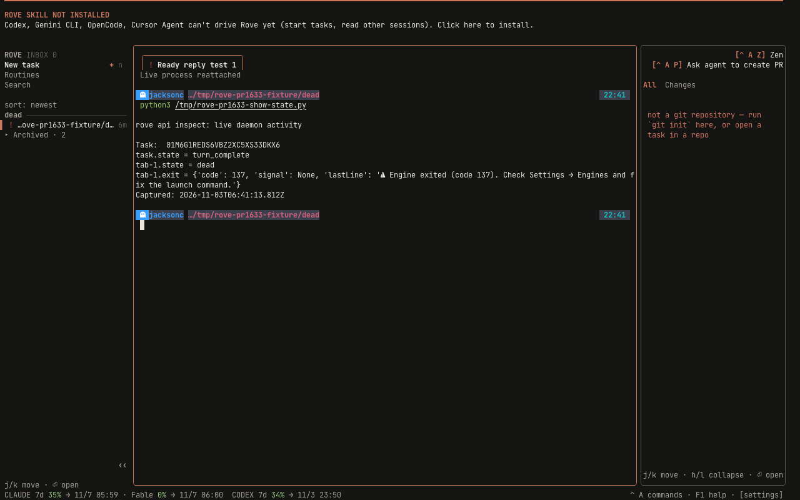
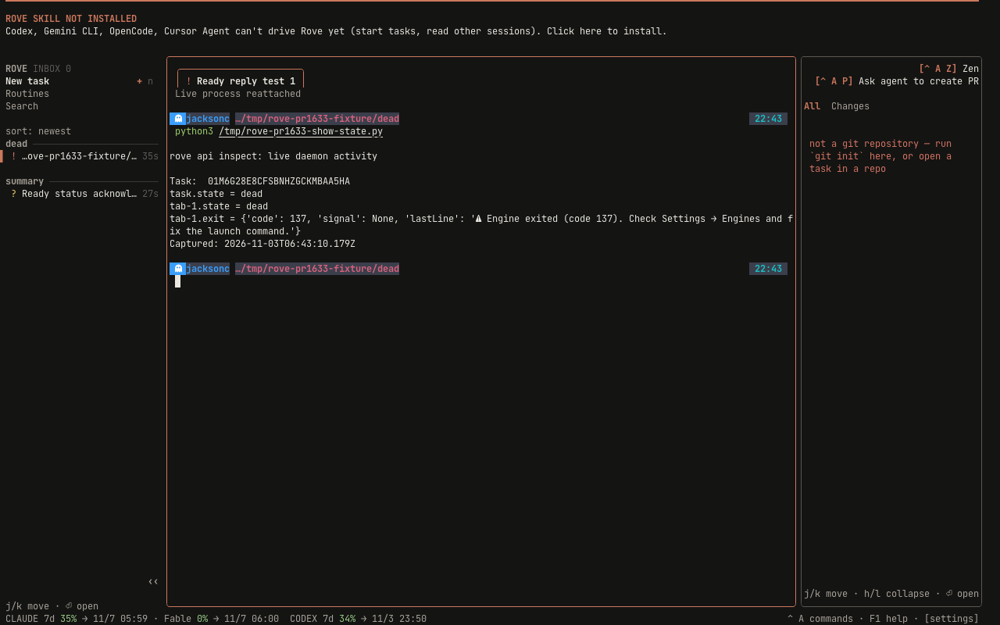
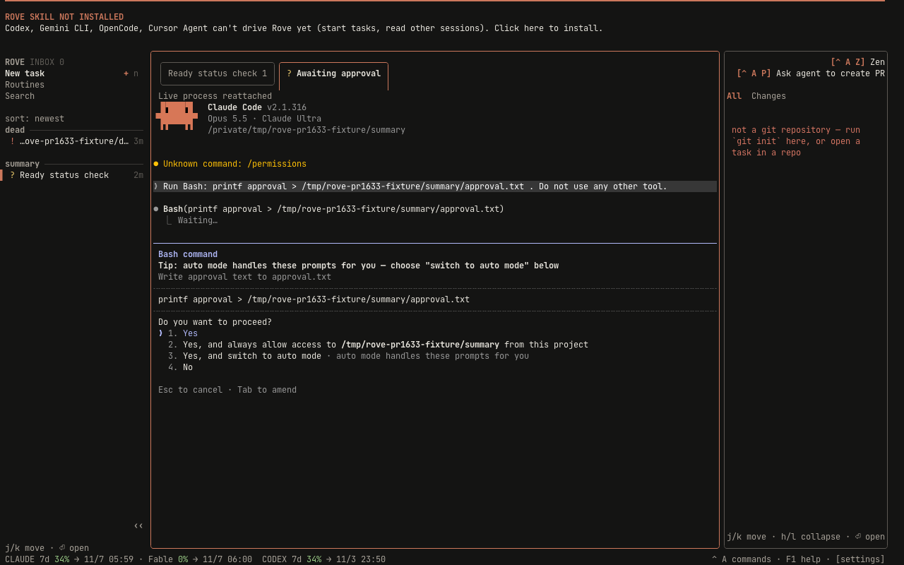
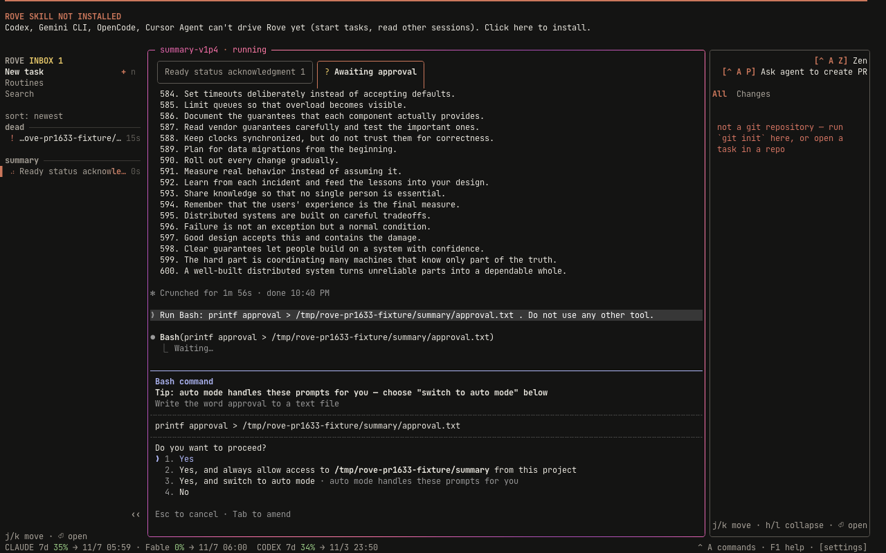

# PR 1633 browser evidence

Captured 2026-11-03 UTC through Chromium at 1280×800, DPR 1, `/harness` → xterm.js → PTY sidecar → `dev:sandbox` → real OpenTUI and daemon. Theme: Claude dark. Tab strip: always. Zen: off.

Baseline: `d20baca1cb923ed8c441112d8a45a3509c0322bb`, extracted with `git archive` and installed with `bun install --frozen-lockfile`. Fixed code: `775f586d869cb76c607aa4883b1cd4e26d9e39cb`. The baseline and fixed runs used isolated Rove homes, the same directory fixture under `/tmp/rove-pr1633-fixture`, and real Claude Code 2.1.316. Generated session IDs, automatic titles, timestamps, and inactive fixture rows differ. Screenshots are unedited browser captures, not render-test frames.

## Dead tab and newer completion

A real hosted Claude session answered READY. The baseline also answered BROWSER_READY submitted through the browser terminal. The capture terminated only that fixture engine PID with SIGKILL. `rove api inspect` confirmed the engine was gone, its shell remained alive, and tab activity was dead with exit code 137. After observing death, another real Claude print-mode turn emitted a Stop hook with explicit task identity and no tab identity. Explicit identity is needed because unattended hooks are otherwise ignored.

The shell in the screenshot runs a small reader of `rove api inspect`; it prints the returned task/tab state and exit record. It does not write activity.

| Revision | Task activity | Tab activity | Task row |
| --- | --- | --- | --- |
| Before | turn_complete | dead | attention/dead |
| After | dead | dead | attention/dead |

| Before | After |
| --- | --- |
|  |  |

[Before inspect](https://raw.githubusercontent.com/Sma1lboy/rove/63a83e50642024c0148cff6739494a9f096898d7/pr-1633/before-dead-inspect.json) · [After inspect](https://raw.githubusercontent.com/Sma1lboy/rove/63a83e50642024c0148cff6739494a9f096898d7/pr-1633/after-dead-inspect.json)

## Running and waiting summary

The fixture uses two live engine tabs in one directory task. `tabs.apply` creates the second tab; selecting it in the browser launches the real engine. One engine streams a numbered response. The other requests a Bash write to `approval.txt` and remains at the real permission prompt. The write was not approved. The fixed run reopened an existing fixture transcript in its second live Claude process and produced a fresh permission prompt. Capture waits for inspect to report running and permission_needed simultaneously, then records status.list and the browser screenshot.

The baseline aggregate row is needs-input. The fixed aggregate row is running. The expanded Awaiting approval tab retains its question mark in both screenshots; its live approval dialog is visible. These captures exercise the changed task-summary ranking, not a synthetic status fixture.

| Before | After |
| --- | --- |
|  |  |

[Before inspect](https://raw.githubusercontent.com/Sma1lboy/rove/63a83e50642024c0148cff6739494a9f096898d7/pr-1633/before-summary-inspect.json) · [After inspect](https://raw.githubusercontent.com/Sma1lboy/rove/63a83e50642024c0148cff6739494a9f096898d7/pr-1633/after-summary-inspect.json) · [Before rows](https://raw.githubusercontent.com/Sma1lboy/rove/63a83e50642024c0148cff6739494a9f096898d7/pr-1633/before-summary-rows.json) · [After rows](https://raw.githubusercontent.com/Sma1lboy/rove/63a83e50642024c0148cff6739494a9f096898d7/pr-1633/after-summary-rows.json)

## Artifact storage and review board

Images and JSON are committed on the separate `evidence/pr-1633` branch and linked above by immutable commit. No binary files were added to the implementation branch.

A [self-contained board](https://github.com/Sma1lboy/rove/blob/551755da0a0bc0464285cab82bcabd7e1a6ccad6/pr-1633/board.html) groups both comparisons. Download it to view locally. Publication to the instructed `https://brand-studio.sma1lboy.me/share?series=rove-pr-1633-ui&round=1` returned HTTP 404. The available share-server README points to `share.sma1lboy.me`, which failed DNS resolution. No successful series URL or reviewer verdict is claimed. The board is preserved with the evidence for republication under that same series when the service is reachable.
