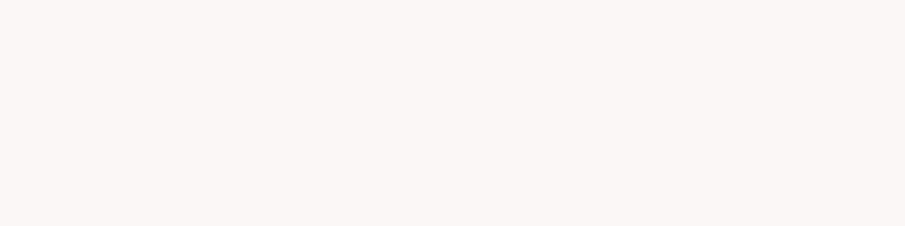
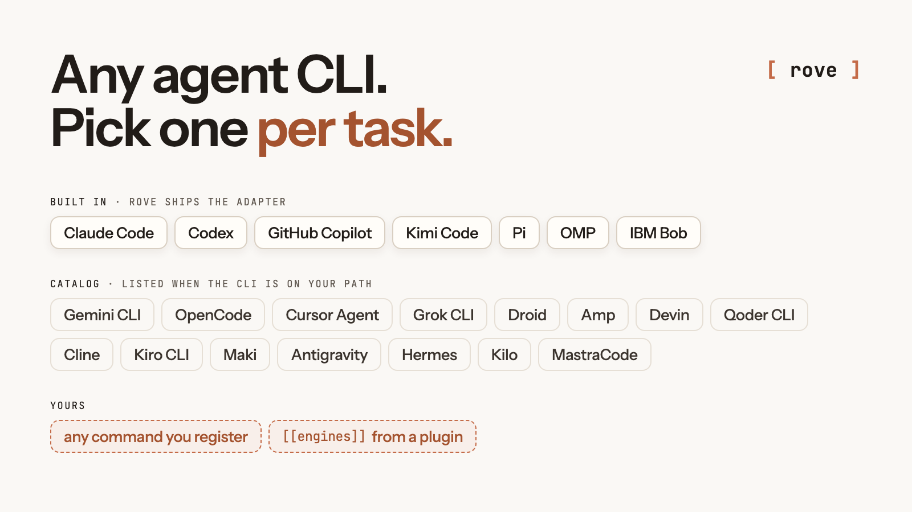
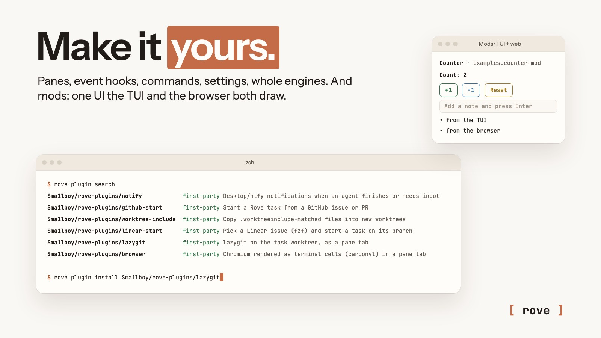

# Rove: all your coding agents, in one place

<p align="center">
  
</p>

Rove is an agentic development environment (ADE) for your terminal. [Claude Code](https://claude.com/claude-code), [Codex](https://github.com/openai/codex), [Copilot](https://github.com/github/copilot-cli) and [a dozen more](./docs/ENGINES.md) work side by side in one window, each task in its own git worktree and branch, and they keep running when you disconnect.

<p align="center">
  <a href="https://www.npmjs.com/package/@sma1lboy/rove"></a>
  <a href="https://github.com/Sma1lboy/rove/actions/workflows/ci.yml"></a>
  <a href="./LICENSE"></a>
</p>

<p align="center">
  <a href="https://docs.rove.run"><strong>Documentation</strong></a> ·
  <a href="https://docs.rove.run/rove/quick-start">Quick start</a> ·
  <a href="https://docs.rove.run/rove/concepts">Concepts</a> ·
  <a href="https://docs.rove.run/rove/cli">CLI</a> ·
  <a href="https://docs.rove.run/rove/api">Agent API</a> ·
  <a href="https://rove.run">Website</a>
</p>

<p align="center">
  
</p>

## Quick start

```bash
curl -fsSL https://rove.run/install.sh | sh
cd your-repo
rove
```

Press `n` to create your first task. You need git and at least one agent CLI on `PATH`. The script covers macOS, Linux and WSL; for npm, bun, npx and native Windows see [Install](#install).

## Why more than one agent

- **Out of quota? Switch to another agent.** When Claude Code hits its usage limit halfway through a task, [switch the task to Codex or any other engine](./docs/ENGINES.md). The new agent reads what the last one did and continues on the same branch.
- **Agents talk to each other directly.** One agent hands work to another with `rove api add` and gets the report back in its own tab. You don't copy text between windows.

## What you get

<p align="center">
  
</p>

- **A worktree and branch per task.** A refactor, a bug fix and a review run at the same time without overwriting each other's files ([Concepts](./docs/CONCEPTS.md)).
- **The real CLIs.** Each task picks its engine; Rove runs that CLI with its own auth, permissions and models ([Engines](./docs/ENGINES.md)).
- **Sessions that outlive the terminal.** Quit the TUI or drop SSH, then reattach. The agents keep working on the host ([Sessions](./docs/SESSIONS.md)).
- **The same tasks everywhere.** A browser with `rove --web` ([Web](./docs/WEB.md)), the [iOS](./docs/IOS.md) and [Android](./docs/ANDROID.md) apps, a [desktop window](./docs/DESKTOP.md), [WeChat](./docs/WEIXIN.md), and [other machines](./docs/MACHINES.md) over SSH.
- **Review and follow-up.** Diff views with inline notes that go back as one prompt, an Inbox of agents waiting for you, and a PR from a finished task ([TUI guide](./docs/TUI.md)).
- **Unattended work.** A prompt on a schedule ([Routines](./docs/ROUTINES.md)).

How the processes fit together: [Architecture](./docs/ARCHITECTURE.md). What is planned: [Roadmap](./docs/ROADMAP.md).

## Install

```bash
npm install -g @sma1lboy/rove   # offers to install Bun on first launch
bun install -g @sma1lboy/rove   # if you already run Bun
npx @sma1lboy/rove              # try it without installing
```

Rove runs on macOS, Linux and Windows, on [Bun](https://bun.sh) ≥ 1.3.11, which every install route brings along. Native Windows also needs Node.js and Git for Windows with Git Bash, and installs through npm, not the `curl` script. Details: [Quick start](./docs/QUICKSTART.md).

## Scripting and Agent API

`rove api` gives shell scripts and coding agents the same task model:

```bash
rove api add --repo "$PWD" --prompt "Fix the flaky auth test."
rove api read-output --task-id <id>
rove api send --task-id <id> --prompt "Run the integration suite too."
rove api land --task-id <id>
```

`rove skill install` teaches a coding agent to drive that loop. Every verb, flag and exit code is in the [Agent API reference](https://docs.rove.run/rove/api).

## Plugins

<p align="center">
  
</p>

A plugin is a directory with a `rove-plugin.toml` manifest and commands in any language. It can add panes, react to events, register commands and settings, contribute engines, and ship a mod: one process whose pane the TUI and the browser both draw.

```bash
rove plugin search
rove plugin install owner/repo
```

The catalog is also on [rove.run/plugins](https://rove.run/plugins). To write one, see [plugin authoring](./docs/PLUGIN-AUTHORING.md).

## Help and development

`rove doctor` diagnoses an install; [Troubleshooting](./docs/TROUBLESHOOTING.md) has the recovery steps.

To work on Rove itself, run `bun install` then `bun run dev:sandbox`, and start with [CONTRIBUTING.md](./CONTRIBUTING.md). Shipped behavior is in the [changelog](./packages/rove/CHANGELOG.md).

## License

[MIT](./LICENSE) © Jackson Chen

## Star history

<a href="https://star-history.com/#sma1lboy/rove&Date">
  <picture>
    <source media="(prefers-color-scheme: dark)" srcset="https://api.star-history.com/svg?repos=sma1lboy/rove&type=Date&theme=dark" />
    <source media="(prefers-color-scheme: light)" srcset="https://api.star-history.com/svg?repos=sma1lboy/rove&type=Date" />
    
  </picture>
</a>
