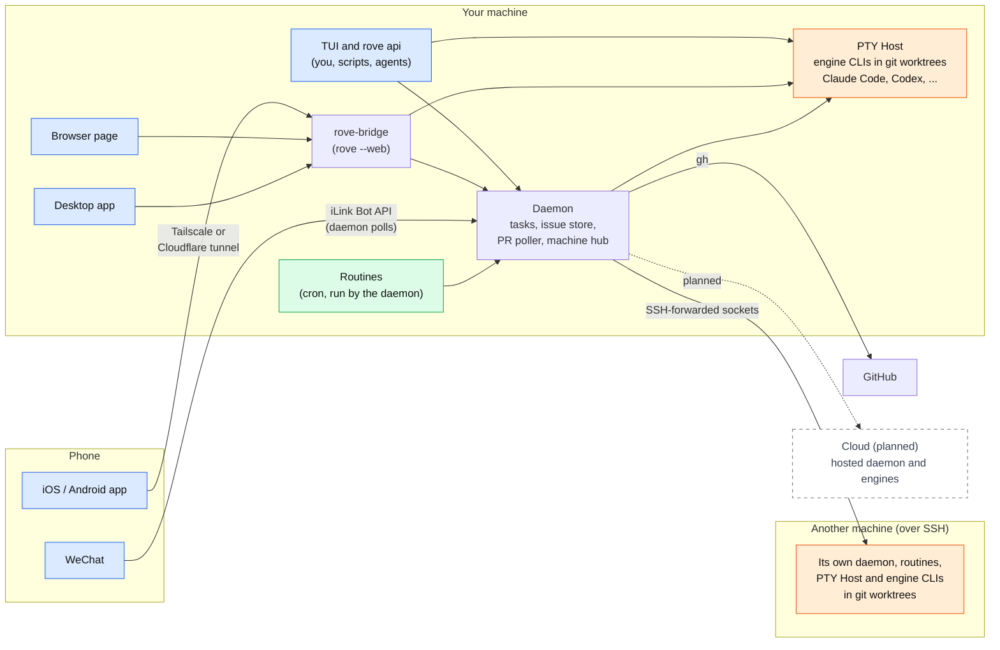
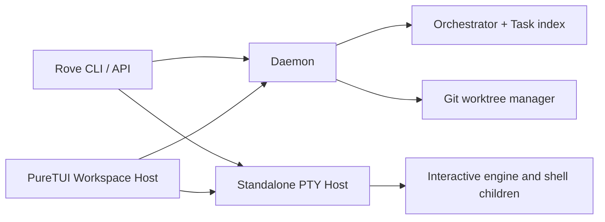

# Architecture

## Where things run



- **Clients** (blue) hold no state. The TUI and `rove api` use the daemon and PTY Host unix sockets; the browser page and phone apps go through `rove-bridge` ([WEB.md](./WEB.md), [IOS.md](./IOS.md), [ANDROID.md](./ANDROID.md)); WeChat is [a bot the daemon polls](./WEIXIN.md).
- **Daemon** owns tasks, worktrees, the issue store, PR status (via `gh`) and the machine hub. **Routines** fire from its scheduler, each opening an ordinary task ([ROUTINES.md](./ROUTINES.md)).
- **PTY Host** owns the engine CLIs (orange), each in its task's git worktree, and outlives the TUI and the daemon ([SESSIONS.md](./SESSIONS.md)).
- **Another machine** runs its own Rove; your daemon reaches it over SSH-forwarded sockets ([MACHINES.md](./MACHINES.md)).
- **Cloud** (dashed) is planned, not shipped: [ROADMAP.md](./ROADMAP.md).

Section 1 below zooms into the process split that diagram shows as one box each.

## 1. System shape



The Daemon owns control-plane state. The standalone PTY Host independently owns
TUI/API interactive processes. This separation is load-bearing: a TUI exit or
daemon restart must not end standalone-host sessions.

The isolation unit for a managed Task is:

```text
Managed task = git worktree + branch + terminal tabs
```

The persisted `Task` type also supports `kind: "dir"` for a user-owned
directory or a saved repository's own checkout. It reuses its directory and does
not own a Rove-created worktree or branch. A project is a `savedRepos` entry,
not a Task; a stored `kind: "main"` row loads as `dir`.

A managed Task may span several repos: the primary stays in `repo` / `branch` /
`worktreePath`, and optional `extraRepos[]` holds the others, each with its own
worktree on the shared branch name. `taskRepos(task)` (in `rove-daemon`'s
`task-tree.ts`) is the derived view of all of them; every consumer that needs
"all repos" or "all worktree directories" (`taskWorktreePaths`) goes through it.

## 2. Package map

- `packages/rove/` — CLI and PureTUI, published as `@sma1lboy/rove`.
  - `src/cli/` — command routing, help, API handlers, daemon and PTY-host
    process entrypoints.
  - `src/engine/` — engine registry, command/capability/history adapters,
    protocols, turn detection, and shared session launch composition.
  - `src/orchestrator/` — Task index and Worktree lifecycle. `workspace/` is the
    backend seam (`git-worktree`, `borrowed`, and `cow-clone` for forks that keep uncommitted work): materialise and dispose go
    through it, and lifecycle code asks `workspaceCapabilities(task)` rather
    than testing `task.kind`.
  - `src/client/` — framework-free remote Orchestrator client and channel
    stores.
  - `src/i18n/` — the message catalogs and `t()`, shared by the TUI, the CLI
    and the web client.
  - `src/theme/` — opentui-free theme data: the JSON shape, bundled palettes,
    loader, installer and hex resolver that `rove api` and the bridge read.
    Resolving to drawable colors stays in `tui/context/theme-core.ts`.
  - `src/tabs/` — the terminal-tab model (tabs, splits, argv, titles) shared
    by the TUI, `rove api` and the web client.
  - `src/tui/` — framework-free keymap, state, terminal, file, sidebar, and
    workspace cores.
  - `src/tui-react/` — the only UI implementation: React 19 over opentui.
    `tui-react/pages/` is the page registry the rail and content pane read,
    the host API a page receives, and the loader for installed plugins'
    `[[pages]]`.
  - `src/bundled-plugins/` — Kanban and Issues, shipped as first-party mods
    that show only once installed (`rove-daemon/src/plugins/builtin-mods.ts`):
    page factories that reach Rove only through the host API
    (`test/architecture/bundled-plugins.test.ts`). The board logic and copy
    they share with `rove --web` stay in core (`state/issue-board.ts`, the
    `kanban` / `workItems` catalogs).
- `packages/rove-daemon/` — Unix-socket daemon protocol/server, standalone
  PTY Host implementation, and the plugin core
  (`src/plugins/`: manifest, registry, event derivation, daemon-side host —
  see [docs/design/plugins.md](./design/plugins.md)).
- `packages/rove-harness/` — the `/harness` capture page and its PTY sidecar (see docs/HARNESS.md).
  **Frozen (2026-07-25):** no new features. It survives because its `/harness`
  route is the only sanctioned visual ground truth for OpenTUI work, not
  because the SPA is a product surface. Every extra GUI consumer is another
  lifetime the daemon has to refcount, which is where the orphan/OOM
  incidents came from. Fix bugs and keep `/harness` working; take new
  surface work to the TUI.
- `packages/rove-bridge/` — the WebSocket bridge between the daemon and the
  browser and phone clients (`rove --web`).
- `packages/rove-web/` — the browser client the bridge serves.
- `packages/rove-desktop/` — the desktop app: rove-web in its own Electron
  window against the local Rove (see [docs/DESKTOP.md](./DESKTOP.md)).
- `packages/rove-weixin/` — the WeChat chat connector, bundled into the CLI.
- `packages/rove-plugin-sdk/` — the typed plugin SDK, published as
  `@sma1lboy/rove-plugin-sdk`.
- `packages/rove-android/`, `packages/rove-ios/` — the native phone apps.
- `packages/rove-landing/` — the rove.run landing page.
- `packages/rove-relay/` — the hosted end-to-end encrypted relay at `relay.sma1lboy.me`: relay-kit's Cloudflare Worker (vendored, MIT) with per-IP, per-pairing and daily byte limits. `bun run deploy` there ships it with `rove-web`'s loader page.
- `packages/promo-kit/` — the team's promo asset site.
- `packages/branding/` — Remotion assets and checked-in replay rendering.
- `packages/rove-docs/` — public docs site (Fumadocs on Next.js, static
  export). Content is synced from `docs/` by `scripts/sync-docs.mjs`
  (frontmatter injection + link rewriting); edit the source in `docs/`,
  never the generated copies.
- Official plugins live in the separate
  [Sma1lboy/rove-plugins](https://github.com/Sma1lboy/rove-plugins) repo
  (`rove plugin install Sma1lboy/rove-plugins/<name>`). New plugins use
  `rove-plugin.toml` and `@sma1lboy/rove-plugin-sdk`.

## 3. Launch and lifetime

Plain `rove` starts `src/tui/index.tsx`, which dynamically loads the React
Workspace Host. Startup has one behavior; there is no launch-mode parser or
environment switch.

The Workspace Host connects as a daemon GUI client and attaches to hosted PTY
sessions. On exit it detaches local consumers. It does not kill children.

The Daemon is refcounted by attached GUI clients. A daemon
idle exit leaves the PTY Host untouched. The PTY Host idle-exits only when it
owns zero live sessions.

The standalone host periodically freezes bounded terminal rings plus launch
metadata. After a host restart or reboot, it restores dead session records;
the first attachment replays the last snapshot and respawns the recorded
command. This recovery is distinct from a still-live child surviving a TUI or
daemon restart. Explicit close/delete/reset operations remove their frozen
records.

Tmux is not a session backend. The CLI retains one quarantined compatibility
seam solely for upgrades from pre-v0.8: `rove doctor` reports processes still
owned by the retired `tmux -L rove` server, and `rove reset` terminates those
pane process groups before stopping that server.

## 4. Hosted session addressing

Each standalone-host Terminal Tab uses `<taskId>::<tabId>`. The initial engine tab is
deterministically `<taskId>::tab-1`; API liveness, delivery, and teardown use
the same address.

`src/engine/session-launch.ts` is the canonical launch builder. It owns shell
quoting, repository init scripts, engine argv/protocol, resume context, and
first-prompt priority. Both the Workspace Host and headless API automation call
it.

`rove api send` and prompted `add` (single or `--count` parallel):

1. ensure the Worktree;
2. ensure the PTY Host;
3. reuse an alive canonical engine session, or open `tab-1` once;
4. deliver the prompt and detach the short-lived client.

The PTY Host's key-level `pty.open` idempotence prevents concurrent callers
from creating duplicate children. Capped CLI launches read the opaque
`admissionToken` from `pty.list`, count running or pending engines, and call
`pty.openChecked`. The host compares that inventory token and opens synchronously;
if another caller changed the inventory, the CLI recounts. Older hosts without
this capability refuse capped launches rather than opening without admission.

## 5. Ownership boundaries

- Engine adapters own identity, launch commands, capabilities, models,
  history, completion markers, and telemetry normalization.
- The Orchestrator owns Task metadata and git Worktree mutations, not engine
  children.
- The Daemon is the Task-index writer and channel publisher, not the terminal
  process owner.
- The PTY Host owns child lifetime and buffered terminal bytes, not Task
  metadata.
- The `/harness` PTY sidecar owns only the capture page's terminal child; it does
  not attach to or replace standalone-host sessions.
- React components render and wire events; reusable policy/state belongs in
  framework-free `src/tui/**` modules.
- Core code (`src/**` outside `tui/`, `tui-react/`, `bundled-plugins/` and the
  `cli/*.ts` entry files) never imports `src/tui*`, so it can split into its own
  package (`test/architecture/core-off-tui.test.ts`).

## 6. State

- Task index: `<ROVE_HOME>/.rove/tasks.json` (the pre-rename state directory's `tasks.json`, `pre-rename-runtime.ts`, is copied additively when the new daemon starts, after the old writer stops)
- Runtime: `<ROVE_HOME>/.rove/{daemon,pty}.{sock,pid,log}` + `client.log`. A socket is the ADDRESS of a live process, so a pre-rename runtime path is still used while the process holding it is alive (`daemon/paths.ts`) — otherwise an upgrade would orphan every engine tab the running PTY host owns.
- UI/settings state: `<ROVE_HOME>/.config/rove/state.json`, fixed under the
  home directory (no `XDG_CONFIG_HOME` or platform config directory); the
  pre-rename config directory's `state.json` is copied without overwrite
- Daemon socket/pid/log: derived from `ROVE_HOME_DIR`, falling back to the user's home
- PTY Host socket/pid/log plus bounded `pty-sessions/` recovery snapshots and
  `pty-exits.json` abnormal-exit tails: derived independently from the same home
- Engine conversation history: engine-owned locations such as
  `~/.claude/projects/**`
- Plugins: registry `<ROVE_HOME>/.rove/plugins.json` (CLI-written,
  daemon-watched); per-plugin checkout/config/state/log under
  `<ROVE_HOME>/.rove/plugins/<id>/`. Plugin paths resolve only there: the
  daemon's start MOVES a pre-rename install across
  (`state/layout-migration.ts`), and until that move succeeds the old tree is
  not read. Commands receive `ROVE_PLUGIN_*` variables.

Never treat browser storage as authoritative for local product state.

### Worktree status collection

The daemon collects at most four worktree status runs concurrently. Due paths join
an insertion-ordered queue; later ticks refresh queued demand without moving it to
the back. A path that finishes and becomes due again joins behind waiting paths,
so continuously active tasks cannot starve the rest of the fleet. Completion starts
waiting work without waiting for the next two-second tick.

Per-path timeouts, hard backoff, quiet fingerprints and active-engine cadence still
apply. A timed-out run retains its global slot until its runner settles, preventing
an uncooperative runner from allowing extra concurrent work. Subscriber absence
pauses new starts. Pruning drops queued demand and ignores old in-flight results,
including when a path is removed and re-added. Stop clears the queue, aborts running
reads and prevents delayed publications. Results arriving within a 10 ms window
share one full-map publication; unchanged counts still publish nothing.

## 7. Reference projects

`refs/` is gitignored and read-only study material. Consult the relevant
project before changing a boundary it demonstrates:

- `agent-deck` — multi-session/task ergonomics
- `opcode`, `codexui` — coding-agent UI patterns
- `codex` — Codex CLI protocols and history
- `claude-code` — interactive engine behavior
- `ccstatusline` — terminal status presentation
- `warp` — terminal interaction and layout patterns

Reference code informs decisions but is never edited or copied wholesale.

Clone them before development:

```bash
mkdir -p refs && cd refs
ln -s /Users/jacksonc/i/agent-deck agent-deck   # if you have it locally
git clone --depth 1 https://github.com/winfunc/opcode.git
git clone --depth 1 https://github.com/tanbiralam/claude-code.git
git clone --depth 1 https://github.com/sirmalloc/ccstatusline.git
git clone --depth 1 https://github.com/openai/codex.git
git clone --depth 1 https://github.com/friuns2/codexui.git
git clone --depth 1 https://github.com/warpdotdev/warp.git
# conductor is image-only — see docs/DESIGN.md §1
```
