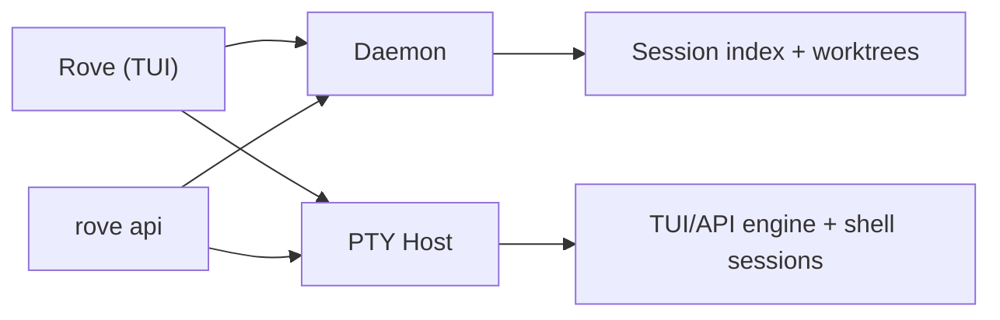

# Concepts

Seven nouns explain Rove: **Workspace**, **Session**, **Worktree**,
**Terminal Tab**, **Engine**, **Daemon**, and **PTY host**. Learn those and the
rest reads itself.

## Workspace

A Workspace is the thing your agents are working on, and the group its Sessions
are listed under in the sidebar. Most of the time a Workspace is one git
repository. It does not have to be: a plain folder that is not a repository is a
Workspace too, a Session can span several repositories, and a Session moved to
another Workspace keeps doing its git work in the repository it was cut from.

A Workspace has no conversation of its own. Everything that runs in it is a
Session.

## Session

A Session is one agent conversation in a Workspace: an engine, the terminal
tabs beside it, and the directory they all run in. It is the row you see under
a Workspace in the sidebar.

A Session and a worktree are separate things. A Session either has a worktree
bound to it, or it has none and runs in a directory you already own:

| Kind | Directory | Git isolation |
|---|---|---|
| Worktree session | A worktree Rove creates for it | Own branch and worktree |
| Directory session | An existing directory opened with `rove .`, or the Workspace's own checkout | Uses the directory as-is; it need not be a git repository |

A second conversation is a **child session**, listed under its parent. It
either shares the parent's directory or gets a worktree of its own
([below](#terminal-tabs-and-engine-conversations)).

### Names you will still see

The app, the CLI and the files on disk were named before these two words were
settled, and have not been renamed yet:

| Concept | Still appears as |
|---|---|
| Session | `task` in `rove api` (`--task-id`, `get-task`), `$ROVE_TASK_ID`, `~/.rove/tasks.json`, and "task" in the app (**New task**) |
| Workspace | `--repo` in `rove api`, and "project" in the app (**Remove project**) |
| A Session's directory | `workspace` in `rove api` (`--workspace-on`, `.task.workspace`) |

Where this page quotes a command, a file or a label in the app, it uses the
name you will actually type or see.

A **New shell** from a Session row is not a Scratch shell: it is a child Session sharing the row's directory, listed under it, whose `tab-1` is the login shell. When that shell exits the row stays, empty, and is never deleted for it.

**Scratch shells** are directory Sessions with an unsettled home: press `tab` in
the `ctrl+e` new-conversation dialog until the destination reads "new scratch
task", pick an engine (or `shell` for a bare shell), and `enter` opens one in
`$HOME` with that engine already running. It
lives in the sidebar's **Ungrouped** group above every Workspace, and follows a
zero-ceremony lifecycle: its last tab exiting removes the row (no archive, no
confirm; nothing on disk is touched). Routines created with **Ungrouped**
run in their own directory under `.rove/routines/` and their Sessions open from
the Routines page, not the sidebar; they are not scratch shells and are never
auto-removed. A scratch row earns a permanent place
two ways: rename it (naming is the keep gesture), or start a coding harness
inside a git repository. Rove detects the live harness plus the shell's
settled directory and quietly migrates the row into that repository's
Workspace. If the settled directory already belongs to a Session (a directory
Session's directory, or inside a worktree Session's worktree), the shell folds into that Session as a new terminal tab, running
engine and all, instead of becoming a duplicate row.

Two stored flags carry this. `scratch` means throwaway (the row goes when its
shell exits, a repo + harness adopts it, it stays untitled); `noProject` means
Ungrouped without being throwaway. A row is Ungrouped when either is set, so a
rename clears `scratch` and sets `noProject`. Before the split, a rename only
cleared `scratch` and the renamed row fell out of Ungrouped into a new group
named after its directory (#2362). Code reads and clears `scratch` only through
`isEphemeral`, `isUngrouped`, `KEEP_SESSION` and `SETTLE_IN_PROJECT` in
`rove-daemon/src/task-scratch.ts` (re-exported from rove-core); an architecture
test holds every other file to that.

Each Session has a `status` you set yourself (`backlog`, `in_progress`,
`in_review`, `done`, `canceled`, `error`) — from the sidebar row's right-click
menu (**Set status**) or with `rove api update --status`. It is a label and nothing
more: `canceled` does not stop an engine or remove a worktree, and `done` does
not close anything. Rove moves a Session from `backlog` to `in_progress` by itself
when its engine starts a turn, and the system prompt asks the agent to set
`in_review` when it finishes, unless another Session handed it the work
(then its `report` or outcome message is the signal); everything past that is
yours. The sidebar row
does not draw it: the one mark in that cell is the PR's, and the status is
something you already know because you set it
(see [TUI](./TUI.md#status-glyphs-in-the-sidebar)).

**Delete is explicit and kind-aware.** Deleting a directory Session removes only
its Rove record, never the directory. Forgetting a Workspace (**Remove project**
on its header's menu) un-saves the repository and keeps every Session, branch and
worktree.
Deleting a worktree Session removes its worktree after the dirty-worktree safety
check. **The Session's branch stays.** Git is the durable record of the work;
pass `--delete-branch` on `rove api delete` to drop it too. That runs
`git branch -d`, which refuses a branch whose commits neither the repo's HEAD
nor the branch's own upstream already contains — so work that was never pushed
and never landed survives the flag, and `--force` is what upgrades the delete
to `git branch -D`. Deleting from the TUI keeps the branch too, unless
you set `worktree.deleteBranch` to `true` ([Configuration](./CONFIGURATION.md)),
which applies the same `git branch -d` rule. **The remote branch is only touched when you ask for it**,
with the separate `--delete-remote` — a local branch is recoverable from any
clone that still has it, a remote one is recoverable by nobody, and deleting
it closes an open PR, so one flag never implies the other.

The separate
[Worktrees page](WORKTREES.md) is an audit/cleanup tool: removing a directory
there keeps its Session record and branch so the worktree can be materialized
again later. `rove api remove-worktree --task-id ID` is the same operation
from a shell — the inverse of `ensure-worktree`, and what a script reclaiming
idle checkouts wants instead of `delete`.

**What the delete did to the branch is in the reply.** With either branch flag
the result carries `branch` — `{ branch, deleted, keptReason?, remote? }` — so
"the branch went with it" is a fact you read rather than one you infer from
`status: "removed"`, which is the worktree's outcome. When git kept the branch,
`keptReason` is its own sentence about why.

## Worktree and branch

Every worktree Session gets its own git worktree at
`~/.rove/worktrees/<repo-key>/<task-slug>/`, checked out to the session's
branch. The slug is drawn from a pool of animal names, so parallel Sessions in
one repo get distinguishable directories without anyone choosing them;
`rove api add --worktree-name NAME` overrides that when a script needs to
predict the path instead of reading it back, and refuses a name already in
use rather than suffixing it. That's what makes running many sessions at once safe: N sessions means N
working trees that can't overwrite each other or your main checkout. Edits
cross over only when you merge.

Directory Sessions are the exception: they point at an existing
checkout or directory. Use a worktree Session when you want isolation.

The worktree outlives everything else. Killing an engine, quitting the TUI,
dropping SSH, restarting the daemon: none of them touch it.

> **One thing to watch:** a child that shares its parent's directory shares its
> worktree, and Rove does not coordinate their writes. Two conversations editing
> the same file at once will conflict. If you need real isolation, open a new
> session or `add --parent <this task>` a child with its own worktree.

## Terminal Tabs and engine conversations

A Session is one engine conversation: its `tab-1`. A second conversation is a
**child session**, shown under its parent in the sidebar. A child either shares
the parent's directory (`ctrl+t`, `ctrl+e`,
`add --no-worktree`) or gets its own worktree cut from the parent's branch tip
(`add` run from inside the Session). Deleting a parent promotes its children; `delete --cascade` removes
the subtree.

A Session owns its Terminal Tabs. The engine tab runs an engine inside an
interactive shell and can resume an engine-owned conversation. Other tabs can be
shells, fixed commands/editors, or read-only file/diff content; those are not
engine conversations. Splits add more shell leaves inside a tab.

Tabs let you ask a side question or open a shell without changing directories.
Close a tab when you're done; the Session's directory stays. Exiting the engine
CLI itself returns an engine tab to its shell prompt. The hosted terminal ends
only when that wrapping shell exits or Rove explicitly closes it.

**Closing the last tab is "done for now", not "forget".** Close every tab of a
worktree Session and its row stays in the sidebar; entering it again opens a fresh
tab in the same worktree. A Workspace whose only row is a directory Session with no
tab open leaves the sidebar, header and row together. Nothing is deleted: the
Session record and the saved repository both stay on disk. A Workspace has no
standing conversation: to start one in its own checkout, open New task (`n`),
pick the same repository, and choose "the project itself" instead of a new task
worktree (see [TUI](./TUI.md#creating-a-task)), or `rove api send --repo PATH`.
Forgetting a Workspace (**Remove project** on its header's menu) is the separate,
un-saving gesture.

A Session-level reasoning-effort choice is forwarded when the engine supports it.
A child session runs the engine it was started with, so conversations in one
directory can use different vendors. The embedded engine CLI owns its own model
and permission controls.

Conversation history belongs to the engine, not to Rove (Claude Code, for
example, keeps JSONL transcripts under `~/.claude/projects/**`). Hosted
terminal output has separate persistence rules; see [Sessions](SESSIONS.md).

## Engines

An engine is the execution backend a session runs on. Rove embeds the **real
interactive CLI** (`claude`, `codex`, `copilot`, `kimi`, `pi`, `omp`, or one
yourself) inside a hosted terminal. No API wrappers, no re-rendered
output: what you see is the actual engine running next to your dependencies
and credentials.

Details: [Engines](ENGINES.md).

## Daemon and PTY host

Rove splits into three processes, and that split is why your sessions
survive you:



- **Daemon.** Owns your session list, worktrees, and the issue store. Starts on
  its own, then stops after the last attached GUI disconnects unless an
  enabled routine, or any live tab in the PTY host, holds it alive
  (it must stay up to collect engine activity, or the status dots go stale).
- **PTY host.** Owns the running engine and shell processes. Survives both
  the TUI *and* a daemon restart.
- **The TUI.** Just a viewport. Quitting it kills nothing.

Full lifetime rules, and exactly what survives a reboot:
[Sessions](SESSIONS.md).

## The issue store

Rove has no external issue tracker. Your backlog lives in a daemon-owned
store at `~/.rove/issues.json`, shared between a repo and all its worktrees.

It's deliberately simple. No type taxonomy, just a status
(`open → doing → done`, plus `hold` for things parked on purpose):

- **You.** The Kanban in the TUI. Open a card with `enter` and tab to its
  STATUS field to move it between columns; `d` on the board deletes the story
  outright.
- **Agents and scripts.** `rove api issue-list`, `issue-create`,
  `issue-update` (`--status` moves a card), `issue-delete`.

Issues track *what to do*; the changelog records *what shipped*.

## Where things live on disk

| What | Where |
|---|---|
| Session index | `~/.rove/tasks.json` |
| Worktrees | `~/.rove/worktrees/<repo-key>/<task-slug>/` |
| Issue store | `~/.rove/issues.json` |
| Daemon socket / log | `~/.rove/daemon.sock`, `~/.rove/daemon.log` |
| Settings | `~/.config/rove/state.json` (open with `rove config`) |
| Conversation history | engine-owned, e.g. `~/.claude/projects/**` |

Setting `ROVE_HOME_DIR` moves Rove's home-rooted product data and compatibility
runtime; `ROVE_HOME_DIR` remains a fallback. It does not relocate platform
settings or engine-owned conversation stores. That's how the dev sandbox
avoids touching your real `~/.rove` session data or runtime.

## Three ways people use it

**Many attempts at one prompt.** Press `n` in the TUI, or script it:

```bash
rove api add --repo "$PWD" \
  --agents claude:2,codex:2 \
  --prompt "Try independent approaches to simplify the auth flow."
```

Each attempt is its own Session with its own worktree. Workers message their
outcome back to the spawning agent's engine tab (`rove api send`); compare
with `rove api collect`, merge with `rove api land`.

**Over SSH, on the machine your code lives on.** The daemon and PTY host run
on that machine, so dropping SSH does not end hosted terminals. SSH back in and
run `rove` to reattach. Clipboard and terminal notifications depend on the
attached terminal connection; attention that happens while disconnected stays
available in Rove's Inbox when you return.

## Glossary

- **Workspace.** What your agents work on and the sidebar group its Sessions
  sit under; usually one git repository.
- **Session.** One agent conversation in a Workspace, with its terminal tabs
  and the directory they run in: a worktree of its own, or an existing
  directory (the Workspace's own checkout included).
- **Worktree.** A git working tree on disk. Rove creates one for each worktree
  Session; directory Sessions reuse existing directories.
- **Terminal Tab.** An engine, shell, command/editor, or read-only content
  surface inside a Session. N per Session.
- **Engine.** The coding-agent CLI a session runs on.
- **Daemon.** The background process holding your session list and issues.
- **PTY host.** The standalone process holding the live engine and shell processes; survives
  daemon restarts.
- **`rove api`.** The headless surface for scripts and agents.
- **Fan out / fan in.** Run N attempts of one prompt, then merge the winner.
