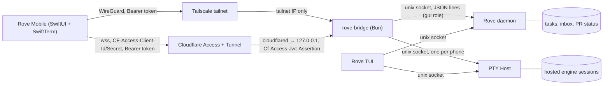

# iOS client

Rove Mobile is an iPhone app that drives the Rove on your Mac: see every task and what it is waiting on, watch an engine's terminal, type into it, read the diff, start, land and delete tasks. The Mac stays the only place state lives; the phone holds no copy of your tasks, files or sessions.

The phone cannot reach the daemon's unix socket, so a small Mac-side process, `rove-bridge`, carries a fixed list of operations over one WebSocket. It is off unless you start it.

## Start the bridge

From a checkout of the Rove repo:

```bash
bun install
bun run --filter rove-bridge start                      # your real Rove home
bun run --filter rove-bridge dev                        # the dev:sandbox home instead
bun run --filter rove-bridge dev -- --name ios          # a named sandbox home
```

It prints a pairing URL (and a QR code), then keeps running. It connects to the same daemon and PTY Host your TUI uses, starting them if they are down.

With no flags it listens on `127.0.0.1` only, which reaches the Mac itself and the iOS Simulator. A real phone uses one of two presets. [`packages/rove-bridge/README.md`](../packages/rove-bridge/README.md) has the full setup for each, including the Cloudflare Tunnel and Access application.

| Preset | Listens on | Phone dials | Transport security | Extra check |
| --- | --- | --- | --- | --- |
| `--preset tailscale` | the Mac's Tailscale IPv4 only (exits if there is none) | `ws://<MagicDNS name>:7878`, or `wss://` with `tailscale serve` + `--public-host` | WireGuard (plus TLS with `tailscale serve`) | — |
| `--preset cf` | `127.0.0.1`, for `cloudflared` | `wss://<tunnel hostname>` | TLS to Cloudflare, then the tunnel | Cloudflare Access JWT (signature, issuer, AUD, expiry) |

Plain `ws://` on a LAN (`--host <LAN address>`) still works, but it is not a supported way to reach the bridge remotely: the token and terminal output travel in cleartext.

| Flag | Effect |
| --- | --- |
| `--preset tailscale` / `--preset cf` | See above. |
| `--public-host <name>` | Hostname the phone dials over `wss://` (tunnel hostname, or a `tailscale serve` name). |
| `--cf-team`, `--cf-aud` | Cloudflare Access team and application AUD tag; also readable from `<ROVE_HOME>/.rove/bridge/config.json`. |
| `--host <addr>` | Without a preset: an explicit listen address. Repeatable. |
| `--port <n>` | TCP port, default `7878`. |
| `--rotate-token` | Mint a new token. Every paired phone must pair again. |
| `--no-qr` | Print the URL without the QR code. |

## Pair the phone

1. Build and run the app (below), open **Settings**.
2. Scan the QR code, or paste the URL, for example `wss://rove.example.com/?token=…&preset=cf`. A `rove://pair?url=<percent-encoded URL>` link opens the app straight into pairing. The app's **network** picker has two choices: **direct** (same Wi-Fi or Tailscale, `100.x` or `*.ts.net`) and **cloudflare**. A URL with `preset=cf` selects cloudflare; any other URL, including the bridge's `preset=tailscale`, selects direct. Which address the bridge listens on is the bridge's preset, not the phone's.
3. For **cloudflare**, also fill in `CF-Access-Client-Id` and `CF-Access-Client-Secret` from your Access service token. Either choice can carry additional request headers.
4. The app stores the endpoint, token, preset and headers in the iOS Keychain and connects. It sends the token as `Authorization: Bearer …`, never in the URL. It reconnects by itself when the Mac or the bridge comes back.

The token lives in `<ROVE_HOME>/.rove/bridge/token` (mode 0600) and survives bridge restarts, so a paired phone stays paired. `--rotate-token` is the revoke button.

## What the app does

- **Tasks.** Every task across repos with its title, branch, engine and group — `waiting-on-you`, `landing`, `ready-for-review`, `working`, `idle`, `unknown` — sorted so what needs you is on top. The groups are computed by the same code as `rove api context`. A badge counts unread attention-inbox items. Pull to refresh; changes also arrive live.
- **Terminal.** Each Terminal Tab of a task attaches to the hosted session in the PTY Host — the same session the TUI shows, so both see the output and both can type. A key row under the terminal (always visible, no keyboard needed) sends Esc, Tab, Shift-Tab, a sticky Ctrl, arrows, Enter and Ctrl-C; typing into the terminal goes through keystroke by keystroke; the composer sends a line, then Enter. **Fit** (default) resizes the shared session to the phone's screen, so the TUI pane re-wraps to the phone's width until it next resizes; **Watch** leaves the size alone and scales the font instead.
- **New tab.** An engine tab with a first message is `rove api send --tab new`; without one (an idle engine, or a plain login shell) it is `rove api tab-new`.
- **Diff.** Files changed on the branch versus its base (same base rule as the TUI's changes pane) and uncommitted files, each with its unified diff.
- **New task, land, delete.** New task takes a repo, an engine and an optional first prompt. Land and delete ask twice; delete keeps the branch, as `rove api delete` does.
- **Notifications.** While the app is running, a task that moves into `waiting-on-you`, or from `working` to `ready-for-review`/`idle`, posts a local notification.
- **Demo.** `try a demo` on the first screen runs the whole app against canned data bundled in the app (`Sources/RoveMobile/Demo/demo-fixture.json`, the same file `scripts/fixture-bridge.ts` serves to the UI tests): no Mac, no bridge, no network request. A strip on every screen says `demo · not connected to a mac`; `connect a mac` leaves it. Nothing about the demo is saved, so a cold launch starts on the pairing screen. It exists so App Store beta review can use the app without a Mac (`packages/rove-ios/docs/REVIEW_NOTES.md`).

Engine names in the app come from Rove's engine registry through the bridge.

## Architecture



- The bridge subscribes to the daemon as a `gui` client, the way an open TUI does, so the daemon does not idle-stop while a phone is the only UI.
- Task rows come from `task.list`, the activity registry, the attention inbox and PTY Host liveness, folded by `buildContext` from `rove api context`. Mutations go through the `rove api` verbs themselves (`add`, `delete`, `land`, `send --tab new`, `tab-new`, `tab-close`), so they keep every guard those verbs have.
- Each phone connection opens its own PTY Host socket. Closing the WebSocket detaches every session that phone watched; it never ends a session.
- The daemon is unchanged. No HTTP or SSE was added to it.

## Security model

- **Off by default.** Nothing listens until you run the bridge.
- **Loopback by default.** Remote access is `--preset tailscale` (tailnet address only) or `--preset cf` (loopback behind cloudflared); anything else is an explicit `--host`.
- **One bearer token.** 32 random bytes, sent only as `Authorization: Bearer`; a token in the URL query is refused, so it never lands in proxy or tunnel logs. It is checked with a constant-time compare at the WebSocket upgrade; a missing or wrong token gets HTTP 401 and no socket. Every later frame rides that authenticated socket. The browser client (`rove --web`, [WEB.md](WEB.md)) cannot set that header, so it offers the same token as the `Sec-WebSocket-Protocol` `rove.bearer.<token>` next to `rove.v1`, and the bridge echoes only `rove.v1`. An upgrade whose `Origin` names another host is refused with 403; phones send no `Origin`.
- **Cloudflare Access (`--preset cf`).** Before the token, the bridge verifies `Cf-Access-Jwt-Assertion` against the team's published keys (`/cdn-cgi/access/certs`) and checks issuer, AUD and expiry. Both layers must pass; each refusal is logged with the reason, never with the token or JWT.
- **Closed op list.** The phone can call the operations listed below and nothing else. There is no generic daemon passthrough; anything else is refused with `UNKNOWN_OP`. `api.invoke` serves the validated `rove api` verb contract, not daemon RPCs: it grants nothing `term.input` into a shell does not, and its destructive verbs are logged like the destructive ops.
- **Terminal input is scoped.** `term.input` only reaches a session this connection attached, and attach refuses a tab with no hosted session instead of spawning one.
- **Diff paths stay in the worktree.** Absolute paths and `..` are refused.
- **What the token grants.** Whoever holds it can do what the app can: read task output, type into engine sessions (which run with your user's permissions), create, land and delete tasks. Treat the pairing URL like a password; rotate it if it leaks.
- **Transport encryption comes from the path.** WireGuard for Tailscale, TLS for Cloudflare and `tailscale serve`. The bridge itself speaks plain `ws://`, so a LAN `--host` exposes the token and terminal contents to that network.

## Protocol

JSON text frames over one WebSocket. Request `{"id": 1, "op": "tasks.list", "args": {}}`; reply `{"id": 1, "ok": true, "result": {…}}` or `{"id": 1, "ok": false, "error": {"code", "message", …}}`, where a refusal from a `rove api` verb also carries its `hint`, `nextCommandArgs` and refusal data; push `{"event": "tasks" | "term.data" | "term.exit", "data": {…}}`. The types live in `packages/rove-bridge/src/protocol.ts`. A slow op may also stream `{"event": "op.progress", "data": {id, line}}` to the connection that sent it, `id` being the request's; the reply still ends it (`repo.clone` streams git's progress lines, at most one per 150 ms). A client that ignores the event loses only the progress text.

| Op | Args | Result |
| --- | --- | --- |
| `hello` | — | `{protocol, apiVersion, roveVersion, host}`; `apiVersion` is the verb contract `api.invoke` speaks |
| `api.invoke` | `verb`, `params?` (keyed by flag name, as `rove api schema --verb` lists them) | the verb's result; a refusal is the verb's full error object ([API.md](API.md#one-contract-three-transports)) |
| `tasks.subscribe` | — | `{tasks, attention, gates}`, then `tasks` pushes on change, and `tabs` pushes (`{taskIds}`) when only those tasks' Terminal Tabs changed (re-read them with `task.tabs`; older apps ignore it) |
| `tasks.list` | — | `{tasks, attention, gates}` (fresh read) |
| `engines.list` | — | `{engines: [{id, name, command, protocol, builtin}]}` |
| `repos.list` | — | `{repos}` (saved projects plus repos with tasks) |
| `task.create` | `repo`, `engine?`, `prompt?`, `title?` | `{taskId}` |
| `task.delete` | `taskId`, `force?` | `{status}` |
| `task.land` | `taskId`, `strategy?` (`merge`/`squash`) | `{landedOn, commit}` |
| `task.tabs` | `taskId` | `{tabs: [{id, kind, title, engineName, liveEngine?, alive, engineAlive, split?}]}; `liveEngine` = the engine running in the tab right now (null when the probe has no answer; `engineName` falls back to the configured one)`; `split` = `{activeLeafId, root}` while the tab is split (`root` is a tree of `{kind: "leaf", id, title, own}` and `{kind: "group", orientation: "row" \| "column", children}`), absent otherwise |
| `tab.new` | `taskId`, `kind?` (`engine` default / `shell`), `prompt?`, `engine?` | `{tabId}`; with a `prompt` it starts the engine on it (`send --tab new`), without one it opens the tab empty (`tab-new`); a `shell` tab takes no `prompt` or `engine` (`BAD_ARGS`) |
| `tab.close` | `taskId`, `tabId` | `{}` |
| `term.attach` | `taskId`, `tabId`, `leafId?` (a split pane `leaf-N` beyond `leaf-1`; its stream is `taskId::tabId::leaf-N`), `cols?`+`rows?` | `{stream, alive, replay}` (base64 bytes) |
| `term.input` | `stream`, `data` | `{}` |
| `term.resize` | `stream`, `cols`, `rows` | `{}` |
| `term.detach` | `stream` | `{}` |
| `diff.files` | `taskId` | `{base, files: [{path, status, added, deleted, scope}]}` |
| `diff.file` | `taskId`, `path`, `scope` | `{kind, text?, message?}` |
| `files.list` | `taskId` | `{files, truncated}` (tracked + untracked, not ignored) |
| `review.list` | `taskId` | `{notes, unsent}` (notes live in `state.json` `diffComments.<taskId>`, shared with the TUI) |
| `review.add` | `taskId`, `filePath`, `line`, `startLine?`, `body` | `{note}` |
| `review.remove` | `taskId`, `id` | `{removed}` (destructive) |
| `review.send` | `taskId`, `tabId?` | `{sent, delivered, reason?}`; notes are marked sent only when delivery is confirmed |
| `worktrees.list` | `network?` | `{projects: [{repo, worktrees: [{path, branch, dirty, branchOnRemote, verdict, verdictReason, taskId?, taskKind?, …}]}]}` |
| `worktrees.remove` | `path`, `force` | `{removed, residue?}`; a dirty worktree is refused with code `DIRTY_WORKTREE` unless `force` (destructive) |
| `attention.dismiss` | `taskId`, `tabId?`, `deliveryId?` | `{}`; refused with `GATE_NOT_DISMISSABLE` when `gateId` is named, or when the tab holds only a decision row |
| `gate.answer` | `gateId`, `option?`, `text?` (at least one) | `{delivered}`; wraps daemon `gate.answer` with `by: "bridge"` |

### Task area ops

Each wraps one `rove api` verb, daemon RPC or Rove helper; args are schema-checked, engine arguments are engine ids from `engine-list` (never a command line), and the three destructive ones are logged and confirmed twice in the app. Repo-scoped ops accept only repos `repos.list` knows (`UNKNOWN_REPO` otherwise): pass the path as `repos.list` returned it.

| Op | Args | Result | Wraps | Destructive |
| --- | --- | --- | --- | --- |
| `task.get` | `taskId` | `{task}` (path, prompt, engine, model, effort, PR detail, report) | `get-task` | |
| `task.info` | `taskId` | `{running, activity, changes, base, tabs: [{exit?, tail?}]}` | `collect` | |
| `repo.branches` | `repo` | `{branches, current}` | `listLocalBranches` | |
| `notes.list` | `repo` | `{notes}` | `note-list` | |
| `worktree.adoptable` | `repo` | `{worktrees, unreadable}` | RPC `worktree.discoverAdoptable` | |
| `task.spawn` | `repo`, `engine?`, `title?`, `prompt?`, `branch?`, `baseBranch?`, `model?`, `effort?`, `count?` (1–10) or `agents?` (`id:N,…`), `status?`, `pin?` | `{taskIds, groupId?}` | `add` | |
| `task.rename` | `taskId`, `title` | `{}` | `update --title` | |
| `task.setBranch` | `taskId`, `branch` | `{}` | `update --branch` | |
| `task.setCommand` | `taskId`, `engine` | `{protocol?}` | `update --command` | |
| `task.setModel` | `taskId`, `model` | `{}` | `update --model` | |
| `task.setEffort` | `taskId`, `level` | `{}` | `update --effort` | |
| `task.setStatus` | `taskId`, `status` (six) | `{}` | `update --status` | |
| `task.pin` | `taskId`, `pinned` | `{}` | `update --pinned` | |
| `task.move` | `taskId`, `direction` (`up`/`down`/`top`) | `{}` | RPC `task.move` | |
| `project.forget` | `repo` | `{}` | RPC `project.forget` | yes |
| `notes.delete` | `repo`, `id` | `{deleted}` | `note-delete` | yes |
| `task.openMain` | `repo` | `{taskId}` | RPC `task.ensureMain` | |
| `worktree.adopt` | `repo`, `worktreePath` (must be adoptable), `branch?`, `title?`, `engine?` | `{taskId}` | RPC `worktree.adopt` | |
| `repo.clone` | `url` (https/http/ssh/git/scp form), `parentDir`, `folder?` | `{path}`; streams `op.progress` lines while git runs | `cloneRepo` | |
| `task.ensureWorktree` | `taskId` | `{worktreePath}` | `ensure-worktree` | |
| `task.removeWorktree` | `taskId`, `force?` | `{removed, worktreePath?, branch?}` | `remove-worktree` | yes |

Task rows (`tasks` push and `tasks.list`) also carry optional `pinned`, `routine` (a scheduled routine's standing session; clients fold these behind a count row), `order`, `createdAt`, `updatedAt`, `changes` (`{added, deleted, ahead?, behind?}` or `{unreadable: true}`, from the daemon's `worktree.changes` push; absent = not collected), `rowTokens` (`{text, tone?, source, expiresAt}`), `prChip` (`conflict`/`failing`/`passing`), `prChipStale`, `noWorktree` (`true` when the task has no worktree on disk yet; call `task.ensureWorktree` before opening it), and `pr.mergeable`. Engine rows carry optional `models`, `effortLevels` and `ready`. Older apps ignore them; the app decodes rows without them.

### Task-row verb ops

Area ops in `packages/rove-bridge/src/ops/taskops.ts`; the client never names a directory to open, a command or a path to run.

| Op | Args | Result | Wraps |
| --- | --- | --- | --- |
| `task.landPreflight` | `taskId` | `{branch, landedOn, ahead?, refusal?, message?, baseDir}` (read-only) | RPC `task.landPreflight` |
| `task.syncBase` | `taskId` | `{baseRef, alreadyCurrent}`; refusals carry `SYNC_CONFLICT: <files>` / `SYNC_WORKTREE_DIRTY` | RPC `task.syncBase` |
| `task.fixChecks` | `taskId`, `tabId?` | `{outcome: "sent" \| "none" \| "unavailable", detail?}` | RPC `pr.failingChecks` + CI prompt + `send --plain` |
| `task.openScratch` | `engine?` | `{taskId}`; always the Mac's `$HOME` as a Scratch task | RPC `task.openDir` |
| `task.setEngine` | `taskId`, `engine`, `effort?`, `model?` (`""` clears) | `{}` | RPC `task.setVendor` |
| `tab.move` | `taskId`, `tabId`, `direction` (`up`/`down`) | `{moved}` | `moveTab` on the persisted tab order |
| `file.openExternal` | `taskId`, `path` (relative to the worktree) | `{}`; opens an image, audio, video, PDF or font in the Mac's own opener. Refused (`NOT_OPENABLE`) for anything else, anything executable, and any path or symlink that leaves the worktree | helper `openExternally` |
| `fs.subdirs` | `path` (absolute or `~`) | `{base, home, names}` (read-only) | `listSubdirs` |
| `repo.probe` | `path`, `adoptable?` | `{ok, repo, reason?}` or `{ok, repo, branches, current, worktrees?}` (read-only) | `validateRepoPath` + branch helpers |
| `welcome.env` | — | `{engines: [{id, name}], signedOut: [{id, name}], git, start}` (read-only): the engines installed and signed in, those installed but signed out, git on PATH, and `start` = `{repo, label, baseRef, engine}` for the quick start on the repo `rove --web` was started in (`null` outside a repo, without git, or without a usable engine) | `probeableEngineIds` + `detectEngineStatuses`, `firstTaskRepo` |
| `file.openInEditor` | `taskId`, `path` (relative to the worktree) | `{tabId}`; opens the file in the Mac's configured editor (`editor.kind` / custom command, else `$VISUAL`/`$EDITOR`) in the task's editor tab, replacing the previous one. Refused for a path that leaves the worktree (`BAD_FLAG`), a missing file, or no editor (`NO_EDITOR`) | `tab-new --kind editor` |
| `plugin.panes` | — | `{panes: [{id: "<plugin>.<pane>", title, placement: "split" \| "tab"}]}` (read-only): panes of enabled plugins, never their commands | `listPaneLaunches` |
| `plugin.paneOpen` | `taskId`, `pane`, `tabId?` (the tab to split) | `{tabId, leaf?}`; the pane's argv comes from the plugin manifest on the Mac | `tab-new --kind pane` |
| `tab.openViewport` | `taskId`, `viewTaskId` (same project) | `{tabId}`; a tab that shows `viewTaskId`'s first engine session (its rows carry `viewOf`) | `tab-new --kind viewport` |
| `task.openEditor` | `taskId` | `{outcome: "opened" \| "noEditor" \| "failed", label?}`: the task's worktree (materialised first when missing) in the Mac's editor, as the TUI's `o` (`ROVE_OPEN_EDITOR`, else an installed editor CLI or app); the command is never the client's | helpers `detectWorktreeOpener` + `openWorktree` |
| `keybindings.get` | — | `{path, exists, rows: [{id, keys, prefixKeys?, hint?}], prefix: {key, firstStrokes, timeoutMs}, plugins: [{chord, kind: "pane" \| "action", target}], applied, warnings}` (read-only): what the TUI's `keybindings.yaml` parser makes of the file, only the rows it changed | `resolveUserKeybindings` |
| `keybindings.createFile` | — | `{path, created}`: writes the fixed, fully commented starter; `created: false` when a `.yaml`/`.yml` already exists (never overwritten) | `createKeybindingsFile` |
| `plugin.chordAction` | `chord` | `{target}`; runs the plugin action the Mac's own `keybindings.yaml` binds to that chord, detached. `NOT_BOUND` for anything else | `rove plugin action invoke` |

Task rows also carry optional `hasPrompt` (a stored brief exists, for Run again); engine rows carry optional `acceptsModel`.

### Terminal-tab ops and the `notice` push

Area ops (`packages/rove-bridge/src/ops/terminal.ts`); each wraps one verb, RPC or helper and checks its arguments.

| Op | Args | Result | Wraps |
| --- | --- | --- | --- |
| `tab.states` | `taskId` | `{tabs: {tab-N: {state, at}}}` | `debug.inspect` (`activity.tabs`) |
| `tab.rename` | `taskId`, `tabId`, `title` | `{}` | `update --tab --title` |
| `tab.split` | `taskId`, `tabId`, `action` (`open`/`close`/`rename`/`reset`), `leafId?` (`leaf-N`; required except for `open`), `direction?` (`right` default / `down`, `open` only), `title?` (`rename`; one line, ≤80, empty clears), `cols?`+`rows?` | `{leaf, changed, split}`; `split` is the tab's pane layout (null once back to one pane); `changed: false` = pane too small to split. The shell is always the login shell: no command line is taken | `tab-split` |
| `tab.interrupt` | `taskId`, `tabId?` | `{}` | `interrupt` |
| `tab.forkTask` | `repo`, `baseBranch`, `prompt`, `engine?`, `title?`, `count?` (1–5) | `{taskIds}` | `add --base-branch` (`--count` for attempts) |
| `tab.handoff` | `taskId`, `tabId` | `{kind: "handoff", prompt}` or `{kind: "no-session" \| "no-transcript", engine?}` | `planWorktreeHandoff` |
| `tab.requestPR` | `taskId`, `tabId?` | `{}` | `buildPRPrompt` + `send --plain` |
| `attachment.put` | `mime` (png/jpeg/gif/webp/pdf), `data` (base64, ≤ 5 MB) | `{path, kind, bytes}` | writes `~/.rove/attachments/attach-<date>-<nonce>.<ext>` |

`attachment.put` checks the file's magic bytes against the declared type. A continuing session is always a transcript handoff: a native fork needs an attached desktop, so the phone offers none.

### Decisions

A task can ask its owner a question (`rove api gate-raise`, see `docs/design/long-run-controls.md` § 3). The bridge carries the open ones, and the answered ones the engine has not received yet, in `gates` beside `tasks` and `attention`, and pushes a new `tasks` event when they change:

```json
{"id": "g-7", "taskId": "…", "tabId": null, "question": "Which approach?",
 "options": [{"key": "a", "label": "Rewrite", "detail": "2 days"}, {"key": "b", "label": "Patch"}],
 "recommended": "b", "context": "…", "status": "open",
 "createdAt": "2026-10-12T00:00:00.000Z", "label": "Nightly loop"}
```

`status` is `open`, or `answered` with `handoff: "undelivered"` (the engine was not running; the answer rides the task's next message). `label` is the task's title; `options` is empty for a free-text question. Each gate also appears in `attention` as a `decision_needed` row with `gateId` set. That row is answered, never dismissed: the app opens an answer sheet (option buttons, the recommended one marked, an optional note) and sends `gate.answer`. `attention.dismiss` refuses a decision with `GATE_NOT_DISMISSABLE`, and so does an older app that names only `taskId` and `tabId` for a tab that holds nothing else. `gate.answer` keeps the daemon's refusal code on the wire: `GATE_NOT_FOUND`, `GATE_NOT_OPEN` (answered or withdrawn elsewhere first), `BAD_OPTION`.

### Mods: the `mods` push and `mod.press`

On connect and on every change the bridge pushes `{"event": "mods", "data": {"panes": [{plugin, id, title, tree}]}}`: every pane a plugin's `[mod]` has open, each `tree` an element tree of `box` / `text` / `button` ([PLUGIN-AUTHORING.md](PLUGIN-AUTHORING.md#mods)). Validate it with the SDK's `parseModUiPayload` rules and drop a pane you cannot draw. `mod.press` (`plugin`, `pane`, `key`) → `{}` forwards one button press to the mod over the daemon's `mod.press` RPC; `MOD_UNAVAILABLE` means the mod is gone or no longer draws that button. `mod.submit` (`plugin`, `pane`, `key`, `value` ≤ 4000 chars, may be empty) → `{}` does the same for an `input` field's Enter. The phone apps do not draw mods yet.

### Plugin input dialog: the `prompt` push and `ui.promptReply`

A plugin's `rove api prompt` arrives as `{"event": "prompt", "data": {promptId, title, placeholder?, initial?, at}}`, once per prompt and only to clients connected when it was asked. Answer with `ui.promptReply` (`promptId`, `value?`) → `{}`; leave out `value` to cancel. The first answer from any client (TUI, web, phone) wins; a later one gets `PROMPT_GONE`.

Additive fields and events, ignored by an app that predates them: `gates` itself, `attention[].gateId`, `attention[].resumeAt` (a rate-limited task's scheduled auto-resume, ISO time), `attention[].label` (a routine episode's name) and `attention[].automationId` (that routine's id, for `attention.dismissRoutine` and for opening the Routines page on it); `tasks[].machine` (`{id, label, stale?}`, set only on a row served by another registered machine, `rove machine add`; `id` is the machine alias, `stale` means it is unreachable and the row is its last known state; absent on this Mac's rows); `tasks[].repoId` (the repo across machines: the serving daemon's normalized `origin`, `github.com/me/rove`, else `root:<first commit sha>`; absent outside a repo; group by it, else by `repo`). Remote rows carry no live activity, changes or tabs, and every op that takes a `taskId` refers to this Mac's daemon, so a client lists them read-only. The push `{"event": "notice", "data": {title, body?, kind, taskId?, source?, at}}` for `rove api notify`. The bridge drops a notice whose `at` it already sent or that is older than 10 seconds, so a daemon replay on reconnect is not shown twice.

### Board, routines, GitHub issues and settings ops

Area ops live in `packages/rove-bridge/src/ops/` (one table per area, merged in `ops/index.ts`). Each wraps one `rove api` verb, daemon RPC or Rove helper and validates its own arguments; ops marked **destructive** are logged with their ids, and the app asks for a second confirmation before sending them.

| Op | Args | Wraps | Destructive |
| --- | --- | --- | --- |
| `issue.repos` | — | RPC `issue.repos` | — |
| `issue.list` | `repo` | `issue-list` | — |
| `issue.create` | `repo`, `title`, `body?` | `issue-create` | — |
| `issue.update` | `repo`, `id`, `title?`, `body?` or `clearBody`, `task?` (`none` unlinks) | `issue-update` | — |
| `issue.setStatus` | `repo`, `id`, `status` (`open`/`doing`/`hold`/`done`) | `issue-update --status` | — |
| `issue.delete` | `repo`, `id` | `issue-delete` (the record only) | yes |
| `issue.prompt` | `repo`, `id`, `where` (`worktree`/`project`) | `issue-list` + the kanban drawer's prompt builders | — |
| `task.events` | `taskId`, `limit?` | RPC `task.recentEvents`, newest first | — |
| `routine.list` | — | `routine-list` | — |
| `routine.create` | `repo`, `name`, `prompt`, `schedule`, `targetTask?` + `targetTab?` (both or neither: deliver into that existing engine tab) | `routine-create` | — |
| `routine.update` | `id`, `name?`, `prompt?`, `schedule?` | `routine-update` | — |
| `routine.setEnabled` | `id`, `enabled` | `routine-update --enabled` | — |
| `routine.runNow` | `id` | `routine-run-now` | — |
| `routine.runs` | `id` | `routine-runs` | — |
| `routine.delete` | `id` | `routine-delete` | yes |
| `attention.dismissRoutine` | `automationId` | RPC `attention.dismissRoutine`: clears a routine episode (`routine_failed`/`routine_responded`), which is keyed on its schedule and has no task for `attention.dismiss` | — |
| `workitem.list` | `repo`, `state?`, `assignee?` (`@me`), `search?`, `limit?`, `refresh?` | RPC `workitem.list` | — |
| `workitem.links` | `repo` | RPC `task.list`, folded to tasks started from an issue | — |
| `workitem.start` | `repo`, `number`, `engine?` (built-in) | `workitem-start` | — |
| `usage.get` | `taskId?`, `tabId?` | the orchestrator's `usageSnapshotSignal()`; `{usage: null}` until the daemon reports. With `taskId`+`tabId`, also `context`: that session's `contextUsageSignal()` reading, or `null` | — |
| `update.check` | `force?` | `checkLatestVersion` + `fetchReleaseNotesRange`: `{current, info, notes}`; `info: null` = could not look, never "up to date" | — |
| `release.notes` | `version` (`x.y.z`) | `fetchReleaseNotes`: `{notes}` (GitHub release body, or `null`) | — |
| `machines.list` | — | the bridge's `MachineHub.machinesSignal()`: `{machines: [{alias, hostLabel, state, version}]}`; read-only | — |
| `daemon.info` | — | RPC `daemon.status` + `isDaemonVersionStale` against the bridge's build | — |
| `plugins.list` | — | the Plugins section's `readPluginRows` | — |
| `plugin.setEnabled` | `id`, `enabled` | `setPluginEnabled` | yes |
| `feedback.send` | `title`, `body`, `category?` | `feedback` (a public GitHub Discussion) | yes |
| `engines.settings` | — | engine registry + `detectEngineStatuses` + `engineIntegrations` + state.json switches | — |
| `engine.setEnabled` | `id`, `enabled` | state.json `disabledEngineIds` (+ `defaultVendor` hand-off) | yes |
| `engine.setDefault` | `id` | state.json `defaultVendor` | yes |
| `engine.rename` | `id`, `name` | state.json `engineName.<id>` | yes |
| `engine.reset` | `id` | state.json `engineCommand`/`engineName`/`engineProtocol`/`customEngineIds` | yes |
| `output.read` | `taskId`, `tab?`, `source?`, `cursor?`, `limit?` | `read-output` | — |
| `repo.digest` | `repo`, `sinceDays?` | `digest` | — |
| `turns.list` | `taskId?`, `repo?`, `sinceDays?`, `limit?` | `agent-turns` | — |

What the phone cannot do, because each would make the Mac run a command the phone wrote: set a routine's precheck, edit an engine's launch command, change a plugin's manifest settings, install a plugin from the marketplace, set the custom editor command. Engine rows never carry account emails or the launch command's arguments.

### Settings preferences

`prefs.get` returns every Settings knob the TUI keeps in state.json, already run through the TUI's normalizers, so a client never restates a default: `prefs` (current values by wire key), `options` (the choices of each enum key, `{min, max}` for `scrollbackRows`), `info` (`editorCustomSet`, `worktreeCustomPath`: read-only facts), `glyphSets` (the TUI's three state-glyph presets) and `themes` (every bundled and user theme resolved to `#rrggbb` for `dark` and `light`, including the colorblind diff pair from the TUI's own `diffInks`). `prefs.set` writes one key per call; the value must be one of `options` (a boolean for flags, an integer in range for `scrollbackRows`), and the reply carries the full `prefs` as the TUI will now read them. Keys: `locale`, `theme`, `themeMode`, `transparent`, `focusAccent`, `splitStyle`, `railFold`, `tabRowHeight`, `workingBorder`, `taskColors`, `glyphSet`, `colorblind`, `runningTitle`, `toast`, `sound`, `soundVolume`, `crossTask`, `keyHints`, `zen`, `editorKind`, `worktreeBase` (`default`, `nextToProject`, or `custom` only when the TUI already remembers a custom base), `scrollbackRows`, `tabStrip`, `prefixTap`, `remoteProjects`, `autoStatus`, `dispatcher`. A running TUI follows theme, mode, transparency, accent and language at once (the daemon's ui-prefs watcher); it reads the rest the next time it starts.

| Op | Args | Wraps | Destructive |
|---|---|---|---|
| `prefs.get` | — | state.json Settings keys + resolved theme palettes + glyph sets | — |
| `prefs.set` | `key`, `value` | one allowlisted state.json key | — |
| `theme.taskColors` | `theme`, `mode` (`dark`/`light`), `taskIds` (≤500) | the TUI's `taskColor(taskId, theme)` | — |
| `autoRouting.get` | — | tiers (`readAutoRoutingTable` + `tierBlock` verdict), pickable engines (effort levels, takes-model), classifier mode/host/key source | — |
| `autoRouting.setTier` | `tier` (`swift`/`standard`/`deep`), `engine`, `model?`, `effort?` | state.json `autoRouting.<tier>.engine\|model\|effort` | yes |
| `autoRouting.setClassifier` | `mode` (`off`/`jev`/`custom`) | state.json `autoRouting.classifier`; `custom` only restores the endpoint the TUI remembered | yes |
| `engines.hooks.install` | — | `ensureGlobalRoveHooks` | yes |
| `engines.hooks.uninstall` | — | `removeActivityHooks` for every hook adapter | yes |
| `dev.reset` | — | empty state.json and remove tasks.json, then restart the daemon so its in-memory task list goes too (the TUI's "Reset UI state"; the TUI exits instead) | yes |
| `daemon.restart` | — | RPC `daemon.stop {reason: restart}` | yes |

The classifier's endpoint (shown as a host only), threshold and API key stay Mac-side edits: an endpoint is a destination the Mac would post prompts to, and the key a secret it would store.

## Build the app

The app is in `packages/rove-ios` (SwiftUI, iOS 17+, SwiftTerm). The Xcode project is generated, not committed:

```bash
cd packages/rove-ios
xcodegen generate
xcodebuild -scheme RoveMobile -destination 'platform=iOS Simulator,name=iPhone 17 Pro' build test
```

Running on a physical iPhone needs your own signing team in Xcode; the repo ships no signing configuration.

## Not done yet

- Push notifications (APNs). Notifications fire only while the app is running.
- TestFlight / App Store distribution.
- A chat view of the conversation; the app shows the raw terminal.
- End-to-end encryption between the phone and the bridge (Orca pins a desktop key); today the tunnel or tailnet is trusted.
- Per-device tokens with a device list and per-device revoke; today one token is shared and rotation revokes all.
- Restoring the TUI's terminal size when a phone leaves Fit mode.
