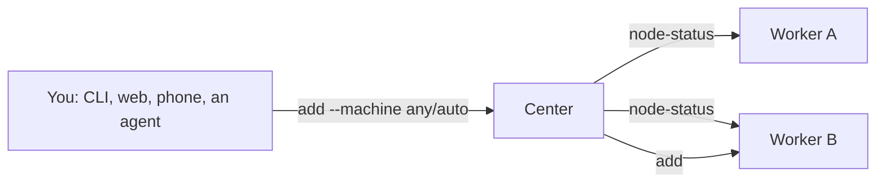

# Machines

One Rove watching every computer you code on.

Install Rove on each machine, register the others with `rove machine add`, and
their tasks appear in your sidebar under a row of their own. There is no
"switch to that machine" step — every machine is connected at once, and the
tree is the answer to what is running where.

## What this needs

- Rove installed on **both** machines (`npm i -g @sma1lboy/rove`). Run in a
  terminal, `machine add` offers to install it on the other one for you.
- SSH access to the remote one. A `Host` block in `~/.ssh/config` is the usual
  way; Rove reads it rather than replacing it. If no key you have is accepted
  there, `machine add` offers to set one up (below).

Nothing else. Rove opens no ports and adds no authentication of its own: the
remote daemon keeps listening on its private unix socket, and SSH forwards that
socket to yours. SSH *is* the transport and the authentication.

Both machines need a Rove new enough to have machines — an older one reports no
PTY socket in `rove daemon status`, and `machine add` says so rather than
half-connecting.

While a machine's rows are on screen, Rove counts as one attached window on
that machine, so its daemon stays up for as long as you are looking at it.

## Add a machine

```console
$ rove machine add narwhal
rove machine: contacting narwhal…
rove machine: Nahuels-Mac-mini → narwhal (rove 0.9.185 on Nahuels-Mac-mini.local)
```

`add` verifies before it saves: it asks the machine where its daemon listens
(`rove daemon status --json`, starting one there if none is up) and refuses if
the host is unreachable, Rove is not installed, or no daemon can be started.

- **First connection.** If the host key is not in your `known_hosts` yet, `add`
  prints its fingerprints and asks before trusting it. Run from a script (no
  terminal), it prints them and trusts on first use, as `ssh` itself would.
  Hosts reached through `ProxyJump`/`ProxyCommand` are left to ssh.
- **Rove off the PATH.** A Rove installed with bun or nvm is often missing
  from the PATH of `ssh narwhal <command>`, because the rc file that adds it
  only runs for interactive shells. `add` asks the login shell and the usual
  install directories, then remembers that path for the machine. Your rc files
  are not touched.
- **Fixes, not dead ends.** In a terminal, a failure `add` can repair is
  offered as a fix: it shows the exact command, asks, runs it, and tries
  again. `--yes` runs every offered fix without asking.
  - *No key is accepted:* `add` creates `~/.rove/ssh/hub_ed25519`, a key just
    for this Rove, with no passphrase so it can reconnect unattended, and adds
    it to the machine's `~/.ssh/authorized_keys`. You type that machine's
    password once, into ssh. To revoke this Rove's access, delete the line
    ending in `rove-hub@<this host>` there.
  - *Rove is missing:* `add` runs the official install script on the machine
    (`curl -fsSL https://rove.run/install.sh | sh`).
  - *Rove is too old:* `add` runs `rove update` there.
- **When ssh fails**, the message names the cause and the fix: a name that
  does not resolve, a refused or timed-out connection, a rejected key, a host
  key not trusted yet, or one that **changed** (which `add` will not override).
Rove never guesses a remote socket path — the remote home may be a different
user, and the path may have been shortened to fit the platform's socket-name
limit.

The alias is what the sidebar shows. It defaults to the target you typed —
`rove machine add narwhal` gives you a machine called `narwhal`, because that
is the name you already chose for it. A target that is addressing rather than a
name (`user@host`, an explicit port, a bare IP) takes the machine's own
hostname instead. Override either with `--alias`:

```console
$ rove machine add nahuel@mac-mini.local --alias narwhal
```

| Option | What it does |
| --- | --- |
| `--alias <name>` | Local name for the machine. Default: the target you typed, or the machine's hostname when the target is `user@host` / has a port / is an IP. |
| `--port <n>` | SSH port. Default: whatever `ssh_config` says. |
| `--identity <file>` | SSH private key. Default: ssh-agent / `ssh_config`. |

The target is `[user@]host[:port]`, usually just an `ssh_config` `Host` alias.
An IPv6 address with a port needs brackets, exactly as `ssh` requires:
`[fe80::1]:2222`.

Nothing secret is written to `state.json`. A key is stored as a path; a
password is stored as a keychain reference, never as a password.

## What you see

```
rove                          ← your projects, exactly where they were
  main
  fix/machines
narwhal · v0.9.185            ← a machine
  narwhal:rove                ← its checkout of a repo you also have
    remote probe
```

- **Two machines, one repo name.** A repo called `rove` on both machines shows
  as `rove` here and `narwhal:rove` there. The local one keeps the bare name —
  it is the one you are sitting at. Two checkouts of `rove` on the *same*
  machine take the path instead (`gihub/rove`, `i/rove`): there the machine
  name would say nothing.
- **Offline machines keep their rows.** A laptop whose lid closed has not
  stopped having those tasks, so the row stays and greys out instead of
  vanishing. Rove reconnects in the background and the rows come back to life.
- **Version skew is on the row.** `narwhal · v0.9.180` next to your own build
  explains most of what otherwise looks like a bug. A machine whose Rove is too
  old to talk to yours reads `⚠ v0.9.100 (protocol mismatch)` and is the only
  row affected.

## Check a machine again

```console
$ rove machine doctor
narwhal  ✓  rove 0.9.251 on Nahuels-Mac-mini.local
```

`doctor` re-runs the same checks for every registered machine (or the one you
name) and offers the same fixes, for when something changed underneath: a key
was revoked, Rove was reinstalled somewhere else, the machine was rebuilt. It
also says when a machine runs a different Rove version than this one, and
exits 1 if any machine is not usable.

## List and remove

```console
$ rove machine list
narwhal  narwhal  Nahuels-Mac-mini.local

$ rove machine remove narwhal
rove machine: removed narwhal. Nothing on that machine was changed — its daemon, tasks and worktrees are untouched.
```

Registering one machine under two aliases is recognized and reported: Rove
compares the remote daemon's hostname, state root and pid, and renders one row
either way.

## Run commands on a machine

Every `rove api` verb takes `--machine <alias>` and runs in that machine's
daemon, so its tasks, worktrees and engine sessions are created there:

```console
$ rove api add --machine narwhal --repo /home/nahuel/rove --prompt "fix the flaky test"
```

A `--task-id` that belongs to another machine goes there on its own: `send`,
`read-output`, `land` and `delete` work on a remote task the same as on a local
one. Paths are paths on that machine. [API.md](API.md#run-a-verb-on-another-machine)
has the details.

A daemon left running with `rove daemon start --resident` on an always-on box
can be the one you dispatch from: register your machines there, and anything
that reaches that daemon (`rove api`, `rove --web`, the phone apps) can send
work to any of them. That also means a bridge token for that daemon runs
commands on every machine registered there: guard it like an ssh key.

## Let a center pick the machine

`--machine any` and `--machine auto` on `rove api add` hand the choice to a
**center**: one machine that knows the others and places each new task on a
worker.



- `any` puts the task on the least-loaded worker.
- `auto` reads the prompt and sends it to the worker it fits best. When the
  prompt fits no worker better than the others, load decides.

Any machine can be the center. It needs the workers registered with
`rove machine add`, which a resident daemon on an always-on box usually
already has. On every other machine, name it in `fleet.centers`:

```jsonc
// state.json on your laptop
"fleet.centers": ["mini", "studio"]   // try mini first, then studio
```

With no `fleet.centers`, the machine you run the command on is its own center.
Put `local` in the list to mean "this machine".

### How the center picks

The center asks itself and every registered machine for `rove api
node-status`, in parallel. A machine that does not answer within 5 seconds is
skipped, so one stuck worker cannot stall a dispatch. A machine can take the
task only if:

- it has a checkout of the repo. Checkouts are matched by `origin` URL, so
  `/Users/me/app` on your laptop and `/srv/app` on a worker are the same repo.
  The task is created at the worker's own path.
- it has the engine `--vendor` names, if you named one.
- it is below its `engine.maxLiveSessions` cap, if it has one.

The center does not take tasks itself while a worker can, so dispatching
never adds load to the machine doing the dispatching. Set
`fleet.centerTakesTasks: true` to let it compete like any worker. When no
worker qualifies, the center runs the task itself if it can.

For `auto`, each machine describes itself in its own `state.json`:

```jsonc
// on the GPU box
"fleet.tags": ["gpu", "cuda", "训练"],
"fleet.description": "RTX 4090, the staging database, internal mirrors"
```

A tag that appears in the prompt counts more than a matching description
word. Matching is by substring, so CJK tags work. For real semantic routing,
point `fleet.router` at an endpoint that reads the prompt and names the
machine (see [Configuration](CONFIGURATION.md#fleet)). If it times out or
names a machine that was not offered, the built-in match decides.

The result says where the task went and why:

```json
"dispatch": { "machine": "studio", "host": "studio.local", "reason": "least loaded (load 0.31)",
              "skipped": [{ "machine": "mini", "why": "at its session cap (4)" }] }
```

`rove api fleet-status` shows which center your calls go to right now and each
machine's load. `NO_ELIGIBLE_NODE` lists every machine with the reason it was
passed over.

### When a center goes down

Calls go to the first machine in `fleet.centers` that answers. If it does not
answer, or drops during the call, the next one is asked. Nothing has to be
handed over: the center keeps no state of its own. Tasks live on the workers,
and each candidate reads the worker list from its own machine registry. So
register the workers on every machine in `fleet.centers`, not just the first.

After dispatch, `send`, `read-output` and the other task verbs find the task
by its id. They check this machine, then the machines registered here, then
ask the center. A task placed on a worker your laptop never registered is
still reachable.

## What this release does not do yet

- Opening a remote task's session in the TUI is not wired up yet. You can see
  the row and drive it with `rove api`, but not enter it.
- The file tree and diff panes show `on <host>` for a remote task. Its worktree
  path means nothing on your filesystem, and reading it would list whatever
  happens to sit at the same path here.

Windows can register and list machines, but cannot open the tunnel: OpenSSH on
Windows has no unix-socket forwarding. Such a machine's row reads
`unsupported`.

## Where things live

| Path | What |
| --- | --- |
| `state.json` → `machines` | The registry: host, user, port, auth, learned identity |
| `<home>/.rove/machines/<alias>/daemon.sock` | Local end of the forwarded daemon socket |
| `<home>/.rove/machines/<alias>/pty.sock` | Local end of the forwarded PTY-host socket |
| `<home>/.rove/machines/<alias>/cm` | The shared SSH connection (ControlMaster) |

Under a deeply-nested home these move to a short `$TMPDIR/rove-m-…` directory:
a unix socket path cannot exceed ~104 bytes, and `<home>/.rove/machines/…`
overruns that before it starts. The fallback is derived from the home and the
alias, so it is the same path every time.

The directory is owner-only (`0700`); so are the sockets in it. They reach a
daemon that runs commands as its owner.

## Not the same as `rove add --remote`

`rove add --remote` registers a remote *project* and drives git and the engine
over SSH from **your** daemon — it assumes the far side has no Rove. Machines
assume the far side runs Rove and speaks the daemon protocol. Both still exist;
they answer different questions.
