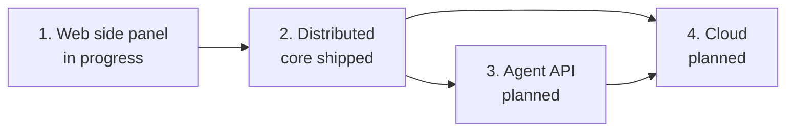

# Roadmap

Rove runs many AI coding sessions side by side. Each task gets its own git
worktree, branch and terminal tabs, and the real engine CLIs (`claude`, `codex`
and others) run inside them. One daemon per machine owns the tasks, so the
terminal UI, `rove --web`, the iOS and Android apps and `rove api` all look at
the same state. Machines you register with `rove machine add` show up in the
same rail. This page says where that is going.

Each milestone has a goal, what "done" means (something you can see or run), a
status, and links to the docs, PRs and code that exist today. Status is one of
**shipped**, **in progress** or **planned**. Planned means no work has started
and no date is promised. Last checked against Rove 0.9.270 on 2026-10-26.

The order is the order of work: the nearest milestone is first.

## 1. Web side panel

**Status: in progress.**

**Goal.** A panel on the right of the task terminal in `rove --web`. Buttons
along its top switch what it shows: a live web page (a local dev server or any
URL), the task's files and diffs, and other artifacts a task produces. The
features are borrowed from the Claude desktop app's side panel and from the
canvases in Codex, ChatGPT and claude.ai; the layout is Rove's own.

**Done means:**

- From a task, you open a URL in the panel and use back, forward and reload.
- You switch to Files or a diff and back without losing either: the page keeps
  its place and the file keeps its scroll.
- On a desktop window the panel sits beside the terminal. On a phone it opens as
  a full-screen sheet.

**What exists.**

- The Files pane is already on the right of the terminal on a desktop window,
  with All and Changes tabs and a working-tree or branch scope
  ([`files-view.tsx`](../packages/rove-web/src/files-view.tsx)). On a narrow
  window it takes the whole screen.
- A file and diff reader with line notes you can send to the engine
  ([`preview-view.tsx`](../packages/rove-web/src/preview-view.tsx)).

**What is missing.**

- The reader does not sit beside the terminal. It opens as a tab in the strip
  and hides the terminal while it is open.
- Nothing in the page shows a web page. The page's content security policy is
  `default-src 'self'` with `frame-ancestors 'none'`
  ([`web-static.ts`](../packages/rove-bridge/src/web-static.ts)), so an embedded
  frame pointing at another origin is blocked until the policy allows it.
- A dev server runs on the machine that runs the task. For a task on another
  machine, or from a phone, `localhost:3000` in your browser is the wrong
  machine. The page needs a way through to the right one, and
  [web/MEMO.md](web/MEMO.md) says any capability the page needs is a bridge op
  that the phone apps can use too.
- Some sites refuse to be framed. The panel needs an "open in a new tab" answer
  for them.
- The panel and its buttons are new rows in [web/PARITY.md](web/PARITY.md); the
  TUI has no counterpart.

**See also.** [WEB.md](WEB.md), [web/PARITY.md](web/PARITY.md),
[web/MEMO.md](web/MEMO.md).

## 2. Distributed

**Status: core shipped; the rest is in progress.**

**Goal.** One person's tasks run on several machines and are driven from
anywhere: from the terminal UI, the web, a phone, or an agent with no UI
attached. Code and engine logins stay on the machines they are already on.

**Done means:**

- You register a machine once. `rove api add --machine auto --repo owner/name`
  puts the task on a machine that has the repo, and you watch it, type into its
  terminal, read its diff and land it from wherever you are.
- A task started by an agent on one machine can report back to its parent on
  another.
- None of this needs a terminal window open on either machine.

**Shipped.**

- Register and check machines over SSH, with guided fixes: `rove machine add`,
  `doctor`, `list`, `remove`. Native Windows can be a machine (#1392) and a hub
  (#1346), and `rove machine tunnel` reaches machines behind NAT (#1342). See
  [MACHINES.md](MACHINES.md).
- Every `rove api` verb takes `--machine <alias>` or `--machine auto` (#1348),
  and a `--task-id` on another machine goes there by itself. Repos are named by
  id, not path (#1351, #1339), a base with unpushed commits is refused (#1340),
  and `--clone` fetches a repo the machine lacks. See
  [API.md](API.md#run-a-verb-on-another-machine).
- A remote task opens like a local one in the web (#1320) and the TUI (#1344,
  #1343): its tabs, its live terminal, its files and diffs. `land` pushes the
  branch from that machine and opens a PR (#1341).
- A resident daemon (`rove daemon start --resident`) can be the hub that
  dispatches to the others ([CLI.md](CLI.md#headless-hosts---resident)).
- Phones and browsers reach a daemon through the bridge: Tailscale or
  Cloudflare Access presets, a token per device (#1347), password login
  (#1386), install to the home screen. See [WEB.md](WEB.md) and
  [IOS.md](IOS.md). The Android app is in [ANDROID.md](ANDROID.md).
- Each machine decides what other hubs may run on it:
  `rove machine inbound` (#1345).

**Missing.**

- The daemon is not yet the only actor. The brief in
  [design/fleet-direction.md](design/fleet-direction.md) lists session launch
  and prompt delivery as still run by the calling process (the TUI or
  `rove api`); terminal tabs have since moved into the daemon (#1353). Until
  launch moves too, those paths cannot be pointed at another machine.
- No placement beyond fewest tasks in progress. There is no per-machine
  capability or load check, so `--machine auto` cannot tell a GPU box from a
  laptop.
- No run with no client attached that decides where work goes (for example CI
  asking for `--machine any`). The control plane is the hub inside each
  client or daemon; the open question is whether it becomes its own resident
  node ([fleet-direction.md](design/fleet-direction.md), question 2).
- Remote access hardening that is designed but not built: a hub key restricted
  to Rove's relay, Tailscale SSH detection, a peer check on the local sockets
  ([design/remote-access-auth.md](design/remote-access-auth.md)).
- No leader election or failover. Every machine owns its own tasks
  ([MACHINES.md](MACHINES.md#what-this-release-does-not-do-yet)).
- The mobile apps are not in the stores yet. [IOS.md](IOS.md) lists TestFlight
  and App Store distribution as not done; the Android release work is #1409.

**See also.** [design/workspace-runner.md](design/workspace-runner.md) (routing
and dispatch design), [design/fleet-direction.md](design/fleet-direction.md)
(the owner brief, still marked Proposed), [design/daemon-owned-state.md](design/daemon-owned-state.md).

## 3. Agent API

**Status: planned. The first part has shipped.**

**Goal.** The same contract serves people, agents, CI and issue trackers, and
it is safe to retry.

**Done means:**

- A client can resume an event stream after a disconnect and miss nothing.
- Sending the same `add`, `send` or `land` twice does the work once.
- A child task on another machine can report to its parent, because tasks have
  an address that includes the machine.

**Shipped.** One verb registry is the contract, run by one executor over the
CLI, the daemon socket and the bridge, with one `ROVE_API_VERSION` on every
output ([API.md](API.md#one-contract-three-transports)). Delivery reports,
should-run checks and decision gates cover unattended runs
([design/long-run-controls.md](design/long-run-controls.md)).

**Missing.** An event stream with sequence numbers and replay: `watch` carries
engine-state changes only and is, in its own words, not a general event bus.
Idempotency keys on `add`, `send` and `land`. A `machine:taskId` address.
Per-engine cost in money (token counts exist for `claude` and `codex`; there is
no price table).

**See also.** [API.md](API.md), [design/fleet-direction.md](design/fleet-direction.md)
(step 3).

## 4. Cloud

**Status: planned. No work has started.**

**Goal.** A hosted Rove: the daemon and engines run on machines Rove or a
provider runs, so a person can start work without owning or setting up a
machine, and a team can share them.

**Done means** (a draft, to be confirmed by the owner before work starts):

- Someone with no machine of their own signs in and gets a running Rove, with
  an engine logged in and a repo cloned.
- Two accounts on one hosted Rove see only what they are allowed to.
- Closing every browser and phone leaves the work running, and reopening shows
  where it got to.

**What exists toward it.**

- A daemon that stays up with no UI: `rove daemon start --resident`.
- Reaching a daemon from a browser or phone: the bridge presets, a token per
  device, password login with lockout, `--public-host` behind a tunnel, and the
  installable page ([WEB.md](WEB.md)).
- A hub dispatching to other machines by repo id, with `--clone` and a
  per-machine inbound policy ([MACHINES.md](MACHINES.md)).
- Engine logins stay on the machine they were made on; the hub never ships
  secrets ([design/workspace-runner.md](design/workspace-runner.md)).

**What is missing.**

- Accounts, teams and permissions. The daemon socket has no authentication of
  its own: the directory mode is the access control, and
  [design/daemon.md](design/daemon.md) (section 10) rules out a permission
  model. A bridge token today means a shell on every machine registered with
  that hub ([MACHINES.md](MACHINES.md#run-commands-on-a-machine)).
- Something that starts, stops and bills machines. Today you provide the
  machines.
- Machines that dial out. Registering a machine needs the hub to reach it over
  SSH; a cloud machine that sits behind NAT, or comes and goes, needs the
  opposite direction ([design/workspace-runner.md](design/workspace-runner.md)
  calls this a later transport).
- Engine login on a fresh machine, and how a team's engine accounts and spend
  are handled.
- Cheap throwaway workspaces. Git worktrees are full checkouts; the design
  surveys copy-on-write workspaces for cloud runners but has not built the
  seam ([design/workspace-runner.md](design/workspace-runner.md), phases 0
  and 4).

**Open decision.** [design/fleet-direction.md](design/fleet-direction.md) sets
the positioning as "your compute, not a vendor's cloud" and says hosted comes
later. This milestone needs the owner to say how hosted Rove fits that
positioning, and who it is for first (individuals, or teams).

## Not scheduled

Designed, but not part of a milestone above:

- Checkpoints at each engine turn, rewind, and forking a task with its
  uncommitted work ([design/workspace-runner.md](design/workspace-runner.md),
  phase 1).
- Racing several engines on one task with an automatic judge. The race
  commands exist (`add --count`, `--agents`, `collect --group`); the judge does
  not ([design/fleet-direction.md](design/fleet-direction.md)).
- Freezing `rove add --remote` in favour of machines
  ([design/remote-projects.md](design/remote-projects.md)); it is
  experimental and its engine launch regressed.

## Keeping this page current

- When a milestone moves, change its status and its **Shipped** or **Missing**
  lists in the same pull request as the work.
- Link the PR number or the doc, not a date.
- If a design page and this page disagree, the code decides; fix both.
