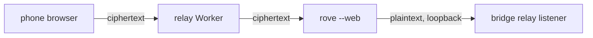

# Web client

`rove --web` serves Rove in a browser. It runs the same bridge the iOS and
Android apps pair with ([IOS.md](IOS.md)), and the page is one more client of
it: same daemon, same tasks, same terminal sessions as the TUI.

```bash
rove --web                 # 127.0.0.1:7878 only
rove --web --port 7900     # another port
```

It prints two links and keeps running until you stop it:

```text
open: http://127.0.0.1:7878/
pair: ws://127.0.0.1:7878/?token=…
```

Open the first in a browser on this computer: it needs no token (see
[Sign-in modes](#sign-in-modes)). The second is the
phone pairing URL. A phone already paired with `rove-bridge` keeps working:
the two share one token.

## What it does today

- The Tasks rail: projects, tasks and their tabs, with the TUI's status marks
  (`?` waiting on you, `!` needs you, `●` unseen turn, `○` quiet, a spinner
  while working) and the `+N` / `−N` / `↑N` / PR marks. A task row is named
  as in the TUI: by the title its engine gave the conversation, else the
  stored title. The bridge computes that name (`TaskRow.label`) and updates it
  within a few seconds of the engine retitling, with the task closed; sort by
  name and search read it too. The web is bundled with its bridge, so it reads
  `label` with no fallback.
- Click a task or tab to open its terminal session, and type into it. That
  includes answering an engine's prompts.
- Right-click a project, task or tab for the same menu the TUI has: new
  conversation, close tab, rename, rename branch, pin, set status, change
  engine, copy the task ID, branch or path, land, delete.
- Drag a project header up or down among projects, or a task among its
  project's tasks (pinned and unpinned tasks stay in their own groups). The
  other rows slide aside to show where it lands. The order is the daemon's, so
  the TUI and phones follow. Only in the default sort, outside a search.
- `+ New task` at the bottom of the rail, and `+` in the tab strip for a new
  conversation. The first message is optional, as in the TUI's picker: without
  one you get a plain engine (or shell) tab. A fork to new tasks needs one.
- Mods: while a plugin's `[mod]` has a pane open, the rail lists **Mods**.
  The page draws the same panes as the TUI's Mods page, and a button pressed
  here updates both ([PLUGIN-AUTHORING.md](PLUGIN-AUTHORING.md#mods)).
- A plugin's input dialog (`rove api prompt`) opens here too; the first
  answer from the web or a TUI wins.
- On a touch screen an engine tab has a message field under its terminal,
  above the key row: hold to talk, or type, dictate or paste there (images and
  PDFs too, or pick them with the paperclip) and Send pastes and submits the
  whole message through the engine's own composer (`tab.send`, as
  `rove api send`). While the agent is working the engine's own input queue
  takes it, as if typed in its terminal; Rove holds nothing. A draft is kept
  per tab until the engine takes it.
  Another machine's tasks have none: they are read-only here.
- New session takes images and PDFs (paperclip, paste or drop) for its first
  message. `/?prompt=<text>&repo=<path>` opens New session with that draft and
  project, for a bookmark or a home-screen shortcut. It only fills the
  composer; nothing starts until you press Start.
- New session's project chip picks one project: a click (or Enter) replaces the
  pick and closes the list; Shift-click (or Shift+Enter; ⌘/Ctrl works too) adds another repo
  for a multi-repo task. Any folder works, git or not: a folder git cannot use
  (no repository, or no commit yet) opens in place as a directory session, with
  Worktree off and no branch to pick, and cannot join a multi-repo task.
- One prompt, several engines: the New session engine chip's `[ compare engines ]`
  turns it into a check-list (Claude + Codex …), and Start fans the prompt out
  as one attempt per engine (`add --agents`, each in its own worktree, sharing
  a `groupId`) and opens Compare. Compare is also on any attempt's row menu:
  each attempt's status, latest reply, and changed files side by side (stacked
  on a phone), with its terminal and diff one click away. `[ keep this one ]`
  marks it kept (`update --kept`) and offers to archive the others behind the
  usual confirm. Not available in place, ungrouped, or on another machine.
- The Issues page has a second source, `[ PRs waiting on me ]` (also the palette's
  **Review queue**): open PRs that ask for your review, in the projects Rove
  knows, read through this Mac's own `gh` (one read-only search, cached for a
  minute; `r` rereads). Each row shows the PR, author, draft / fork / checks,
  `+/-` and age. `[ review ]` (or Enter) fetches the PR's head into a local ref
  (`refs/rove/pr/<n>`, the same for a branch and a fork) and opens New session
  on that project, starting from it, with a review prompt as an editable draft:
  nothing starts until you press Start, so you pick the engine and the agent
  never begins on someone else's code from a click in a list. Nothing is written
  to GitHub.
- The Chat tab (first of the panel's buttons) reads the task's conversation from
  the engine's own history (`output.read`, claude and codex alike): user and
  assistant turns as Markdown, each tool call folded to one line, `[ copy ]` per
  message, a find box, `[ export .md ]` for the whole thread, and new messages
  as the engine writes them. A palette conversation hit opens it scrolled to
  that message. An engine with no readable history shows its labelled terminal
  tail. It never takes input: the composer stays in the terminal.
- The side panel holds several tabs per task (Files, a diff per file, a
  Browser per page), optionally in two stacked groups, and its views answer to
  agents. It starts closed: the Chat, Files, Diff and Browser buttons at the
  workspace's top right open it on that view (the shown kind is tinted;
  pressing it again closes the panel), and its top row has an expand button
  and a close ×. A phone keeps its Terminal / Chat / Files / Diff / Browser switch
  and shows no buttons. A page
  reports whether it has a panel, whether it is open, and its width, so
  `rove api viewers` tells an agent what you can see (and whether the page is
  on the daemon's machine or behind a tunnel). `rove api panel-show` makes
  every page remember a view for a task: an address focuses the Browser tab
  already on it or opens a new one, `--path` opens or focuses that file's Diff
  tab, and it opens the panel on a page that is on
  that task with a panel, without taking focus or switching task. The Browser
  asks the bridge (`browser.probe`) whether a page forbids framing before it
  loads it.
- Command palette (`ctrl+a /`): the commands, then the tasks whose title,
  branch or project matches, then what you and the agents wrote in any task's
  conversation (`rove api search`, from two characters), newest first, the words
  around each hit shown. A task or hit opens its task; the terminal does not
  scroll to the line. Tool output is not searched, and a task on another machine
  is not. A machine that is not connected greys its rows in the rail; the cloud
  mark's hover says why, and `rove machine doctor <alias>` fixes it
  ([MACHINES.md](./MACHINES.md)).
- The Inbox: click `INBOX n` at the top of the rail. `↑↓` moves, Enter opens
  the session and clears it, `d` clears it without opening.

The keyboard works as in the TUI: the rail's own keys (`j`/`k`, Enter, `n`,
`/`, `r`, `d` and the rest of the sidebar chords), the `ctrl+a` prefix layer
with its guide, F1 help and the command palette, and the direct chords such as
Ctrl+E, Ctrl+1..9, F2–F5 and F7. Your `~/.rove/settings/keybindings.yaml`
applies here too. Chords the browser keeps for itself never reach the page:
close a tab with `ctrl+a w` or the menu instead of Ctrl+W, open one with `+` or
Ctrl+E instead of Ctrl+T, and there is no Ctrl+Q (a page cannot quit itself).

[web/PARITY.md](web/PARITY.md) lists every TUI action and whether the web
has it yet.

## Dictation (optional)

Typing on a phone is the worst part of driving a session from one, so the composers have a mic (and,
on a phone, hold-to-talk). The page records 16 kHz mono PCM and the op `voice.transcribe` hands it to
a sidecar on this machine together with the conversation it is dictated into; the transcript is
inserted at the caret and sent only when you slide up to send.

Nothing in Rove bundles a model, and the mic stays hidden until dictation is set up. **Settings →
Voice** does it from the page with one choice, **Dictation**:

- **Off** — no mic, and no sidecar running. The default until something is set up.
- **On this Mac** — Whisper large-v3 on the Mac's GPU. Install shows only on an Apple Silicon Mac with
  [uv](https://docs.astral.sh/uv/) and ~3.5 GB free; otherwise the row says which is missing. Install is
  a detached job on the Mac (`uv sync --frozen --extra local`, then the model download), so a phone
  that sleeps or reconnects mid-download does not stop it; the page shows its latest line. **Uninstall**
  removes the model from the Hugging Face cache and, unless a cloud endpoint is in use, the sidecar's
  environment, and turns dictation off. Your dictionary and learned terms stay.
- **Cloud** — base URL, model and API key of any OpenAI-compatible `/audio/transcriptions` service. The
  key is written to `<ROVE_HOME>/.rove/voice/config.json` (mode 0600) and never sent back to the page.
  The endpoint is kept when you switch to another choice, so coming back needs nothing retyped;
  **Forget** removes it and its key.

Once local or cloud is chosen and set up, the bridge starts the sidecar whenever it is not answering
(`voice.status`) and restarts it when the choice or the endpoint changes. The sidecar's environment lives in
`<ROVE_HOME>/.rove/voice/venv`; its code is `scripts/voice/` in a checkout and `dist/voice/` in a
release, one environment described by `pyproject.toml` and `uv.lock`. By hand:

```bash
uv run --project scripts/voice --extra local scripts/voice/asr_server.py   # 127.0.0.1:8791
uv run --project scripts/voice --extra local scripts/voice/bench.py        # key-term bench: 11 zh/en clips, 82 terms
```

It listens on loopback and takes the shared token in `<ROVE_HOME>/.rove/voice/token`; the bridge is
the only public path to it.

- **Recognizer.** Local `mlx-community/whisper-large-v3-mlx` by default. `~/.rove/voice/config.json`
  (read when the sidecar starts; restart it after a change) picks another:
  `{"model": "mlx-community/whisper-large-v3-turbo"}` for speed, or any OpenAI-compatible
  `/audio/transcriptions` endpoint, for example
  `{"backend": "cloud", "baseURL": "https://api.openai.com/v1", "model": "gpt-4o-mini-transcribe", "apiKeyEnv": "OPENAI_API_KEY"}`.
  For OpenRouter the vocabulary goes in the field each provider reads (`azure.phraseList` for
  `microsoft/mai-transcribe-2`); that body follows yap's measured one but has not been run from
  here yet. Elsewhere it is the `prompt`. The key stays on this Mac. Chinese comes back in
  Simplified script unless `"simplified": false`.
- **Vocabulary.** The bridge reads the last 30 messages of the task's conversation (text and tool
  inputs, or the terminal tail; at most 1.5 s, else the take goes without). Its term-like words
  (`GraphQL`, `rove-web`, `useEffect`, not words the system dictionary knows) join the terms kept in
  `~/.rove/voice/vocab.json` (created from the old `dictionary.json`). English the recognizer split
  or misspelled is snapped back onto them: "Graph, Q, L" → GraphQL, "Decorfile" → Dockerfile; a
  real English word is never rewritten. A local recognizer's prompt gets only the stored terms the
  draft shows (other terms there cost a term whenever they were not said: 68 → 64 with 15 learned
  ones); a cloud one gets all of them (`"promptContext"` overrides either).
- **Learning from your fixes.** On the phone bar, when you fix a word inside a take before sending
  ("Jithub" → GitHub, "github" → GitHub, "Graph QL" → GraphQL), the bridge op `voice.learn` diffs
  the draft as dictation left it against what was sent and stores the fix in `vocab.json`; the next
  take is rewritten before it shows. A toast says what was learned, with `[ undo ]`
  (`voice.unlearn`). Learning nothing is the default: punctuation, spacing and full-width forms
  never count, a case-only fix counts only as a term's casing (not "the" → "The"), the new word must
  be term-like, and a send that rewrote half the take or fixed more than 4 terms teaches nothing.
  `"learn": false` turns it off. Bench: `bench.py --edits` 20/20 labelled edits;
  `bench.py --learn` (fix each take, take it again) 68 → 76/82 on large-v3, with the recognizer's
  own score unchanged.
- **Live text while you hold.** A held take (not a tapped one) streams through `voice.stream`: the
  page sends what it recorded about once a second, one chunk in flight at a time, and with a local
  recognizer the sidecar (`live.py`) decodes the take so far whenever at least 0.8 s is new and the
  GPU is free, so the words show in the hold button as they are said. Letting go sends the rest and
  the whole take is decoded once more through the same steps as a one-shot take. A cloud recognizer
  is billed per request, so its takes are buffered and decoded once, at the end. Any streaming error
  (an older bridge, a lost chunk) falls back to sending the whole take. Bench (`bench.py --live`,
  large-v3, 1 s chunks): a partial every 1.43 s p50 (1.68 s p90), the text trails speech by 1.43 s
  p50 (2.66 s p90), the first words show at 2.1 s p50, and the final text equals the one-shot text on
  11/11 clips.
- **Sound-alikes.** After the spelling fix, a word the recognizer *heard* wrong is matched by
  pronunciation (Metaphone; a Chinese run is read as pinyin first): "Jithub" → GitHub, "Cavin" →
  Kevin. Only a run that is not all dictionary words and keys within a close length of a term is
  touched. On the bench it lifts large-v3 from 72 to 74 when the conversation holds the terms and
  changes nothing otherwise; `"phonetic": false` turns it off.
- **Cleanup (off by default).** A `polish` block in `config.json` sends each finished take, with its
  vocabulary, to an OpenAI-compatible `/chat/completions` model that drops fillers, applies
  self-corrections ("三次，不对，五次" → 5 次), writes numbers and spacing as text and turns spoken lists
  and steps into lists: `{"polish": {"model": "gpt-6-luna", "body": {"reasoning_effort": "none"}}}`
  (key in `OPENAI_API_KEY`; `baseURL`, `apiKey`/`apiKeyEnv` and `body` reach other providers). Live
  partials are never polished. A failed or late call (8 s) keeps the recognizer's text. The prompt is
  yap's RecommendedPrompt as written; the conversation's terms fill its `<CUSTOM_VOCABULARY>`.
  Bench (`polish_bench.py`, yap's 25 cases plus 7 agent prompts, automatic checks): gpt-6-luna
  281–284 of 288 over 9 rounds, every agent case passing, p50 0.8–0.95 s; gpt-4.1-mini 168/192.
  Rewording the prompt for agents scored lower (157–160 of 192 on gpt-4.1-mini), so it was not
  kept. In the phone smoke it added about 0.7 s between letting go and the text.
- **Measured** (`bench.py`; clips are synthesized with macOS `say` on first run and cached, so the
  voices are synthetic; real recordings are scored with `--recordings`). "Has the terms" puts each
  clip's own sentence in the conversation, an upper bound; "only other terms" is all distractors:

  | Recognizer | no context | context has the terms | context has only other terms | p50 |
  | --- | --- | --- | --- | --- |
  | large-v3 (default) | 68/82 | 74 | 68 | 1.6–2.5 s |
  | large-v3-turbo | 63 | 65 (69 with `promptContext`) | 63 (61) | 1.0 s |
  | gpt-4o-mini-transcribe (cloud) | 75 | 78 | 77 | 0.9 s |

- **Privacy.** With the local recognizer, audio, model and vocabulary stay on this machine and no
  audio is written to disk. A cloud backend sends the audio and the term list to the endpoint you set;
  cleanup sends the transcript and the term list to its own endpoint, even with a local recognizer.


## Security

- It listens on `127.0.0.1` only unless you pick a bridge preset
  (`--preset tailscale` or `--preset cf`, see [IOS.md](IOS.md); or
  `--preset relay`, below). There is no flag that opens it to the whole
  network by default.
- The token rides in the link's `#fragment`, which browsers never send to a
  server, so it reaches no access log. The page stores it in the browser's
  local storage and removes it from the address bar.
- The page sends the token as a `Sec-WebSocket-Protocol` value, because a
  browser cannot set the `Authorization` header phones use. A socket opened
  from another site is refused even with the token.
- `--rotate-token` revokes every browser and phone at once: the shared token
  and every device token, password sign-ins included. The web password itself
  stays; change it with `--set-password`.
- `--device <name>` gives one phone or browser its own token and prints its
  link; `--revoke-device <name>` revokes just that one, and
  `--list-devices` shows them. Only a SHA-256 of each device token is kept
  (`<home>/.rove/bridge/devices.json`, owner-only).
- Every action that loses work (delete or land a task, close a tab, remove
  a worktree, delete a routine) is written to the bridge's stderr with the
  time, the device that sent it and its address, never the token. See
  [TROUBLESHOOTING](./TROUBLESHOOTING.md#who-deleted-my-task).
- `--setup` checks for Tailscale and cloudflared on this machine and prints
  the commands to reach the bridge from another device. It changes nothing.

The page's files are served without the token (they carry none); every
operation needs it, except from this computer's own browser as described
next. With `--preset cf`, Cloudflare Access gates the page too.

### Sign-in modes

How a browser gets in is one of three modes. Tokens (the printed link, a
device token, a phone's pairing URL) work in all of them.

| Mode | A browser with no token | Offered on |
| --- | --- | --- |
| `open` | gets in from this computer; anywhere else it is asked for the link | a plain run only |
| `password` | signs in with the password | every run |
| `token` | is asked for the link; password sign-in is off | every run |

A plain run is `rove --web` with no `--preset`, no `--public-host`, no relay
and no `--host` other than loopback. It starts in `open`, and `open:` is then
the bare address. Any other run starts in `token`. Once a password is set,
both start in `password`.

Pick the mode in **Settings → About → Sign-in**, or by hand; it applies to
the next connection, with no restart:

```json
// <home>/.rove/bridge/config.json
{ "auth": "password" }
```

Picking Password in Settings asks for one if none is set, and can change it
later. Picking Token link keeps the stored password, so going back to
Password needs no new one. Leaving `open` from a browser that got in without
a token gives that browser a device token of its own, so it stays signed in;
other tokenless sessions are closed.

In `open`, only a request that came straight from this computer is let in
without a token: its `Host` is `127.0.0.1`, `localhost` or `[::1]`, and it
carries no forwarding header (`X-Forwarded-For`, `CF-Connecting-IP`,
`Forwarded`, `Via`, `X-Real-IP`, `X-Forwarded-Host`, `X-Forwarded-Proto`).
cloudflared and `tailscale serve` set these, so a tunnel pointed at a plain
run still needs a token.

Leave `open` if other people have accounts on this computer: any local user
or program that can reach `127.0.0.1:<port>` can drive Rove. Leave it as well
if a reverse proxy of your own forwards to the bridge without passing the
original `Host` or any forwarding header (a bare nginx `proxy_pass` does
this): the bridge cannot tell such a request from a local one.

### Password login

So you can open the page on a phone or another computer without carrying the
token link, you can set a password, in Settings → About → Sign-in or from the
terminal. Setting one switches the mode to `password`:

```bash
rove --web --set-password     # asks twice, nothing echoed
rove --web --clear-password   # remove it
rove --web --unlock           # lift a lockout
```

At the terminal the password is only ever typed at that prompt, never passed
as an argument or an environment variable, so it reaches no shell history or
process list. Set in Settings, it travels once over the page's own signed-in
connection.
Only a scrypt hash with a random salt is kept, in
`<home>/.rove/bridge/web-password.json` (owner-only).

With a password set, a browser that has no token shows a password field
instead of asking for the link. A right password mints a new device token
named `web-login-<date>-<time>` (UTC) and the page keeps it as it would a
`#token=` link. Each login shows in `--list-devices`, and
`--revoke-device <name>` signs that browser out. **Sign out** in Settings →
General forgets the token in this browser and revokes it on the host, which also
closes any socket that device still holds — the page lands back on the sign-in
screen instead of retrying with a dead token.

Wrong guesses are slowed and counted, and the counts survive a restart:

- 5 wrong passwords from one address lock that address for 15 minutes.
- 20 wrong passwords in 24 hours, from anywhere, lock password login for
  everyone until you run `rove --web --unlock` (or `--set-password` again).
- Each failure and each lock is logged with its time and address; the
  password never is.

To reach it from elsewhere through a plain tunnel to `127.0.0.1` (cloudflared
without Access):

```bash
cloudflared tunnel --url http://127.0.0.1:7878      # or a named tunnel to your hostname
rove --web --public-host rove.example.com
```

`--public-host` keeps the bridge on `127.0.0.1`; it only tells the bridge the
page's https address, so a page served from it is accepted and every other
site is still refused. Behind such a tunnel the address counted is the one
Cloudflare reports (`CF-Connecting-IP`); otherwise it is the connecting socket.

What the password changes: it is one more door in front of the token, not a
replacement for it. Anyone who can reach the page can try passwords, slowly,
until the lockout stops them; a long, unique password matters. Token links,
phone pairing and device tokens keep working as before. Cloudflare Access
(`--preset cf`) is still the stronger choice when you have it, because nobody
reaches the page at all without passing Access first. With no password set,
none of this exists: there is no login route and the page asks for the link.

### Through an encrypted relay

`--preset relay` reaches this machine from a phone browser with no VPN app and
no Cloudflare Access, and the relay in the middle sees only ciphertext. It uses
[relay-kit](https://github.com/nanami-0713/relay-kit) (MIT): a Cloudflare
Worker you deploy to your own account, and its `relay-e2e/v1` protocol.



Set it up once (`rove --web --setup` prints the same steps):

```bash
git clone https://github.com/nanami-0713/relay-kit && cd relay-kit/workers/relay
rove --web --relay-shell public                  # writes public/index.html
printf '\n[assets]\ndirectory = "public"\n' >> wrangler.toml
npx wrangler login && npx wrangler deploy        # prints https://<worker>.<account>.workers.dev
rove --web --preset relay --relay-server https://<worker>.<account>.workers.dev
```

`--relay-server` can also live in `<home>/.rove/bridge/config.json` as
`relayServer`. `*.workers.dev` is blocked on many mainland China networks; bind
a custom domain (the commented `routes` in `wrangler.toml`).

The bridge prints a link and a QR code:
`https://<relay>/#code=<pairing code>&token=<bridge token>`. Both ride in the
fragment, so the Worker never receives them.

- **What the Worker serves.** Only the page `--relay-shell` wrote: a small
  loader. It runs the encrypted handshake, then fetches the real client from
  this machine through the tunnel, so the client always matches the bridge.
  Redo `--relay-shell` and `wrangler deploy` only when the loader changes.
- **Pairing code.** 32 random bytes in `<home>/.rove/bridge/relay-code`
  (owner-only). It derives the relay room and keys the handshake. `--rotate-relay`
  mints a new one, which unpairs every browser paired through the relay.
- **The bridge token still applies.** The relay is a layer on top: a browser
  with the pairing code but no token, or a revoked device token, gets no
  socket. `--device`, `--revoke-device` and password login work as on any
  other preset.
- The bridge opens a second listener on `127.0.0.1` (a random port) that only
  the relay agent dials. The agent opens its sockets without headers, so that
  listener alone takes the token from `?token=`; the main listener still
  refuses a token in the URL.

What it does not protect against: the relay can drop or delay traffic and see
message sizes and timing. The loader is served by Cloudflare, so you trust it
the way you trust any page you load. relay-kit's handshake is its own design
and has not been audited. One relay link per browser origin: a second machine
needs its own Worker.

## Install to the home screen

The page carries a web app manifest, so a browser can install it: Safari's
Share → Add to Home Screen on iOS, Install on desktop and Android Chrome. It
opens in its own window without browser chrome and starts at the page root of
whatever host and port serve it.

On iOS an installed app keeps its own storage, apart from the Safari tab it
was added from, so it does not inherit the token. The first launch shows the
connect screen (paste the `#token=` link) or, with a password set, the
password field. Do that once; the app keeps the token after that. Chrome's
install shares the browser profile, so it is already paired.

## Notifications when the page is closed

Settings → General → Notifications → "Notify when this page is closed"
subscribes this browser to Web Push. When a task finishes, needs you or fails
and no Rove page is on screen, the bridge sends an encrypted push (RFC 8291,
signed with its own VAPID key in `~/.rove/bridge/push.json`) through the
browser's push service; clicking the notification opens that task. While a
page is visible nothing is pushed: the page notices on its own. The switch
follows Cross-task, and a revoked device token stops its pushes.

Push needs a secure page: https (a tunnel or `--public-host`) or
`localhost`. On iPhone and iPad it also needs the page installed to the home
screen first (iOS 16.4 or later); the switch says so when it cannot turn on.

## Limits

- The standalone `rove` binary does not include the page; `rove --web`
  says so. The npm package does.
- A browser tab resizes the shared session to its own width, as the phone
  apps do, so the TUI may redraw at the browser's size while it is open.
- Through the relay, one message is capped near 700 KB (the Worker's 1 MiB
  per message, after encoding), so a large image paste fails;
  the notification sound does not play there either.

The task menu offers **New task from this branch** only when the bridge reports
`TaskRow.ownsBranch: true`, derived from the workspace backend capability. LayerFS
branches live inside the sandbox and cannot seed a host worktree. Older bridges
that omit the capability do not offer this action.
