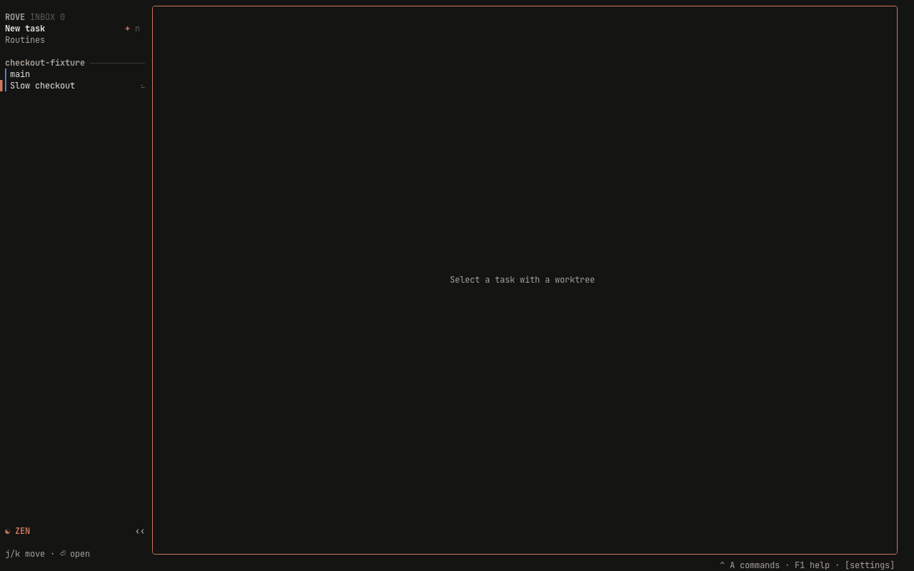
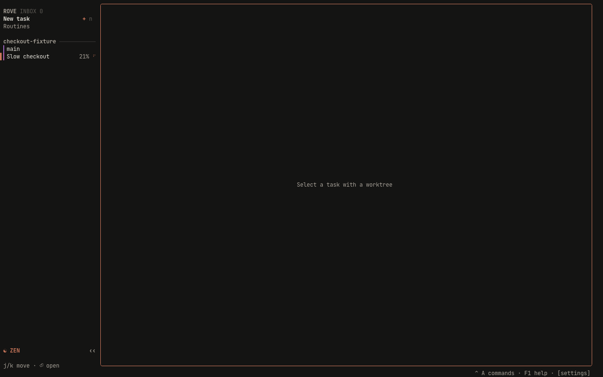

# Checkout progress evidence

PR #1385. Before runs `63ebececd0e968e73503fe92ba26ed2c517a4861`;
After runs `69d8c99323d6ecc2d6826f2aaaaae31634161ccc`.

- Capture: Chromium `/harness` → xterm.js → PTY sidecar → `dev:sandbox` → real OpenTUI and isolated daemon.
- Viewport: 1280×800, device scale factor 1.
- Fixture: `checkout-fixture`, 300 tracked text files, task `Slow checkout`.
  A Git smudge filter sleeps 60 ms per file. Git performs the checkout and
  produces its own progress; no task state or terminal output is fabricated.
- Theme: default `claude`, dark mode, default transparent background over the
  harness terminal background. Both captures use fresh isolated homes.

Before shows the active checkout spinner without a percentage. After shows
21% beside the spinner. Both checkouts finish successfully, and the capture
script verifies the contents of the final file.





## Reproduce

Install with `bun install --frozen-lockfile` and build with `bun run build`
in each source checkout. Run the capture script from the PR checkout, passing
the source root to execute. Use the reviewed base for Before and the PR head
for After:

```sh
bun packages/rove-harness/e2e/checkout-progress-capture.mjs /path/to/base .scratch/checkout-progress before 5583
bun packages/rove-harness/e2e/checkout-progress-capture.mjs "$PWD" .scratch/checkout-progress after 5573
```

Chromium must be installed for Playwright. The script creates a temporary
fixture home and repository, starts an isolated daemon and browser harness,
requests `api ensure-worktree`, and captures while the request is still running.
It stops its servers afterward and retains the temporary files for inspection.
The output directory contains screenshots, terminal buffers, server logs, and
checkout results. The observed percentage can vary with machine speed.
