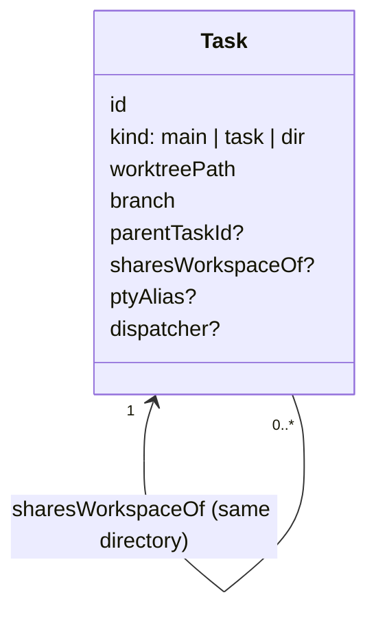

# Child tasks: one conversation per task

## 1. The model

A Task is **one engine conversation**: its `tab-1`. A second conversation is a
**child Task**, shown under its parent in the sidebar. A child either **shares
the parent's directory** or gets **its own worktree**, chosen at spawn time.
Lineage is `Task.parentTaskId`. Report routing stays in `Task.dispatcher`,
which is a separate field.

The code keeps the name *Task*. Renaming it to *Session* is a separate change.

| Before | Now |
|---|---|
| A Task holds N engine tabs in one directory | A Task holds one engine conversation. Other conversations are child Tasks |
| `ctrl+t`, `ctrl+e`, `send --tab new`, `tab-new --kind engine`, and the web `+` add an engine tab | The same entry points create a **shared child Task** (in the TUI once the task's own engine tab has a live PTY or a transcript; before that the pick is the task's own first conversation) |
| Sidebar: project → task → tab rows | Sidebar: project → task → child tasks |
| `rove api add` from inside a task makes a flat sibling | `rove api spawn` makes a child. `add` still makes top-level tasks |

Top-level tasks in a git repo still get their own worktree by default.

## 2. Data



- `parentTaskId` is the tree link, and it is **one level deep**. A
  conversation started from a child becomes that child's sibling: its
  `parentTaskId` is the top-level task (`lineageRootId`). Its directory still
  follows the child that started it (shared or cut from that child's branch
  tip), and `dispatcher` still reports back to that child. Deleting a parent
  promotes its children to top level.
- `sharesWorkspaceOf` is set on a child that runs in another task's directory.
  That other task is the **workspace owner**.
  - A shared child of a managed `task` keeps `kind: "task"` with the owner's
    path and branch.
  - A shared child of `main` or `dir` is stored as `kind: "dir"`, so it never
    counts as a second main, a project, or a Scratch row.
- `ptyAlias` exists only on children created by migration (§5): the child's
  conversation is still the hosted PTY `<parentId>::<tabId>`.

## 3. Spawning a child

`rove api spawn` from inside a task, or the TUI and web entry points:

| Call | Directory |
|---|---|
| `spawn` (default, `--worktree`) | new worktree, branch cut from the **parent's current branch tip** |
| `spawn --no-worktree` | shares the parent's directory |

- `--parent` defaults to the caller, verified the same way as `dispatcher`.
  `dispatcher` is stamped, so the child reports back with bare `send`.
- `--base-branch` overrides the cut point. A child always runs on the parent's
  machine.
- Uncommitted changes are never copied. The reply carries `parentDirty`.

| Parent directory | `--no-worktree` | `--worktree` |
|---|---|---|
| Rove worktree | same dir | worktree from the parent's branch tip |
| Main checkout | same dir | worktree from the checkout's HEAD |
| `dir` inside a git repo | same dir | worktree at the git toplevel; the child's cwd is the same relative subpath |
| `dir`, not in a git repo | same dir | error `NOT_A_GIT_REPO` |

**Symlinked repos.** Top-level entries of the parent directory that are
symlinks to a git toplevel outside it are not isolated by a worktree of the
root, because git copies the link.

- The reply lists them as `sharedLinks`.
- `--isolate-in <link>` cuts the worktree in the linked repo instead.
  A name that is not such a link fails with `NOT_A_LINKED_REPO`.

## 4. Deletion and attribution

- **A directory is removed only when no remaining task points at it** (a path
  refcount). Deleting a shared child never touches the directory. When the
  owner goes and sharers remain, ownership passes to the first sharer.
- **A branch goes with the last row on it.** `--delete-branch` on a row that
  is not the last one on its directory keeps the branch and parks the request
  on a surviving row, so the last row to leave honours it (still `-d`, never
  forced). `--delete-remote` is never pushed while another task holds the
  branch or directory, and the reply says which task. Renaming a branch
  renames it on every row of the directory.
- **Rows deleted together are gated together.** Preparing a deletion takes the
  path lock of every directory it touches, so an owner and its sharers deleted
  at the same moment cannot each skip the dirty gate for the other. A spawn
  whose checkout fails mid-way removes the worktree and the branch it cut.
- **Deleting a task with children:**
  - The TUI shows one dialog in place of the plain confirm: "<task> has N child
    tasks" with Promote children (default, focused), Delete with children, and
    Cancel. A task without children keeps the plain confirm.
  - After the delete the TUI stops the PTYs of the tasks the daemon reports
    (`deleted`/`teardown`), never a set it worked out itself, so an older daemon
    that ignored `cascade` does not lose its children's sessions.
  - The API promotes by default; `delete --cascade` deletes the subtree.
  - Each removed worktree still passes the dirty gate.
- **Attribution never guesses between rows on the same path.** Hooks and
  `rove api` resolve a task from `ROVE_TASK_ID`/`ROVE_TAB_ID`, honoring
  `ptyAlias`. A cwd-only fallback prefers the workspace owner.
- **`read-output` without `--tab`** reads the task's own conversation, not the
  newest session in the directory.

## 5. Migration of existing tasks

The daemon runs this once per boot, after the task index and the tab store
load and before any client connects. A task with more than one engine tab keeps
its canonical engine tab (`tab-1` when it is an engine tab, else the first).
Each other engine tab becomes a shared child task, in the order of the parent's
tab list. Viewport tabs (`ptyTask` onto another task's session) are not
conversations and never move.

- A tab whose hosted PTY is alive keeps running. The child gets
  `ptyAlias: { taskId: parent, tabId }`, and nothing is re-keyed or killed. Its
  own tab list holds one engine tab with the same id, a viewport onto
  `<parent>::<tabId>`.
- A dead tab with a `sessionId` (or a freeze-restored corpse) becomes a child
  whose `tab-1` resumes that conversation.
- A dead tab with a transcript (`spawned`) but no `sessionId` we know (kimi,
  codex mint their own) becomes a child that continues from the directory.
- A dead tab that never ran is dropped and noted in `daemon.log`.
- An unreadable PTY host defers the whole pass to the next boot, so a live tab
  is never filed as dead. So does a missing host while frozen sessions wait on
  disk: they come back as corpses when it starts.
- A crash between creating a dead tab's child and seeding its tab leaves an
  empty child; the next boot reuses it (same parent and title) instead of
  minting a second.

Shell, editor, and content tabs stay with the task that owns the directory.
A migrated tab leaves the parent's tab list, so a task with one engine tab left
plans nothing and a second pass is a no-op.

**While aliased.** The boot PTY sweep and task deletion treat `<parent>::<tabId>`
as the child's: deleting the parent promotes the child and leaves the PTY
running, deleting the child ends it, and closing its only tab ends it. The
parent no longer lists that PTY as one of its tabs or counts it as running.

Every reader and writer of a hosted PTY honours the alias, not only the tab
list. The parent never resolves to the PTY (`send`, `interrupt`, quota resume,
gate answers, routines, `read-output`, `context` liveness), and the child
resolves to it for all of them. The PTY's environment still names the parent,
so a verified session is mapped through the alias before it is used as an
identity: the `dispatcher` a child stamps on its own children, the `[ROVE PEER]`
reply address, gate identity and the audit line of `delete` all name the child
on its aliased tab. Exit records and activity for that PTY are the child's too,
including a death record that arrives after the alias was released, as long as
the death happened before the release.

**When the PTY ends.** The daemon clears `ptyAlias` the next time it sees the
session gone, dead or freeze-restored. The child's viewport tab becomes an
ordinary `tab-1` pinned to its last `sessionId`, so the next open resumes in
`<child>::tab-1`. An engine that exits into its login shell leaves the session
alive, so the alias stays.

## 6. Sidebar

```text
rove
  main                    checkout
  refactor sidebar
    ├ check types         ⑂ shared
    └ port tree builder   ⎇
  fix flaky test
```

- Children indent under their parent and collapse. The fold persists across a
  TUI restart (`sidebar.collapsedTasks` in the TUI's KV store).
  - A collapsed parent shows the child count and the most urgent child state.
  - Indentation stops growing at 3 levels.
- Each child shows a marker: shared directory (`⑂`) or own worktree (`⎇`).
- Engine tabs are no longer sidebar rows. Shell and other non-engine tabs live
  in the task's tab strip.
- **A row is a conversation, so it is named like one.** Every task row, top-level
  and child alike, reads: the engine session's own title (live from the pty host,
  else the recorded one), else the task title, else the branch. An engine's bare
  product name ("Claude Code") is not a title. A `main` row keeps its live HEAD
  and a `dir` row its directory, unless the conversation is named. Search still
  finds a row by its branch.
- Project rows, Scratch, the routine fold, and the machine layer are unchanged.
