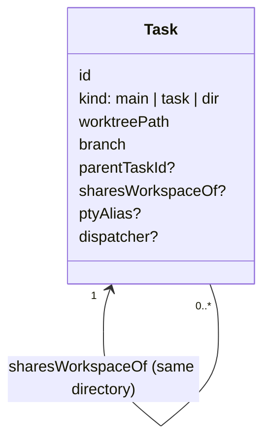

# Child tasks: one conversation per task

## 1. The model

A Task is **one engine conversation**: its `tab-1`. A second conversation is a
**child Task**, shown under its parent in the sidebar. A child either **shares
the parent's directory** or gets **its own worktree**, chosen at spawn time.
Lineage is `Task.parentTaskId`. Report routing stays in `Task.dispatcher`,
which is a separate field.

The code keeps the name *Task*. Renaming it to *Session* is a separate change.

| Before | Now |
|---|---|
| A Task holds N engine tabs in one directory | A Task holds one engine conversation. Other conversations are child Tasks |
| `ctrl+t`, `ctrl+e`, `send --tab new`, `tab-new --kind engine`, and the web `+` add an engine tab | The same entry points create a **shared child Task** |
| Sidebar: project → task → tab rows | Sidebar: project → task → child tasks |
| `rove api add` from inside a task makes a flat sibling | `rove api spawn` makes a child. `add` still makes top-level tasks |

Top-level tasks in a git repo still get their own worktree by default.

## 2. Data



- `parentTaskId` is the tree link. Deleting a parent promotes its children to
  the parent's own parent, or to top level.
- `sharesWorkspaceOf` is set on a child that runs in another task's directory.
  That other task is the **workspace owner**.
  - A shared child of a managed `task` keeps `kind: "task"` with the owner's
    path and branch.
  - A shared child of `main` or `dir` is stored as `kind: "dir"`, so it never
    counts as a second main, a project, or a Scratch row.
- `ptyAlias` exists only on children created by migration (§5): the child's
  conversation is still the hosted PTY `<parentId>::<tabId>`.

## 3. Spawning a child

`rove api spawn` from inside a task, or the TUI and web entry points:

| Call | Directory |
|---|---|
| `spawn` (default, `--worktree`) | new worktree, branch cut from the **parent's current branch tip** |
| `spawn --no-worktree` | shares the parent's directory |

- `--parent` defaults to the caller, verified the same way as `dispatcher`.
  `dispatcher` is stamped, so the child reports back with bare `send`.
- `--base-branch` overrides the cut point. A child always runs on the parent's
  machine.
- Uncommitted changes are never copied. The reply carries `parentDirty`.

| Parent directory | `--no-worktree` | `--worktree` |
|---|---|---|
| Rove worktree | same dir | worktree from the parent's branch tip |
| Main checkout | same dir | worktree from the checkout's HEAD |
| `dir` inside a git repo | same dir | worktree at the git toplevel; the child's cwd is the same relative subpath |
| `dir`, not in a git repo | same dir | error `NOT_A_GIT_REPO` |

**Symlinked repos.** Top-level entries of the parent directory that are
symlinks to a git toplevel outside it are not isolated by a worktree of the
root, because git copies the link.

- The reply lists them as `sharedLinks`.
- `--isolate-in <link>` cuts the worktree in the linked repo instead.
  A name that is not such a link fails with `NOT_A_LINKED_REPO`.

## 4. Deletion and attribution

- **A directory is removed only when no remaining task points at it** (a path
  refcount). Deleting a shared child never touches the directory. When the
  owner goes and sharers remain, ownership passes to the first sharer.
- **Deleting a task with children:**
  - The TUI shows one extra dialog. The default is to promote the children; the
    alternative deletes the whole subtree.
  - The API promotes by default; `delete --cascade` deletes the subtree.
  - Each removed worktree still passes the dirty gate.
- **Attribution never guesses between rows on the same path.** Hooks and
  `rove api` resolve a task from `ROVE_TASK_ID`/`ROVE_TAB_ID`, honoring
  `ptyAlias`. A cwd-only fallback prefers the workspace owner.
- **`read-output` without `--tab`** reads the task's own conversation, not the
  newest session in the directory.

## 5. Migration of existing tasks

At load, every task with more than one engine tab keeps its canonical engine
tab. Each other engine tab becomes a shared child task:

- A tab whose hosted PTY is live keeps running. The child gets
  `ptyAlias: { taskId: parent, tabId }`, and nothing is re-keyed or killed. The
  parent stays in the index, so the daemon's orphan sweep leaves the PTY alone.
- A dead tab with a `sessionId` becomes a child whose `tab-1` resumes that
  conversation.

Shell, editor, and content tabs stay with the task that owns the directory.

## 6. Sidebar

```text
rove
  main                    checkout
  refactor sidebar
    ├ check types         ⑂ shared
    └ port tree builder   ⎇
  fix flaky test
```

- Children indent under their parent and collapse.
  - A collapsed parent shows the child count and the most urgent child state.
  - Indentation stops growing at 3 levels.
- Each child shows a marker: shared directory (`⑂`) or own worktree (`⎇`).
- Engine tabs are no longer sidebar rows. Shell and other non-engine tabs live
  in the task's tab strip.
- Project rows, Scratch, the routine fold, and the machine layer are unchanged.
