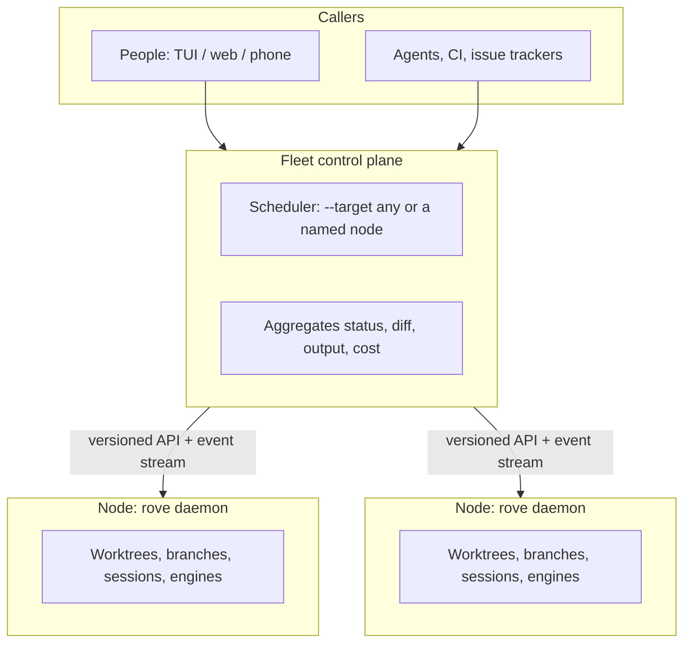

# Fleet direction — brief and gap analysis

> Status: **Proposed.** Owner brief, mapped against `main` at v0.9.250
> (`c94aa1b2`). Until it is accepted, the pages under
> [Docs this supersedes](#docs-this-supersedes-on-acceptance) still describe
> current behavior.

## Positioning

A self-hosted dispatch layer for coding agents: across machines, across
engines, callable by people and by agents.

Rove stops positioning itself as "another TUI for parallel agents". Parallel
sessions and worktree isolation are being absorbed by first-party vendor
products. Rove takes the ground vendors won't:

- **Headless.** Agents stay resident on a machine with no terminal window
  attached. The TUI is one client for watching and steering, not the host.
- **Your compute.** Agents run on machines the user controls (devbox, VPS,
  intranet host), not a vendor's cloud sandbox. The benefits:
  - code never leaves the network
  - the environment is real: databases, private dependencies, GPUs,
    internal services
  - concurrency and cost are the user's own call
- **Engine-neutral.** Claude Code, Codex, Gemini and others plug in as
  equals. No vendor will build this.

## Target architecture

The three layers:

1. **Node**, per machine, already exists: one daemon per machine owns
   worktrees, branches, sessions and engine processes.
2. **Fleet**, new: one control plane dispatches across nodes, aggregates
   their state, and lets a person review and land from anywhere.
3. **API**: the same versioned contract serves people, agents, CI and issue
   trackers. It extends `rove api` and keeps child-to-parent reporting.

## Headline

Most of the Node layer and the first third of Fleet already ship. The gap is
not a missing transport. **The daemon is not yet the only actor:** the TUI
and the `rove api` CLI process still do these themselves:

- spawn engines
- deliver prompts
- write tab state
- run git

A verb whose side effects run in the caller's process cannot be pointed at
another machine. So brief step 1 (daemon/TUI split) is the real prerequisite
for step 2, exactly as ordered. Its scope, though, is "move side effects into
the daemon", not "add an API".

## Node — today vs. brief

| Brief asks | Today | Gap |
|---|---|---|
| A daemon per machine owns worktree, branch, session and engine | The daemon is the index's single writer (`rove-daemon/src/daemon/server.ts`). Engine children belong to the standalone PTY Host, which survives daemon restarts. | The **caller** builds the launch argv (`src/engine/session-launch.ts`) and talks to the PTY Host directly: the TUI via `tui/panes/terminal/pty-hosted*.ts`, the CLI via `cli/api/runtime.ts`. |
| Headless, resident agents | The daemon is refcounted on attached GUIs: it self-stops 3s after the last GUI leaves (`daemon/lifetime.ts`). It stays up only through two holds, a live PTY session or an enabled automation. An autospawned daemon waits 60s for its first GUI. | **Done:** `rove daemon start --resident` never idle-stops, and residency survives restarts ([CLI.md](../CLI.md#headless-hosts---resident)). |
| A stable local API | Unix socket, JSON lines, protocol v5. `hello` negotiates a range, minimum v2 (`daemon/protocol-compat.ts`). | Nothing needed at the node level. HTTP adds no value here: remote reach is SSH forwarding or the bridge (below). |
| The TUI holds no state | It holds no task index; every write goes through `RemoteOrchestrator`. | Still outside the daemon: `terminalTabs` in `state.json` has three writers (TUI `kv-core.ts`, CLI `tab-snapshot.ts`, bridge). File-tree, diff and PR-prompt git runs in the TUI. The machine hub runs in the TUI process. Dev reset deletes `tasks.json` directly. |
| Works with no TUI attached | — | **Done:** `ui.prompt` answers `no-gui` at once and `tab.open`/`tab.close` report `reached`. `terminalTab.close` already skips its TUI ack with no GUI, and `attention.list` serves the inbox headless. |

## Fleet — today vs. brief

**Machines v0 is shipped** ([`MACHINES.md`](../MACHINES.md)). It is the
brief's Node + Fleet shape, and it is read-only:

- `rove machine add <ssh-target>` registers a machine running Rove. SSH
  forwards that machine's daemon and PTY sockets over ControlMaster
  (`src/machines/tunnel.ts`). SSH is both transport and auth, which is the
  "SSH forwarding first" option in the brief.
- `MachineHub` runs one `RemoteOrchestrator` per machine
  (`src/machines/hub.ts`) inside the TUI and the bridge. The sidebar and
  `rove --web` show every machine's tasks.
- `rove api list` merges across machines (`src/machines/api-merge.ts`).
  Every write to a remote task refuses with `NOT_YET_SUPPORTED_REMOTE`.
  Opening a remote session is not wired.
- Windows cannot forward unix sockets, so it is unsupported.

| Brief asks | Today | Gap |
|---|---|---|
| `add --target any\|<node>` | **Done** as `add --machine any\|auto\|<alias>`. Each node reports its load, engines, tags and repos from its own daemon (`node-status`). A center picked from `fleet.centers` (first that answers) schedules: by load for `any`, by prompt match or a `fleet.router` endpoint for `auto` ([MACHINES.md](../MACHINES.md#let-a-center-pick-the-machine)). | The center is stateless, so failover is "next candidate", with no election protocol. Each candidate must register the workers itself. |
| Aggregate status, diff, output | Status is aggregated. Diff panes show `on <host>` for a remote task. | Diff and output need daemon read verbs that work over the forwarded socket. |
| Aggregate cost | Tokens per turn exist: `agent-turns-store.ts`, and `rove api agent-turns` sums them. Only claude and codex implement `readTurns`. There is no USD figure anywhere. | Pricing is vendor data, so the engine adapter owns it (engine-owned UI data rule), not the control plane. |
| Review and land from a laptop or phone | `rove api land` uses `merge --no-ff` or `--squash` with preflight and conflict reporting (`orchestrator/land.ts`). `update --report-branch/--report-pr` records results. `rove --web` plus the bridge (bearer token, Tailscale and CF Access presets) already reach a phone. | Remote `land` is a write, so it is blocked by `NOT_YET_SUPPORTED_REMOTE`. |

`rove add --remote` follows the **opposite** topology: one local daemon
drives git and the engine on a host with no Rove. It is experimental and off
by default, and its engine launch regressed
([`remote-topology-status.md`](./remote-topology-status.md)). The brief's Node
model makes it redundant.

## API — today vs. brief

- **One contract (done).** The `rove api` verb registry is the contract, run
  by one executor (`src/cli/api/invoke.ts`) over three transports: the CLI,
  the daemon's `api.invoke` request and the bridge's `api.invoke` op. One
  `ROVE_API_VERSION` (`rove-plugin-sdk/src/contract.ts`) is reported by
  `schema`, both `hello`s and every envelope ([`API.md`](../API.md#one-contract-three-transports)).
  The daemon's granular RPCs (protocol v5) stay as internal plumbing, and the
  bridge's older per-op wrappers stay for the shipped phone apps.

  Because `api.invoke` runs the verb **inside** the daemon that answers, a
  verb sent over a machine's forwarded socket now does its work on that
  machine: this is the seam step 2 needs to replace
  `NOT_YET_SUPPORTED_REMOTE`.
- **Events.** `watch` streams engine-state transitions only. Its own header
  calls it "deliberately not a general event bus". There are no sequence
  numbers and no replay (`daemon.md` D4, deferred). The plugin event
  vocabulary (`rove-plugin-sdk/src/contract.ts`) names what the brief lists:

  | Brief event | Existing event |
  |---|---|
  | done | `turn.complete`, `task.landed` |
  | needs input | `attention.question`, `attention.permission` |
  | failed | `turn.failed`, `tool.failed` |
  | rate-limited | `agent.rate-limited`, `quota.exhausted` (auto-resume armed) |
  | rate-limit recovered | `agent.rate-limit-recovered` (first completed turn after the limit), `quota.resumed` (continue prompt sent) |
- **Idempotency.** There are no request ids and no idempotency keys on `add`,
  `send` or `land`.
- **Child-to-parent reporting.**
  - `add` stamps `dispatcher:{taskId,tabId}` on the child.
  - A bare `send` in the child pastes into the dispatcher tab with a
    `[ROVE PEER]` prefix.
  - `update --status/--report-*` sets a structured `report`.

  All of it assumes one machine: delivery is a PTY paste from the caller's
  process, and `origin` is stamped by the client, never the daemon.
- **Docs and skill exist:** [`API.md`](../API.md), [`CLI.md`](../CLI.md) and
  `.agents/skills/rove`. Step 3's "write it down" is an update, not a new
  page.

## Engines and the optional differentiator

Neutrality already ships:

- 7 built-in full adapters (`src/types/vendor.ts`)
- 12 contrib screen-scraped engines (`engine/contrib-engines.ts`)
- user and plugin engines

Gemini is contrib-only: it has no history and no usage. The race primitive
also exists: `add --count N`, `--agents claude:2,codex:1`, `collect --group`,
`delete --group`, and auto-routing tiers. Multi-engine racing with automatic
review only needs the judge.

## Shrinking the surface

Plugins can now contribute React pages (`[[pages]]`, [`plugins.md`](./plugins.md)),
rendered in the content pane on the TUI's own React through a versioned
host API. **Kanban and Issues have moved out of core** into built-in plugins
(`src/bundled-plugins/`) that use only that API and can be turned off in
Settings → Plugins. The board logic and copy they share with `rove --web`
stay in core.

| Feature | Size | Coupling | Recommendation |
|---|---|---|---|
| Kanban, Issues | ~1.2k + ~0.3k lines of page UI | **Done**: built-in plugins behind the page host API | The issue store is this repo's own backlog ([`WORK-TRACKING.md`](../WORK-TRACKING.md)), so it stays in the daemon. |
| Routines | ~2k daemon + ~2.4k UI/CLI | Imported by daemon collectors, handlers and contracts; one of the daemon's idle-stop holds | Scheduled dispatch is arguably core to a dispatch layer. Keep the daemon scheduler and move only the page. |
| Themes | ~1.7k | Theme context used across ~110 files; user themes already load as data | Keep in core. Moving it buys nothing. |
| Web/bridge, weixin | ~19k, ~1.4k | Already separate, lazy-loaded packages | Nothing to move. |

## Recommended sequence

This refines the brief's order. Each item below is a PR-sized slice.

**Step 1: the daemon becomes the only actor.**

1. **Resident mode.** *Done.* `rove daemon start --resident`, with systemd and
   launchd recipes in CLI.md.
2. **Daemon-owned session launch.** One daemon request builds the argv from
   `session-launch.ts` and drives the PTY Host. The TUI and `ApiRuntime`
   call it instead of launching themselves. This is the largest slice, and
   fleet writes depend on it.
3. **Daemon-owned delivery.** `send` and `prompt` pastes, and dispatcher
   reporting, run in the daemon.
4. **Daemon-owned terminal tabs.** One writer replaces three.
5. **Headless-safe GUI obligations.** *Done* (see the Node table).
6. **Daemon read verbs** for diff and changes, so review works over the wire.

**Step 2: Machines phase 2.**

- Route `rove api` writes for a remote-origin task through the forwarded
  socket.
- Add `add --target <machine>`, then `--target any` backed by a node-load
  verb. *Done:* `--machine <alias>|any|auto`, `node-status`, `fleet-status`.
- `land` runs on the node and pushes the branch.

`api.invoke` runs a verb inside the daemon that answers, so a verb sent over
a machine's forwarded socket already does its work on that machine. Slices
2–4 of step 1 are no longer prerequisites for step 2; they remain worth doing
so the TUI stops being a second actor.

**Step 3: API as product.**

- A version on every output. *Done:* one contract over CLI, socket and
  bridge, one `ROVE_API_VERSION`.
- One event stream with sequence numbers and replay that reuses the plugin
  event names.
- Idempotency keys on `add`, `send` and `land`.
- A fleet task address (`machine:taskId`), so child reports cross machines.

**Step 4: shrink.** Plugin pages exist; Kanban and Issues are built-in
plugins. Routines' page could follow; its scheduler stays core.

## Docs this supersedes on acceptance

- [`DESIGN.md`](../DESIGN.md) Mission: "Give one developer a terminal-native
  control plane…".
- [`cli-api.md`](./cli-api.md) §2 non-goals: no auth, token or network
  exposure on the daemon socket, and no "remote rove" mode (single-host
  scope).
- [`daemon.md`](./daemon.md):
  - §7 GUI-refcounted lifetime as the only mode
  - §10 "cross-machine attach" and "permission model" out of scope
- [`ARCHITECTURE.md`](../ARCHITECTURE.md) §1: the CLI and the TUI both drive
  the PTY Host directly. The PTY Host can stay the process owner; what moves
  is the caller that issues the launch.
- [`MACHINES.md`](../MACHINES.md) "What this release does not do yet" becomes
  the step 2 plan.
- [`remote-projects.md`](./remote-projects.md): its status changes to frozen
  or retired, depending on open question 4.
- `AGENTS.md` first line (product description).

## Open questions (owner)

1. **Who first:** individual multi-machine power users, or teams and platform
   engineering? *Recommendation: individuals.* SSH auth and Machines already
   serve them. Teams need the permission model `daemon.md` §10 rules out.
   Keep the step 3 contract (versioned, idempotent, evented) so team features
   are additive later.
2. **Where the control plane runs.** *Recommendation: no new service for the
   MVP.* The control plane is the client-side `MachineHub` it already is, in
   the TUI, bridge and CLI. Promote it to a resident node only when something
   must run with no client attached (CI dispatching `--target any`). Hosted
   comes later.
3. **How results reach the main repo.** *Recommendation: push the branch.* The
   git remote is already shared, `land` runs where the worktree lives, and
   `--report-branch/--report-pr` exist. Use patch transport only for a node
   without push credentials.
4. **`rove add --remote`:** freeze and retire in favor of Machines, or repair
   the engine launch? *Recommendation: freeze.*
5. **Routines:** core dispatch scheduling or a plugin? *Recommendation: the
   scheduler stays core and the page moves.*
6. **Kanban:** add page-level plugin UI, or rewrite as a PTY pane?
