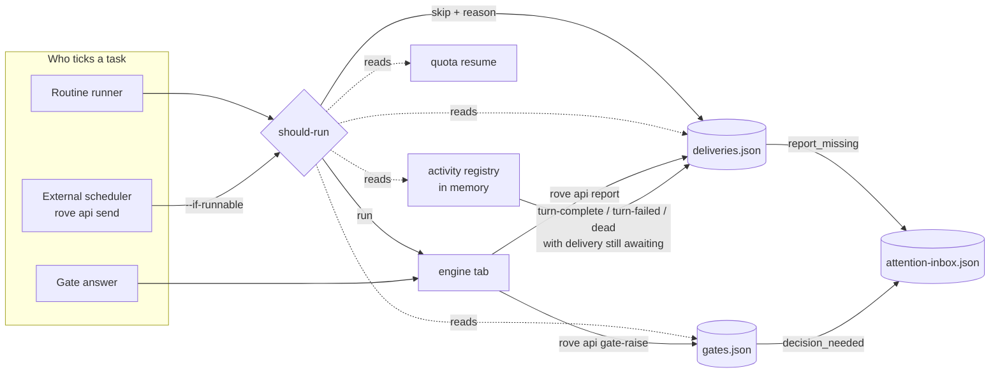
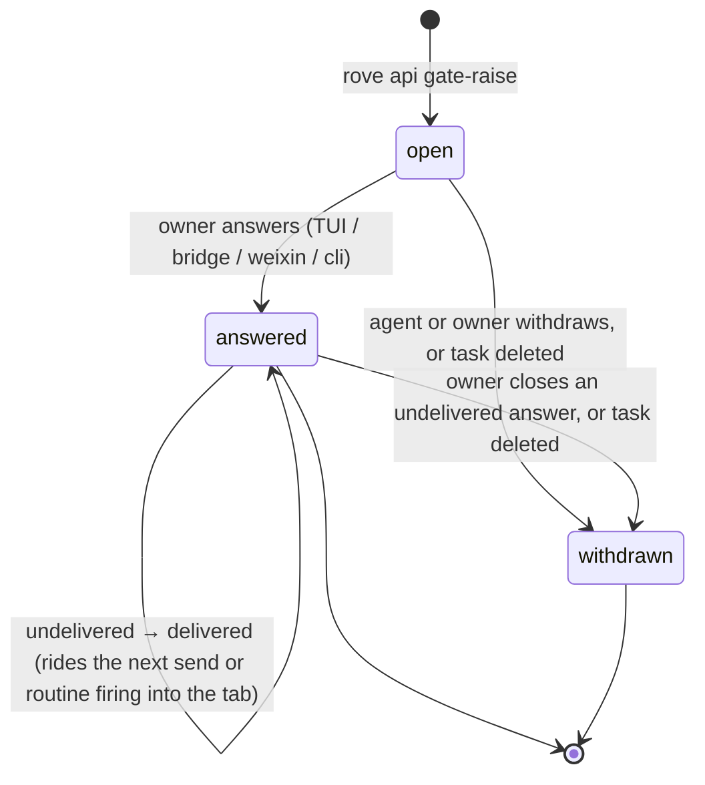

# Long-run controls — reports, should-run, decision gates

> Status: implemented. All three controls and their surfaces ship: hard
> reports (deliveries, `report`, `deliveries`, `send --expect-report`,
> `Task.requireReport`, `report_missing`), should-run (`should-run`,
> `send --if-runnable`, routine `skipped_blocked`, the quota-resume consult,
> `runnability` on `get-task`/`collect`) and decision gates (daemon, CLI, TUI,
> `rove-bridge` with the Android and iOS Inbox rows, and weixin). Three
> daemon-owned controls for tasks that run unattended (routines, standing
> sessions, and external schedulers that tick a task via `rove api send`). The
> owner decided the open questions at the bottom; what shipped differently
> from the spec is listed in the `Deviations — …` sections, in spec order.

## Problem

Observed in real long-running use:

1. A stale engine CLI returned 400 on every turn; three ticked tasks sat dead
   for hours. Another task pushed code, ended its turn without saying so, and
   sat idle for hours. Nothing in Rove distinguished "finished and reported"
   from "stopped".
2. With the engine rate-limited (weekly/5h quota), the scheduler kept ticking
   the task; every tick was a wasted turn.
3. Questions only the owner can answer were buried in repo `MEMO.md` files and
   long free-text reports; the owner had to go looking.
4. Those `MEMO.md` files grew without bound (one is 649 lines) because they
   carried both the decision backlog and the per-tick log.

The external watcher (a cron that runs `rove api collect` then `rove api send`)
can only guess at these after the fact. The facts live in Rove: activity state,
quota resets, pty exits.

## Shape

One new concept — a **delivery** — and one new store — **gates** — sit next to
the existing activity registry and attention Inbox. Should-run is a pure
function over state Rove already has plus those two.



## 1. Hard report — the delivery contract

### Delivery

A delivery is one prompt handed to one engine tab **with an expectation of a
structured report**. It is opt-in; ordinary chat typed into a terminal never
creates one.

```ts
interface Delivery {
  id: string                    // "d-<n>", monotonic per daemon home
  taskId: string
  tabId: string | null          // null until the tab is known (send --tab new, standing targets)
  source: "routine" | "send" | "gate-answer"
  automationRunId?: string      // source === "routine"
  gateId?: string               // source === "gate-answer"
  promptHead: string            // first 200 chars, for the list view
  at: string                    // ISO, when ARMED (before the paste)
  /** First turn-start seen after arming; a Stop before it belongs to an earlier prompt. */
  turnStartedAt?: string
  status: "awaiting" | "reported" | "missing" | "skipped"
  /** Why the expectation failed — set with status "missing". */
  missing?: { cause: DeliveryMissingCause; note?: string; at: string }
  /** Why should-run refused — set with status "skipped". */
  skipped?: RunnabilityVerdict
  report?: DeliveryReport
}

type DeliveryMissingCause =
  | "turn-complete" | "turn-failed" | "engine-dead" | "stalled"
  | "interrupted" | "session-end" | "rate-limited"

interface DeliveryReport {
  outcome: "done" | "partial" | "blocked" | "failed"
  summary: string               // what was done, ≤ 32k chars (see Deviations)
  evidence: string[]            // commits, PR urls, test commands + result, file paths
  next?: string                 // what the next tick should do
  at: string
}
```

Store: `<ROVE_HOME>/.rove/deliveries.json`, `{version:1, deliveries:[]}`, daemon
the only writer, newest 50 per task kept (same retention shape as
`automations.json` runs). Skipped ticks are deliveries with
`status:"skipped"`, so "what happened to every tick of this task" is one list.

### Who arms one

| Path | Arms a delivery when |
|---|---|
| Routine dispatch (`automation-dispatch.ts`) | Always. The run's `deliveryId` replaces the bare run id in the `[ROVE ROUTINE]` header. |
| `rove api send` | `--expect-report` is passed, **or** the task has `requireReport: true`. |
| Gate answer delivery | The task has `requireReport: true`. |

`requireReport` is a new optional `Task` field, set by `rove api add
--require-report` / `rove api update --require-report on|off`. External
schedulers either set it once on the task or pass `--expect-report` per tick.

The delivered prompt gets a one-line footer naming the verb and the id, the
same mechanism `withRoutineRunHeader` already uses:

```text
[ROVE] When this turn ends, report: rove api report --delivery d-41 --outcome done|partial|blocked|failed --summary … [--evidence …]… [--next …]
```

### Reporting

`rove api report --delivery ID --outcome … --summary … [--evidence X]… [--next …]`
(or `--json -` for the whole body). RPC `delivery.report`. A late report on a
`missing` delivery flips it to `reported` and clears its Inbox episode. A
report on a `reported` delivery replaces it (agents re-report after fixing).

`routine-respond --run` is subsumed: a routine run's response *is* its
delivery's report. `AutomationRun.response` becomes a read of the linked
delivery (see open question Q1).

The existing task-level `report` (`update --report-summary`) stays: it is the
task's current claim (branch/PR/summary) shown on cards, not a per-turn record.
`rove api report` also refreshes it from `summary`, so cards stay current
without a second call.

### Detecting a missing report

Checked at the three points where an engine stops working on a prompt. Each
matches the tab's `awaiting` deliveries by lineage, oldest first (see Deviations):

| Event | Where | Result |
|---|---|---|
| `turn-complete` hook | `handlers-engine-report.ts` | `missing`, cause `turn-complete`, only once the delivery's own turn-start was seen (see Deviations) |
| `turn-failed` hook / OSC `status.error` | same | `missing`, cause `turn-failed`, `note` = failure detail (the 400 case) |
| engine exit record | `pty-exit-watch.ts` | `missing`, cause `engine-dead`, `note` = last tail line |
| stall sweep (60 s daemon ticker) | new, beside `sweepAutomations` | `missing`, cause `stalled`: the delivery is older than 10 min and the tab's activity is neither `running` nor `permission_needed` |

`awaiting-input` (permission prompt) is **not** a stop: the delivery stays
awaiting and the existing `permission_needed` episode covers it.

Ordering is safe: `rove api report` is a synchronous tool call inside the
turn, so it lands before the engine's Stop hook fires. A report that races in
after `missing` is accepted (late report above).

The stall sweep is the backstop for signals that never arrive. An API error
does not reliably produce a hook: `StopFailure` exists only in newer Claude
Code builds (the stale-CLI 400 is exactly the case where it may be missing),
Codex installs no failure hook, and a prompt rejected before the turn starts
produces no `turn-start` at all. The sweep needs no engine cooperation: an
armed delivery that is not visibly being worked on is missing. The tab's
screen-classified error (`engine-screen.ts`) is attached as `note` when one
is available.

Coverage by engine:

| Engine | Clean stop | Failed turn | Process gone | No signal at all |
|---|---|---|---|---|
| Claude Code | `Stop` | `StopFailure` (new CLIs) | exit record | stall sweep |
| Codex | `Stop` hook | — (screen `■` line as note) | exit record | stall sweep |
| Kimi / pi / omp | `turn-complete` | `turn-failed` | exit record | stall sweep |
| OSC 7501 programs | `status.done` | `status.error` | exit record | stall sweep |
| no hooks | — | — | exit record | stall sweep |

### Inbox

New `AttentionInboxState` **`report_missing`**, keyed `\0delivery\0<deliveryId>`
so the next `turn-start` on the tab does not erase it (engine episodes are
keyed per tab and overwritten). Opening it jumps to the tab and does not clear
it; an explicit dismiss is the owner's "seen, carry on" and unblocks should-run
(below).

## 2. Should-run — runnability verdict

### Verdict

```ts
type RunnabilityVerdict =
  | { run: true }
  | { run: false; reason: SkipReason; detail?: string; until?: string; gateIds?: string[] }

type SkipReason =
  | "task-missing"
  | "awaiting-owner"      // open gate on the task
  | "report-missing"      // previous delivery ended unreported (not by a rate limit), not yet dismissed
  | "quota"               // rate_limited; `until` from quota-resume's reset or the usage cache; no known reset is not a skip
  | "engine-error"        // sticky `error` (turn-failed other/billing, auth)
  | "engine-dead"         // existing-tab target whose engine exited
  | "awaiting-permission" // permission_needed
  | "busy"                // running, or newest delivery still awaiting
```

`evaluateRunnability(taskId, tabId)` lives in a new daemon module, reads only
in-memory state (activity registry, quota-resume schedule, gates, deliveries),
and is evaluated in the order above — the first match is the reason, so the
owner sees the most actionable one.

Deliberate choices:

- **`engine-dead` for a standing routine session is not a skip.** The current
  revive path stays. But if the previous delivery went `missing` with cause
  `engine-dead`, `report-missing` already stops a crash loop.
- **`quota` clears itself** at `until`; `engine-error`, `report-missing` and
  `awaiting-owner` need a human. This is the line between "skip quietly" and
  "skip and say so".
- **`busy` prevents tick pile-up.** Today a tick pasted into a running engine
  queues behind the current turn. A skip is recorded and dropped — never held
  for later. Rove removed its deferred-prompt queue (#959) because held
  prompts sat unreleased for hours when headless, and this design must not
  bring one back.

### Where it plugs in

| Caller | Change |
|---|---|
| `runAutomationOnce` (`automation-runner.ts`) | After precheck, before `dispatchAutomation`, for existing-tab and standing targets (fresh-task targets have no prior state; only `quota` per vendor applies). New run status **`skipped_blocked`** with `blocked: RunnabilityVerdict`. `automationRunNeedsAttention` stays false for it — the underlying episode (gate, report_missing, rate limit, permission) is already in the Inbox, so the routine row must not double-alarm. `engine-dead` and `engine-error` have no episode of their own, so they are recorded `dispatch_failed` (keeping `blocked`) and alarm. |
| `rove api should-run --task-id ID [--tab T]` | New read verb, RPC `task.runnability`. Prints the verdict; exit 0 run, exit 3 skip. For external schedulers that want to decide themselves. |
| `rove api send --if-runnable` | The daemon evaluates and delivers inside one `send` handler (no check-then-send race). On skip it records a `skipped` delivery (when the send would have armed one) and returns `{skipped: verdict}` with exit 3. The one-line change for the external tick script. |
| quota-resume timer | Before auto-resuming a rate-limited task, consult the verdict minus `quota`: a task awaiting the owner is not resumed. |

### Clearing a block

Every human-needed reason has to be clearable from every surface the owner
uses, or a phone-only owner is stuck:

| Reason | Cleared by |
|---|---|
| `report-missing` | late `rove api report`; an explicit dismiss of the `report_missing` Inbox row (TUI `d`, bridge `attention.dismiss`, weixin `clear d-N`, `rove api attention-dismiss`). Opening or visiting the row does not |
| `awaiting-owner` | answering or withdrawing the gate |
| `engine-error` / `engine-dead` | the engine's next `turn-start` (any human message), or a restart |
| `quota` | time (`until`) |

### Records

Every skip writes its reason once: a routine skip into `AutomationRun`, an
external `--if-runnable` skip into `deliveries.json`. `rove api deliveries
--task-id ID` lists both kinds; `get-task` / `collect` gain
`runnability: RunnabilityVerdict` so a dashboard sees the same answer the
scheduler acted on.

## 3. Decision gates

### Gate

```ts
interface Gate {
  id: string                         // "g-<n>"
  taskId: string
  tabId: string | null               // the tab to answer into; null → task's first engine tab
  deliveryId?: string                // raised during this delivery
  question: string                   // ≤ 500 chars
  options: { key: string; label: string; detail?: string }[]   // 0..6; empty = free text only
  recommended?: string               // an option key
  context?: string                   // ≤ 4k chars: why it matters, what each option costs
  status: "open" | "answered" | "withdrawn"
  answer?: { option?: string; text?: string; by: "tui" | "bridge" | "weixin" | "cli"; at: string }
  handoff?: "delivered" | "undelivered"          // answer → engine
  createdAt: string
}
```

Store: `<ROVE_HOME>/.rove/gates.json`, `{version:1, nextId, gates:[]}`. Open
gates are never pruned; closed ones keep the newest 200.

`gates.json` is the only source of truth for a decision. Not the issue store:
an issue is repo backlog with no task, options or answer routing, and its
`hold` status means "parked", not "asking". Not an `AttentionInboxItem`
either: Inbox items are deleted on open, on dismiss, and replaced on the tab's
next turn — exactly wrong for a question that must survive until answered.
The Inbox shows open gates as a **projection** (below), never stores them.

### Lifecycle



- **Raise:** `rove api gate-raise --task-id ID [--tab T] --question … [--option key=label]… [--recommend key] [--context …]`.
  Raising counts as the current delivery's report with `outcome: "blocked"`,
  so an agent that asks and stops is not also flagged `report_missing`.
- **Answer:** `rove api gate-answer --gate g-12 (--option b | --text …)` (both
  allowed). RPC `gate.answer` persists the answer **first**, then hands it to
  the engine tab as:

  ```text
  [ROVE GATE g-12 answered] <question>
  Answer: b — <label>
  Note: <text>
  ```

  through the same delivery path as `send` (arming a delivery when the task
  requires reports). No live engine → `handoff: "undelivered"`. There is no
  queue and no retry timer (see #959): the answer is prepended to the **next**
  `rove api send` or routine firing into that tab, and nothing else. A prompt
  typed into the TUI, a TUI revive and `session.deliver` do not carry it, and
  nothing pastes on session start. Should-run returns `run: true` for a task
  whose only gate is answered but undelivered, so the next tick carries it.
  Until then the gate list and the owner's surfaces show "answered, engine not
  running".
- **Withdraw:** `rove api gate-withdraw --gate g-12`, or `d` on the Inbox row.
  Closes an open gate, or an answered one still `undelivered` (the owner's
  explicit close; the answer is dropped). Task deletion closes both kinds.
- **List:** `rove api gates [--repo P] [--task-id ID] [--status open]`.

### Surfaces

| Surface | Read | Answer |
|---|---|---|
| Inbox (TUI) | `attention.list` merges a **`decision_needed`** row per open gate, keyed `\0gate\0<id>`, computed from `gates.json` on every snapshot. `turn-start` cleanup, open-to-clear and `attention.dismiss` do not apply to it. Row shows the question. | Enter on the row opens a decision dialog instead of jumping to the tab: options (recommended marked), free-text note, submit. Built on the existing dialog selector, not a new control. No new chord; if one turns out to be needed it ships PROPOSED for owner sign-off. |
| `rove-bridge` (Android, iOS) | `TasksPayload` gains `gates: GateRow[]` (open ones); pushed on change like `attention`. | New op `gate.answer` in the allowlist. Tapping a gate row opens an answer sheet with option buttons; it must not take the existing tap-dismisses path (Android `InboxScreen.kt`, iOS `InboxState.swift`). |
| `rove-weixin` | `gates` command lists open gates with option keys. | `answer g-12 b [note]`. |
| CLI | `rove api gates`, `context` includes open gates. | `gate-answer`. |

### Effect on should-run

An open gate on a task → `awaiting-owner`. Answering it delivers the answer,
which *is* the next tick; the scheduler's next firing then sees `busy` or a
fresh state.

## What this does not do

- No automatic compaction of `MEMO.md` (symptom 4 is out of scope for Rove
  code). What replaces it: open decisions live in `rove api gates`, and the
  recent per-tick log is `rove api deliveries --task-id ID --limit N` (each
  entry: outcome, summary, evidence, next). A loop prompt reads those instead
  of the whole MEMO. Rewriting the loop prompts and trimming existing MEMO
  files is on the caller's side (hermes), as is switching the tick script to
  `send --if-runnable --expect-report`.
- No model-judged "is this report good enough". Rove checks a report exists
  and is well-formed; quality stays with the owner.
- No change to tasks without `requireReport` or `--expect-report`: interactive
  use is untouched.

## Delivery plan

Stacked PRs, each green on its own, none merged or released without the
owner:

1. **Design** — this file.
2. **Deliveries + report** — `deliveries.json`, `rove api report` /
   `deliveries`, `send --expect-report`, `Task.requireReport`, missing detection
   at turn-complete / turn-failed / exit, `report_missing` Inbox state + TUI
   row, routine runs linked to deliveries. Docs: API, ROUTINES, ORCHESTRATION;
   agent skill bumped.
3. **Should-run** — `evaluateRunnability`, `rove api should-run`,
   `send --if-runnable`, routine `skipped_blocked`, quota-resume consult,
   `runnability` on `get-task`/`collect`.
4. **Gates (daemon, CLI, TUI)** — `gates.json`, raise/answer/withdraw/list,
   `decision_needed` Inbox state, decision dialog, `awaiting-owner` verdict.
5. **Gates on the bridges** — `rove-bridge` protocol + op, Android and iOS
   Inbox rows, weixin commands.

All five are implemented in this stack, in this order.

## Decisions

- **Q1. `routine-respond`.** Decided: one store. `AutomationRun` gains
  `deliveryId`, `response` is read from that delivery's report, and
  `routine-respond --run ID --text …` stays as the routine-flavoured spelling
  that writes the same report (`outcome: "done"`, `summary` = text), so the
  documented verb and any run already in flight keep working. Runs from
  before this change keep their stored response.
- **Q2. Does `report-missing` block the next tick?** Decided: yes, until a
  late report or an explicit dismiss (opening or visiting the row never
  clears it) — a loop that stopped reporting is usually broken, and more
  ticks bury the first failure. The blocking belongs to the should-run layer.
  The reports section only records the `missing` state and raises the Inbox
  row; it does not skip any tick.
- **Q3. `busy` skip.** Decided: skip when the engine is running (should-run).

## Deviations — reports

- **Summary cap is 32,000 characters, not 2k.** `routine-respond` already
  accepted 32,000 characters and its runs now share the delivery store, so one
  cap avoids a second limit on the same text. Evidence is capped at 50 items
  of 2,000 characters; `next` at 4,000.
- **A `turn-complete` marks a delivery missing only after that delivery's own
  `turn-start` was seen.** A prompt pasted while the engine is mid-turn queues
  behind it, and the earlier prompt's Stop would otherwise mark the new
  delivery missing. `turn-failed` and engine exit apply at any time.
- **Turn events match by lineage, not recency.** A tab runs its prompts in
  arming order. `turn-start` stamps the OLDEST awaiting delivery without a
  `turnStartedAt`; `turn-complete` settles the OLDEST one that has it. With A
  running and B queued behind it, A's Stop marks A missing and leaves B for its
  own turn. `turn-failed` ends the oldest started delivery, else the oldest
  awaiting one (a rejected prompt never starts a turn); an engine exit ends
  every delivery pinned to that tab.
- **The stall sweep marks the delivery it iterated,** by id, so a stale A never
  flags a fresh B on the same tab.
- **The stall window starts at the later of arming and daemon boot.** Activity
  is in memory, so right after a restart no tab has a state. Measuring from
  boot avoids flagging work still in flight, and an engine that never emits
  hooks is still caught 10 minutes after boot.
- **`turn-interrupted` and `session-end` end the delivery's turn,** with causes
  `interrupted` and `session-end`, under the same lineage rule as
  `turn-complete`.
- **`turn-failed` with `failure: rate_limit` is cause `rate-limited` and raises
  no `report_missing` row.** The engine's own `rate_limited` episode already
  covers it, quota-resume continues the turn, and a late report still flips
  the delivery to `reported`. Should-run ignores such a delivery for both
  `report-missing` and `busy`: the engine's quota is the real block, and it
  names its own reset (see Deviations — should-run).
- **A send that is not confirmed keeps its delivery when the prompt may still
  land.** `delivered: false` with a `reason` is a fresh launch whose argv
  carries the prompt but whose engine was not observed in time: the delivery
  stays `awaiting` so a report lands or the sweep catches it. Only a throw, or
  `delivered: false` with no reason (no live engine to write to), cancels it.
  `add --require-report` shares the rule.
- **Pre-#1247 Android and iOS builds are unsupported for `report_missing`
  rows.** They key inbox rows by task and tab and cannot dismiss by delivery
  id (the Android client is an unreleased MVP).

## Deviations — should-run

- **`send --if-runnable` is atomic for the check and the claim, not for the
  paste.** The paste is made by the calling CLI process (it needs the pty
  host and the per-tab delivery lockfile), so no daemon-side critical section
  can span it. Instead `send.admit` evaluates the verdict, claims the tab and
  arms the delivery with no `await` between the verdict and the claim; the
  claim reads as `busy` to every other should-run on that tab (a `--tab new`
  claim excepted, below) until `send.release` or a
  90-second expiry (a CLI that died between the two). An unarmed paste keeps
  the claim 15 more seconds so the engine's own `turn-start` can land; an
  armed one needs no grace, its awaiting delivery already says `busy`. The
  guarantee is "no two `--if-runnable` ticks both pass", not "no plain
  `send` can interleave".
- **A `--tab new` claim is its own slot.** It covers only the task rollup
  (`should-run` without `--tab`), never an exact `--tab tab-N` send on the
  same task: the new tab is not any existing tab, and `--tab new` itself skips
  the busy check, so the block would only ever run one way. An armed
  `--tab new` send is not fully covered: its delivery has no tab until the
  paste lands and the CLI binds it (`setTab`), and a tab-less delivery matches
  every tab, so exact-tab ticks read `busy` for that window (seconds, not the
  claim's expiry).
- **An unreported tick blocks until a late report or an explicit dismiss.**
  Opening or visiting the `report_missing` row (TUI, phone) never clears it;
  only a late `report` or an explicit dismissal does (TUI `d` on the row,
  bridge `attention.dismiss`, weixin `clear d-N`, `rove api attention-dismiss`).
  Dismissal is recorded on the delivery (`dismissedAt`, set by
  `attention.dismiss` even when the Inbox row was already gone), so the
  verdict reads one record instead of inferring from a missing Inbox row.
- **Skipped ticks never count as the tab's "newest delivery".** A refused
  tick must not clear `report-missing` or look like a prior delivery to
  `busy`. Repeats of the same refusal on the same tab fold into one
  `skipped` row (`repeats`), so a once-a-minute ticker cannot push the real
  reports out of the 50-row retention.
- **A delivery the rate limit ended is not `report-missing` and not `busy`.**
  Cause `rate-limited` is the engine's quota, not an unreported tick; the
  `quota` reason carries it instead. Without this, quota-resume would read
  the tick's own missing delivery at the reset, decline, and clear its
  schedule.
- **Billing rides the `rate_limited` badge** (`reduceActivity`), but it needs
  a human, so it is `engine-error`, not `quota`. A `quota` block also ends at
  `until` while the sticky badge is still up: past its reset the badge is
  stale and the tick runs.
- **A `quota` verdict always carries `until`, and a quota with no known reset
  is not a skip.** `until` is the armed quota-resume time while it is ahead,
  else the reset of the vendor's exhausted window in the usage cache (read
  from the cache only, never fetched). Quota-resume clears `Task.quotaResume`
  when it declines, so a sticky badge with neither source would otherwise
  block forever; it now runs, matching the fresh-task rule below. The cost: a
  badge whose reset Rove never learned lets a tick through, which fails with
  another rate limit and ends as a `rate-limited` delivery.
- **`send` without `--tab` does not treat a dead engine as a skip**
  (`send` revives it, as the routine runner does for a standing session);
  `engine-dead` blocks an exact `--tab tab-N` that was not given
  `--respawn`. `--tab new` is judged on gates and unreported ticks only; the
  other tabs' activity is not its concern.
- **A routine firing refused for `engine-dead` or `engine-error` is
  `dispatch_failed`, not `skipped_blocked`.** Every other reason already has
  an Inbox row (gate, `report_missing`, the engine's own `rate_limited` and
  `permission_needed` episodes), but a dead or errored bound tab has none, so a
  muted skip would delete the earlier `routine_failed` alarm and hide it.
  The run keeps `blocked`; `automationRunNeedsAttention` is unchanged and
  stays false for `skipped_blocked`.
- **Fresh-task routine targets check only a cached quota snapshot.** The
  daemon never fetches vendor usage on the firing path; with no snapshot (or
  an engine with no quota probe) the check is skipped.
- **A manual `routine-run-now` bypasses should-run**, like the precheck.
- **quota-resume drops, not defers.** A due resume that should-run refuses
  for any reason but the quota itself clears its schedule and logs the
  reason; nothing waits to type into the task later (#959).
- **`dispatch` and `add --count` do not take `--if-runnable`.** `dispatch`
  is an agent-to-agent reply routed through `session.deliver` to whichever
  front end hosts the session, not the `send` path, and a fan-out creates
  fresh tasks with no prior state to judge.

## Deviations — gates

- **Bridges briefly showed decision rows without an answer path.** Before the
  bridge layer landed, `attention.list` forwarded `decision_needed` rows to
  phones that could not answer them. The layers shipped together.
- **Withdrawing an answered gate is allowed.** The lifecycle only withdrew
  open gates; an answer owed to an engine that never returns (tab gone, task
  deleted) would otherwise stay in the Inbox forever. `rove api gate-withdraw`
  and `d` on the Inbox row close it.

## Deviations — bridges

- **Bridge `gates` carries open gates plus answered-undelivered ones.** The
  latter are openable on the phone but neither answerable nor dismissable.
  Known limitations: an app that predates the layer shows an error banner when
  a decision row is tapped (Android), and the iOS answer sheet is presented from
  the root, so it waits for any child sheet to close.
