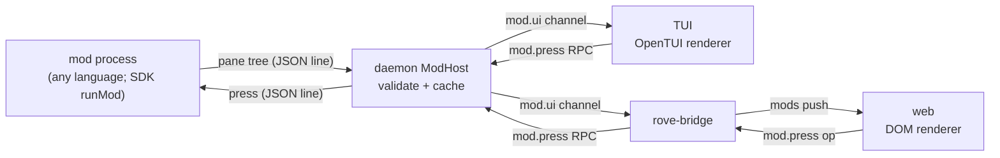

# Mods

Status: v0 shipped. A mod is one long-lived process in a plugin that draws
native UI, and the TUI and the web draw the same UI from the same data.
Author-facing contract: [../PLUGIN-AUTHORING.md](../PLUGIN-AUTHORING.md#mods).

## Why

Before mods, a plugin could put custom UI on screen only as a `[[panes]]`
terminal program. That already shows in both clients, because the web hosts
an xterm, but it is a terminal in a box: it cannot draw in the rail, take
web-native input, or look like the host. Every host-drawn plugin surface
(`rove api prompt`, row tokens) had to be implemented twice, once per client.
Until this change `ui.prompt` existed only in the TUI.

Claude Code mods (2.1.287) show the shape that fixes this: a mod returns a
**declarative element tree**, and each client renders it with its own
primitives. Rove takes that idea, not its runtime. A Claude Code mod runs
inside the one process that draws it. Rove has a hub (the daemon) and several
clients (TUI, web, phones), so a Rove mod runs once, beside the daemon, and
every client draws its last tree.

## Shape

- **One process per mod, out of the daemon.** `[mod] command = [...]` is
  spawned by the plugin host, restarted with backoff when it dies, stopped on
  disable. A mod that spins costs its own panes, not the daemon that every
  task depends on. The wire is JSON lines on stdio, so the "no required SDK"
  rule from [plugins.md](./plugins.md) still holds.
- **Events in, controls out.** A mod subscribes to plugin events over the
  same pipe and gets the `[[events]]` envelopes without a process per event;
  a press or a submitted field goes back as one line.
- **Push, not pull.** A mod sends a new tree when its state changes. The
  daemon keeps the last valid tree per pane and publishes the full list on
  `mod.ui` (last-value, so a late client draws what is open now). Asking a
  remote process for a tree on every frame of every client would cost more
  than it buys.
- **One state, every client.** The mod owns its state; clients hold only what
  is local to them (which button has focus). A press in the browser redraws
  the TUI.
- **A closed vocabulary, validated twice.** `box` / `text` / `button` / `input`, with
  spacing steps 0–3 and semantic tones, defined once in the SDK contract
  (`rove-plugin-sdk/src/mod-tree.ts`). The daemon refuses a tree with an
  unknown element or prop (the last good tree stays and the refusal goes to
  the plugin log). Each client validates again before drawing, as it does
  for row tokens. Every element must be drawable by every client; anything
  narrower needs a fallback before it joins.
- **Text is text.** The web sets mod strings as DOM text, never markup.

## Where it draws

v0 has one site: the rail's **Mods** page, in the TUI and the web. Its rail
row appears only while some mod has a pane open, so nothing changes for users
without mods. Page keys: `↑`/`↓` (and `tab` in the TUI) move between controls,
`enter` presses a button or submits a field, `esc`/`q` leave, a click presses;
while a field has focus only movement and `esc` stay page keys. These are page-local
keys on the content pane, like the other rail pages' keys; they are recorded
as PROPOSED in [keybinding-decisions.md](./keybinding-decisions.md).

## Not yet

- Select, markdown/code and link elements.
- More render sites: a task-workspace tab, a footer segment, palette entries.
- Native renderers in the iOS/Android apps (the bridge already pushes `mods`).
- Restyling host-drawn sites. Rove mods stay at the orchestration layer;
  intercepting an engine's tool calls belongs to that engine's own extension
  system (for Claude Code, its mods), which already draws inside Rove's
  terminal tabs.
