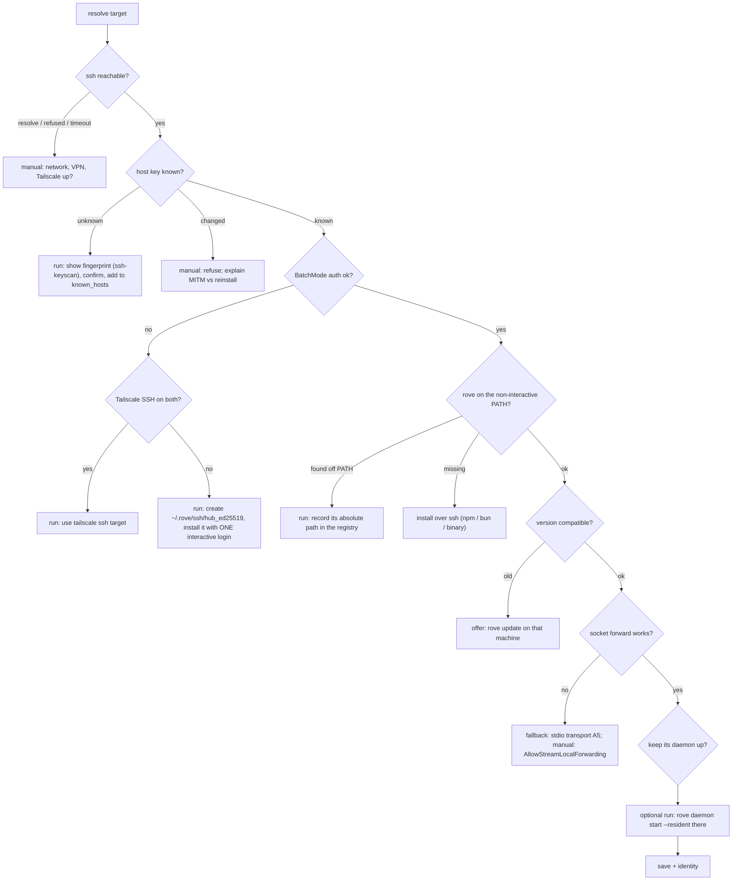

# Remote access: auth model and guided setup

> Status: **design draft.** Step 1 of "Order of work" (ssh failure
> classifier, host-key confirmation, `roveBin`) has landed; the rest is not
> implemented. Companion to
> [workspace-runner.md](./workspace-runner.md): a hub that dispatches to
> machines makes "who may run what where" and "how do I get this working"
> two halves of one problem. Decisions marked **OPEN** need the owner.

## Today (verified on `main`)

| Layer | Auth | Where |
|---|---|---|
| Local daemon / PTY host socket | None of its own. `~/.rove` at `0700` plus a post-listen chmod **is** the access control; no peer-credential check | `rove-daemon/src/daemon/owner-only.ts`, `pty-server.ts:325` |
| Machine ↔ machine | SSH is transport and auth: the user's keys/agent/`ssh_config`, `BatchMode=yes`, `StrictHostKeyChecking=accept-new` (silent TOFU). Registry stores a key *path* or a keychain *pointer* | `machines/ssh-args.ts`, `machines/registry.ts` |
| Bridge (web, phones) | **One** shared 32-byte bearer token (`0600`), rotated all-or-nothing. Network gate: loopback, the Tailscale IPv4, or loopback behind Cloudflare Access (JWT re-verified) | `rove-bridge/src/auth.ts`, `cf-access.ts`, `cli-args.ts` |
| Secrets | `~/.rove/secrets.json` `0600`; remote-project passwords in the macOS keychain, fed through `sshpass -e` | `exec/exec-host.ts`, `exec/keychain.ts` |

What runner routing (`machines/forward.ts`) changed: daemon access was always
≈ a shell for its owner (`add --command` runs anything). The hub now holds that
power over **every** registered machine, and so does anyone holding the hub's
bridge token.

## Gaps, in order of cost/benefit

1. **No per-device credential.** One bridge token for every phone and
   browser. You can't revoke one device or tell which one ran `delete`.
2. **Runners can't limit the hub.** A forwarded call (`forwarded: true`) is
   indistinguishable in power from the owner at that machine's keyboard.
3. **Silent TOFU.** `machine add` accepts an unknown host key with no
   fingerprint shown.
4. **Setup failures read as dead ends.** `discover.ts` classifies
   `SSH_FAILED` / `NO_ROVE` / `NO_DAEMON` / `BAD_STATUS` and prints a
   sentence; it then exits instead of offering the fix.

## Decision: no Rove-managed SSH PKI

Rove does not mint its own CA, sync `authorized_keys` across a fleet, or
replace the user's SSH setup:

- SSH, ssh-agent, 1Password/Secretive agents and Tailscale SSH already solve
  key custody, and users have chosen one of them.
- Key distribution is a security product. Getting it subtly wrong is worse
  than not shipping it.
- Phones and browsers have no SSH keys. Device binding there is per-device
  tokens now, and passkeys/WebAuthn if ever.

Rove **does** use SSH keys narrowly, where they buy something: a *dedicated*
key per hub, so it can be revoked on its own and restricted with
`authorized_keys` options (see "Restricted hub key").

## The auth plan

| # | What | Fixes gap |
|---|---|---|
| A1 | **Per-device bridge credentials.** Each pairing mints a named token (`rove bridge devices list / revoke <name>`, last-used time). The legacy single token is migrated as `legacy`. Every `api.invoke` is logged with its credential name | 1 |
| A2 | **Hub identity on forwarded calls.** The forwarding daemon sends `{ hub: <hostname>, via: <credential name> }`. The runner logs it beside the verb | 1, 2 |
| A3 | **Runner inbound policy.** `machines.inbound` in the runner's own `state.json`: allowed verbs (default denies `delete`, `land`, `remove-worktree`, `reset`), allowed repos, `allowCustomCommand: false` (engines from the registry only). Enforced in `api.invoke` when `forwarded: true`. The hub cannot change it | 2 |
| A4 | **Shown, confirmed host key** on first connect (see the setup flow) | 3 |
| A5 | **Restricted hub key** (optional): a forced command that reaches only the Rove daemon | 2 |
| A6 | **Peer-uid check** on the daemon and PTY sockets (`SO_PEERCRED` / `getpeereid`) as defense in depth behind the directory mode. **OPEN:** whether Bun exposes it | — |

A3 without A5 limits a compromised hub's *Rove* power but not its SSH login.
A5 without A3 limits the login but not Rove's power (`add --command`). Both
are needed for "a hub on a shared server" to be least-privilege. For "my
laptop dispatching to my desktop" neither is needed, so both stay opt-in.

### Restricted hub key (A5)

```text
restrict,command="rove daemon connect --stdio" ssh-ed25519 AAAA… rove-hub@<hub>
```

`restrict` also forbids the `-L` unix-socket forward machines use today. So
A5 needs a second transport: **stdio proxy**. `ssh <host>` runs
`rove daemon connect --stdio`, which pipes stdin/stdout to the local daemon
socket, and the hub speaks the same JSON-lines protocol over it. One stdio
channel per PTY attach, or a multiplexed frame. **OPEN**; the daemon protocol
is already line-framed, so a single channel with the existing framing is the
simple start.

The stdio transport also fixes `AllowStreamLocalForwarding no` hosts and
Windows OpenSSH (no unix-socket forwarding). Both are hard failures today.

## Guided setup: the same `doctor --fix` contract

`rove doctor --fix` already has the safety model (`cli/doctor-fix.ts`): every
remedy is a `run` fix (shown argv, per-fix y/N, reversible) or a `manual` fix
(printed, never executed). Setup reuses it rather than inventing a wizard
framework. A setup is **an ordered list of checks, each with a probe and a
fix**. It stops at the first failing check whose fix the user declines.

Entry points:

- `rove machine add <target>`: when stdin is a TTY, a failed probe offers
  the fix instead of exiting. `--yes` accepts every `run` fix. Non-TTY keeps
  today's verify-or-fail behaviour (scripts never block on a prompt).
- `rove machine doctor [alias]`: re-runs the checks for a registered machine,
  e.g. after an OS reinstall or a key rotation.
- `rove remote setup`: the bridge side (phone/web access). **OPEN** naming;
  could be `rove --web --setup`.

### Machine checks



Notes on each step:

- **Classify ssh's own stderr**, not exit codes alone. 255 covers
  `Could not resolve hostname`, `Connection refused`, `timed out`,
  `Host key verification failed`, `REMOTE HOST IDENTIFICATION HAS CHANGED`
  and `Permission denied (publickey…)`, and each has a different fix. This
  is a pure function with a fixture per phrasing, extending `discover.ts`.
- **Never edit `~/.ssh/config` or shell rc files.** Rove's registry already
  stores `--identity` and port, so a dedicated key needs no `Host` block.
  The PATH problem (`rove` installed under `~/.bun/bin` but missing from the
  non-interactive PATH, the most common `NO_ROVE`) is fixed by recording the
  remote binary's absolute path (`MachineConfig.roveBin`), not by editing
  `.zshrc`.
- **Key install is the only interactive step.** One `ssh` without
  `BatchMode` appends the public key with `umask 077` and dedupes on the
  comment. The user types their password once, into ssh, never into Rove.
  With A5 the appended line carries `restrict,command=…`.
- **Dedicated key per hub** (`~/.rove/ssh/hub_ed25519`, comment
  `rove-hub@<hostname>`). Revoking a hub means deleting one line. The key is
  generated without a passphrase only if the user agrees. Otherwise it goes
  into the agent. **OPEN.**
- **Tailscale SSH** short-circuits all key work. Detect it with
  `tailscale status --json`: the peer is online and offers SSH.

### Bridge (phone/web) checks

| Check | Probe | Fix |
|---|---|---|
| Path chosen | — | Ask: Tailscale (recommended when installed), Cloudflare, local-only |
| Tailscale up | `tailscale ip -4` | manual: install / `tailscale up` |
| HTTPS name | `tailscale serve status` | run: `tailscale serve` for the bridge port (reversible) |
| Cloudflare | `cloudflared --version`, tunnel config | manual: `cloudflared tunnel login` (browser), Access app + AUD. Rove writes `bridge/config.json` from the answers |
| Device | — | run: mint a **named** device credential (A1), print QR |

## Where this conflicts with an existing rule — OPEN

`doctor-fix.ts` says installing software is always `manual`. A setup the user
started explicitly ("set up narwhal") arguably consents to installing Rove
there. Options:

1. Keep the rule: print the install command and wait for the user to rerun.
   Safe, but not one-click.
2. Add a third kind, `install`: like `run`, but only offered inside an
   explicit setup flow, never by `doctor --fix`.

Recommend 2.

## Order of work

1. ssh stderr classifier + host-key confirmation (A4) + `roveBin`. These are
   small, and they fix the most common dead ends.
2. Guided `machine add` / `machine doctor` on the `doctor --fix` contract,
   including dedicated key install.
3. Per-device bridge credentials (A1) + `rove remote setup` for
   Tailscale/Cloudflare.
4. Hub identity (A2) + runner inbound policy (A3).
5. Stdio transport + restricted hub key (A5): also unblocks hosts without
   unix-socket forwarding and Windows runners.

## Decisions (owner, 2026-10-20)

1. **Install is part of setup.** A third fix kind, `install`: offered only
   inside a flow the user started (`machine add`, `machine doctor`,
   `rove --web --setup`), never by `doctor --fix`.
2. **Hub key: no passphrase by default.** An unattended hub cannot answer a
   passphrase prompt. The risk is bounded: the key is dedicated, `0600` under
   `~/.rove/ssh/`, and revoked by deleting one `authorized_keys` line. When
   ssh-agent already authenticates the target, no key is created.
3. **Bridge setup is `rove --web --setup`.**
4. **`land` is allowed by default.** The default deny list is the
   irreversible verbs only: `delete`, `remove-worktree`, `reset`. The policy
   is changed on the runner itself (`rove machine inbound allow|deny <verb>`),
   never by the hub.
5. **One ssh channel per stream** (daemon, each PTY attach) over the existing
   ControlMaster. ssh already multiplexes channels on one connection, so Rove
   adds no framing of its own.
