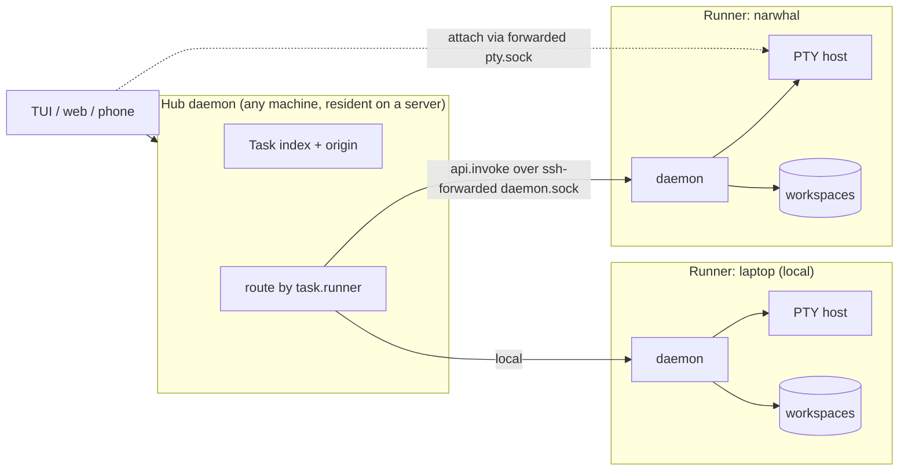
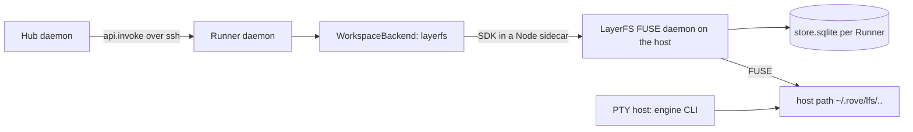

# Workspace backends and runners

> Status: **design draft; the dispatch half has landed** (0.9.258+). Shipped:
> runner routing for `rove api` / `api.invoke` (`--machine <alias>|auto`,
> task-id routing), dispatch by repo identity (`repo-match`; `--repo` takes a
> repo id, with primary checkouts, fork refusal and `--clone`), refusal of an
> unpushed base, `land` on a remote task as push + PR (`publish`), remote tasks
> opened in the web and the TUI (terminals + Files), the runner's inbound
> policy, the stdio transport (native Windows hubs) and `machine tunnel`.
> Phase 0 has landed: the `WorkspaceBackend` seam (`src/orchestrator/workspace/`,
> `git-worktree` and `borrowed` backends, `Task.workspace`, lifecycle `kind`
> checks turned into capability checks), plus the `cow-clone` backend behind
> `add --fork` (fork with uncommitted state, see WORKTREES.md). Phase 1 has
> landed on the seam: checkpoints at turn boundaries, `checkpoint-list` /
> `checkpoint` / `rewind` (see "Checkpoints" below and
> [WORKTREES](../WORKTREES.md#checkpoints)), gated by the `checkpoint`
> workspace capability. Not implemented: the experimental `layerfs` backend.
> Decisions marked **OPEN** need the owner.

## Why

Two directions turn out to be one change:

1. **Workspaces as first-class objects.** The agent-infra layer is converging
   on workspaces that fork, checkpoint and rewind cheaply (LayerFS, Turso
   AgentFS, microVM snapshot/fork). Rove's isolation unit is a git worktree: a
   full checkout with no checkpoint, no rewind, and a fork that drops
   uncommitted state.
2. **Dispatch to machines.** A resident daemon (`rove daemon start --resident`)
   on a server dispatching Tasks to registered machines. Machines began
   read-only (`docs/MACHINES.md`); dispatch and writes have since landed, see
   the status above.

Both need the same thing: a Task must stop *being* a local path.

```text
today:    Task = worktreePath + branch + Terminal Tabs
proposed: Task = Workspace (backend + handle) + Runner (machine) + Terminal Tabs
```

## The one invariant that makes this tractable

**A Workspace is always materialized as a stable, absolute, local path on its
Runner, for the Workspace's whole lifetime.**

The code survey found ~60 consumers that treat `worktreePath` as a local path
*and as identity*:

- engine history: Claude's `~/.claude/projects/<encodeCwd>`, the
  codex/kimi/copilot `cwd` fields, pi's directory encoding
  (`engine/*-local/history.ts`, `session-files.ts`)
- trust entries keyed by path (`engine/trust-worktree.ts`, per-engine
  `trust.ts`) and the init marker (`env.ts:110`, sha1 of the path)
- hook cwd → task mapping (`rove-daemon/src/daemon/cwd-task.ts`, lexical
  `pathIdentity`, a local `existsSync(.git)` boundary check)
- the PTY host's spawn `cwd`, persisted in the freeze store and matched by
  string in the warm-spare pool (`pty-freeze-store.ts`, `pty-warm.ts`)
- daemon collectors and caches keyed by path (`worktree-changes-collector.ts`,
  `transcript-activity-collector.ts`, `worktree-probe.ts`, `base-ref-cache.ts`)
- sync fs probes on hot paths (`realpathSync`, `statSync`, `spawnSync` in
  `branch-signals.ts` and `worktree-changes.ts`)

Making all of these remote- or mount-aware is the trap `remote-projects`
walked into. Phase 6 regressed once, and phases 7–8 are "route every reader
through ExecHost". The invariant sidesteps that:

- **Different backend** → the backend owns how the path comes to exist (git
  worktree, CoW mount, …). Every path consumer is unchanged because the path is
  real and stable.
- **Different machine** → *all* Task work runs in the **Runner's own daemon**,
  where the path is local. The hub routes by task id and never reads a remote
  path.

Consequences:

- **Per-call mount models are out.** LayerFS's "mount, exec, commit, unmount
  per Bash call" needs control of the agent's tool loop. Rove runs the real
  engine CLIs (DESIGN principle 1), which spawn their own shells. A backend
  must give one long-lived mount. Rove takes commits as *checkpoints* at turn
  boundaries (see Checkpoints).
- **Path stability across restarts.** A backend whose mountpoint changes after
  a reboot must remount at the same path. Otherwise resume silently starts a
  blank session, the trust entry is lost and the init script re-runs.
- **`remote-projects` (local daemon, remote files over SSH) is the wrong
  topology** for this model (see Retire remote-projects).

## Topology



- **Every Runner is a full Rove daemon.** It is sovereign over its own
  workspaces, PTYs, engine logins and transcripts. This is federation, not
  centralization: engine credentials never leave the machine they were logged
  in on.
- **The Hub is a role, not a new process.** Any daemon can be one. On a
  server it is just `--resident`. It owns routing, the merged view and
  placement. It never reads a remote workspace path.
- **Transport stays SSH-forwarded unix sockets** (what machines do today).
  `api.invoke` (#1297) already gives "run this verb inside the daemon that
  answered", which is exactly the forwarding property needed. Outbound-connect
  runners for NAT'd machines (Cursor's self-hosted model) are a later,
  separate transport.

## The `WorkspaceBackend` interface

Shaped like engine adapters: an id, declared capabilities, and lifecycle
methods. Neutral layers ask for capabilities and never test backend ids.

```ts
interface WorkspaceBackend {
  readonly id: WorkspaceBackendId            // "git-worktree" | "borrowed" | "layerfs" | …
  readonly capabilities: {
    fork: "committed" | "with-uncommitted"    // does fork carry dirty state?
    checkpoint: boolean
    cheapClone: boolean                       // O(1) create (CoW)
    ownsBranch: boolean                       // has a git branch Rove may land/delete
  }
  materialize(spec: { repo: string; slug: string; baseRef?: string; branch?: string }): Promise<WorkspaceHandle>
  /** Re-attach after reboot; MUST return the same path or fail. */
  ensureMounted(h: WorkspaceHandle): Promise<WorkspaceHandle>
  status(h): Promise<{ dirtyPaths: string[]; ignoredWork: string[] }>
  checkpoint?(h, label: string): Promise<CheckpointRef>
  rewind?(h, to: CheckpointRef): Promise<void>
  fork(h, opts: { from?: CheckpointRef; slug: string }): Promise<WorkspaceHandle>
  /** Git is the interchange format: every backend can land as a branch. */
  exportBranch(h): Promise<{ repo: string; branch: string }>
  dispose(h, opts: { force: boolean; deleteBranch: boolean }): Promise<DisposeReport>
}

interface WorkspaceHandle { backend: WorkspaceBackendId; path: string; ref?: string }
```

Notes:

- **`exportBranch` is the land boundary.** Land, sync-base, PR and the branch
  chips keep operating on a git branch. A non-git backend exports to one (or
  is a git branch underneath, as LayerFS/Freestyle argue it should be). This
  keeps `land.ts`, `land-preflight.ts` and `sync-base.ts` almost untouched.
- **`borrowed` absorbs `kind: "main"` and `kind: "dir"`.** It is a backend
  whose `materialize` is "use this existing directory" and whose `dispose` is
  "forget". The ~35 lifecycle `task.kind ===` checks (orchestrator, daemon,
  CLI; all `if` chains, no `switch`) become capability checks. UI grouping can keep `kind`.
- **The seed already exists.** `types/worktree.ts:71` declares a
  `WorktreeManager` interface, but every consumer is typed against the
  concrete `GitWorktreeManager`. The git backend is `GitWorktreeManager` +
  `WorktreeCoordinator`'s slug and branch logic + `clone-ignored.ts`, behind
  the interface.

## Task model change

```ts
// types/task.ts (additive; no TaskIndex version bump, per task.ts:226-231)
workspace?: { backend: WorkspaceBackendId; ref?: string }   // absent → derived from kind
runner?: string                                             // machine alias; absent → this daemon
```

- **Remoteness becomes stored, not sniffed.** Today it is inferred two ways
  (an `ssh://` repo key, a `basePath` prefix) and duplicated across the
  daemon collectors. A third backend needs one answer, and it lives on the
  Task.
- `TaskOrigin` (client-stamped) stays the *display* of where a row came from.
  `runner` is the *routing* fact the hub persists for tasks it dispatched.
- `worktreePath` keeps its meaning (the materialized path on the Runner), so
  the plugin SDK's `PluginEventTask.worktreePath` stays valid. The plugin runs
  on the Runner, where that path is real.

## Checkpoints: the first user-visible payoff, no new infra

The git backend can checkpoint today. `salvage.ts` already snapshots a dirty
tree into a gc-proof ref (`refs/rove/salvage/*`). Generalize it:

- `checkpoint` = commit the working tree (including untracked files, minus
  ignored ones) to `refs/rove/checkpoints/<task>/<n>` without touching the
  branch, index or HEAD.
- **Trigger at turn boundaries.** The engine-turn completion signal already
  exists (hooks → `activity-arbitrate.ts`). That gives one checkpoint per
  agent turn, the granularity users think in.
- `rewind` restores files only. **Conversation rewind is engine-owned**
  (Claude Code has its own). Whether Rove coordinates the two is an engine
  capability, not a Rove feature. **OPEN.**
- `fork({from})` with `"with-uncommitted"` fixes a real gap. Quick-fork and
  `--count N` give every sibling a fresh worktree at `baseRef` and drop the
  parent's uncommitted work (`handlers-add.ts` `addParallel`,
  `quick-fork.ts`).

A CoW backend makes the same verbs O(1) instead of O(tree). The product
surface ships first on git.

**Status (git backend, shipped).** `orchestrator/worktree/checkpoint.ts` reuses
`salvage.ts`'s temporary-index snapshot, minus its ignored-file pass: a
checkpoint is exactly tracked + untracked, minus ignored. The daemon takes one
at the normalized `turn-complete` report (`handlers-engine-report.ts`),
serialized per workspace owner with the `checkpoint` / `rewind` verbs,
fire-and-forget so the hook reply never waits on git, and skipped when the tree
equals the latest checkpoint. Checkpoints belong to the **workspace owner**: a
child sharing its parent's directory resolves to the owner for the trigger and
all three verbs (replies carry `workspaceTaskId`), and an owner's deletion hands
the history to the heir. The gate is the owner backend's `checkpoint`
capability (`workspaceCapabilities`: `git-worktree` and `cow-clone` yes,
`borrowed` no, since a main/dir tree is the user's own) with a worktree on disk
(`Orchestrator.canCheckpoint`). `rewind` is files-only: it checkpoints the
current state first (so a rewind is undoable), then lets `git read-tree --reset
-u` over a throwaway index rewrite the tree, and resets the real index to HEAD;
it refuses with `TASK_BUSY` while any engine sharing the workspace runs unless
`--force`. The newest 100 per workspace are kept, and deleting a task removes
its refs.

## Runner routing: what exists vs what's missing

| Piece | State |
|---|---|
| Registry, discover, ssh tunnel (daemon.sock + pty.sock), backoff | Exists (`machines/*`) |
| `api.invoke` runs a verb inside the answering daemon | Exists (`handlers-api.ts`, `core/daemon-runtime.ts:62`) |
| Resident daemon | Exists (`resident.ts`) |
| Attach pattern on an existing PTY key, never spawning | Exists in the bridge (`rove-bridge/src/terminal.ts`) |
| Route `rove api` / `api.invoke` (daemon, bridge) by `--machine` or by the machine holding `--task-id` | **Done** (`machines/forward.ts`); forwarded calls never move again |
| Route TUI writes on a remote row | **Done**: the TUI and the web open a remote task's tabs, terminals and Files over the machine's forwarded sockets ([MACHINES.md](../MACHINES.md#working-on-a-remote-task)) |
| Per-machine PTY client in the TUI | **Done**: the hosted terminal takes a `machine` option (`tui/panes/terminal/pty-hosted.ts`) |
| pty.sock forward | Dialed by remote terminals in the TUI and web. Whether the tunnel health check probes it is unverified |
| Hub in the daemon | **Done**: the daemon runs `MachineHub` (`machines/daemon-hub.ts`) and clients read it on the `machines` channel; see [daemon-owned-state.md](./daemon-owned-state.md) |
| No recursive fan-out | **Done**: `list` over a transport returns the answering daemon's own tasks |
| Per-caller auth | Per-device bridge tokens and the runner's inbound policy (`rove machine inbound`) exist; see [remote-access-auth.md](./remote-access-auth.md). The daemon socket itself still has none: reachability is the access control |

## Dispatch: what "the repos are all the same" actually requires

Placement (`add --runner <alias>` or a policy) has to answer:

1. **Base ref reachability.** The Runner's clone must have the `baseRef`.
   Unpushed local commits are invisible. Options: refuse with a "push first"
   recovery, or `git fetch <hub-repo> <ref>` over the existing ssh. **OPEN.**
2. **Repo identity across machines.** Match by remote URL / root commit, not
   path. The two checkouts live at different paths.
3. **Environment.** `.env`, dependencies and init scripts are per machine.
   `repo-init.ts` already resolves the init script from the worktree, so it
   runs on the Runner. Secrets are configured per Runner, never shipped by the
   hub.
4. **Capacity.** `engine.maxLiveSessions` / `ENGINE_LIMIT` already exist per
   daemon, so the hub reads them for placement.
5. **Landing.** `land` runs on the Runner, against the Runner's base
   checkout. Landing into the hub's checkout means pushing the branch. In a
   multi-machine setup, a PR is the natural land target.

## Retire `remote-projects`

`rove add --remote` (local daemon, remote files via ExecHost) needs every one
of the ~60 path consumers above to become remote-aware. Phase 6 has already
regressed once, and phases 7–8 are exactly that rewrite. A machine Runner gets
the same outcome ("my code and engine live on that box") with zero consumer
changes, because the far side runs Rove.

Proposal: freeze `experimental.remoteProjects` (no phase 6–8 work) and
document "use `rove machine add`" as the path. ExecHost's git/fs surface stays
as an implementation detail where it is useful. **OPEN** (owner call; nothing
is deleted by this doc).

## Phases (each shippable alone)

| # | Phase | User-visible? | Risk |
|---|---|---|---|
| 0 | Extract `WorkspaceBackend`; git + borrowed implementations; `task.workspace` defaulted from `kind`; lifecycle `kind` checks → capabilities **(shipped)** | No (pure refactor) | Medium: wide, so it needs the `worktree*` / `task-deletion` / `land` suites green |
| 1 | Git checkpoints at turn boundaries, rewind, fork-with-uncommitted via `cow-clone` **(shipped)** | Yes | Low: refs only, reuses salvage |
| 2 | Runner routing: hub routes remote-task writes via `api.invoke`; per-machine PTY client; open a remote tab | Yes (machines become writable) | Medium: TUI PTY singleton |
| 3 | Dispatch: `rove api add --runner`, base-ref reachability, hub inside a resident daemon, placement by capacity | Yes | Medium |
| 4 | Experimental CoW backend (LayerFS or AgentFS) on Linux Runners, behind `experimental.*` | Opt-in | High upstream risk (preview/beta, no durability guarantee); isolated by the seam |

Phase 1 doesn't depend on 2–3, and 2 doesn't depend on 0. The two halves can
proceed in parallel.

## Open questions for the owner

1. Does Rove rewind coordinate with engine conversation rewind, or stay
   files-only?
2. Unreachable base ref on dispatch: refuse, or fetch from the hub?
3. Freeze `remote-projects` in favour of machines?
4. Hub placement: explicit `--runner` only at first, or a default policy?
5. Phase 4 candidate: LayerFS or AgentFS? LayerFS v1.0 is surveyed below and
   has the long-lived mount; AgentFS is not yet surveyed.

## LayerFS v1.0 survey (phase 4 candidate)

Read from the v1.0.0 source; no part of it was run here (no Docker).

- **Shape.** One `store.sqlite` per host: content-addressed BLAKE3 objects,
  append-only, no GC. A Workspace is an immutable base Commit plus a private
  SQLite overlay, served over FUSE at `/workspaces/N` inside a Docker sandbox
  (`CAP_SYS_ADMIN`). Mount is O(1); reads fetch only touched chunks; writes
  record byte ranges, with no whole-file copy-up.
- **Long-lived mount exists.** `workspace.mount` stays until `unmount`;
  `exec` creates no history; only `workspace.commit` (or `fs.*` writes)
  does. That fits Rove taking commits as checkpoints at turn boundaries.
- **Single host, not shared across machines.** One writer per store
  (`flock` + queue), network filesystems refused. A Runner owns its own store.
- **Import takes everything.** `init` ignores `.gitignore`, so `target/`,
  `node_modules` and `.git` enter history, and no commit can exclude a path.
- **Disposable durability.** `synchronous=OFF`, fsync a no-op; an
  uncommitted overlay dies with the container.
- **FUSE gaps.** No xattrs; fsync, FIFOs and Unix sockets refused; locks
  are kernel-local (no lock capability negotiated).

### Build caches (Rust as the worst case)

Build output inside the mount makes every commit carry `target/` churn into
the GC-less store, makes merges conflict on binaries, and routes every
build-time cache miss through one userspace daemon. Cargo fingerprints also
embed absolute paths, so `/workspaces/N` must be stable per Workspace.
Rove's answer: build caches never enter the mount.

### Integrating it as a Runner's workspace backend

The blocker is visibility. A Sandbox's only mount is the Store volume, so a
Workspace exists only inside its container, at a `/workspaces/N` that LayerFS
numbers and reuses. Rove's engines, PTY host, hooks and collectors run on the
Runner host and need a stable host path (the invariant above). Docker is
LayerFS's packaging, not its core: it supplies FUSE on macOS (via the Docker
VM), the mount privilege and an agent sandbox. Developing inside a container
fights Rove's model (host toolchain, keys, editor, engine history), so:

| | A: engine inside the Sandbox | B: mount surfaces from the Sandbox | C: native mount, no Docker |
|---|---|---|---|
| How | PTY host spawns `docker exec -it -w /workspaces/N … claude` | Sandbox bind-mounts a host dir `rshared`; the mount appears at `~/.rove/lfs/<project>/<task>` | The FUSE daemon runs on the host and mounts at `~/.rove/lfs/<project>/<task>` |
| Linux | Works, breaks most `worktreePath` consumers | Works | `fusermount3`, unprivileged |
| macOS | Docker VM | Docker VM; host sees it only through the VM | macFUSE (FSKit backend) or an NFS loopback mount |
| Upstream change | Extra mounts per Sandbox | Host mount dir, stable names, uid mapping (exec runs as `501:20`) | A Docker-free daemon mode; a macOS port of the FUSE layer |

Route C is the target; B is the fallback if upstream keeps Docker.

**macOS trial (local, next).** Install macFUSE, build the LayerFS FUSE daemon
for macOS (or wrap its store behind a macFUSE/NFS shim), mount one Workspace
under `~/.rove/lfs/`, point a real Rove task at it, and record: mount/fork
latency, `git status` and dev-server cold start, socket/xattr failures, and
whether macFUSE's FSKit backend needs a kernel extension approval. The Store's
filesystem check refuses APFS today, so the Store may have to live on a
disk image formatted for it, or upstream relaxes the check.

**Not suited for (keep these on git worktrees).** Unix sockets and FIFOs are
refused inside the mount (git fsmonitor, watchman, local databases, Rove's own
harness sidecar), there are no xattrs (quarantine, codesign), fsync is a no-op,
and an uncommitted overlay dies with its daemon. Under Docker, dev-server ports,
browsers and iOS simulators do not reach the host at all. LayerFS fits headless
loops: edit, test, commit, many parallel attempts, cloud Runners. The backend
advertises `interactive: false` and the hub keeps UI/e2e tasks off it.

Everything else maps onto existing pieces:



| Rove | LayerFS |
|---|---|
| Repo on a Runner | Project, `init` from a clean checkout (no build output) |
| Task | Branch; `materialize` = fork + mount, metadata only |
| Fork a task | Commit, then `branch.fork` from it |
| Checkpoint (turn boundary) | `workspace.commit` |
| Rewind | Remount a branch forked at an older Commit (fork-at-commit unverified) |
| Land / PR | Unchanged: `.git` is inside the tree, the agent pushes from it |
| Task moves Runner | git push/fetch; stores are per host |
| Runner reboot | `ensureMounted` remounts the last Commit; uncommitted work is lost |

### TODO

- [ ] Upstream (route C): a Docker-free daemon mode mounting at a
      caller-chosen host path; route B (propagated mount) as the fallback.
- [ ] Local macOS trial with macFUSE (above).
- [ ] Spike on Linux + Docker: run a real engine CLI and 6 concurrent
      builds in surfaced mounts; measure FUSE overhead, overlay size, store
      growth per commit, lock behaviour.
- [ ] Check the SDK (Node, native addon) under Bun; else a Node sidecar.
- [ ] Phase 0 seam first; then a `layerfs` backend with capabilities
      `{ fork: "committed", checkpoint: true, cheapClone: true, ownsBranch: false, interactive: false }`.
- [ ] Wire checkpoints to `workspace.commit` at turn boundaries; surface
      that uncommitted work dies with the Sandbox.
- [ ] Runner capability probe in `machine doctor`: Docker, `/dev/fuse`,
      local ext4/xfs/btrfs; the hub places `layerfs` tasks only there.
- [ ] Build caches outside the mount: Rove sets `CARGO_TARGET_DIR` and
      peers to a host dir, seeded by reflink from the parent task
      (`clone-ignored.ts`), optional shared sccache.
- [ ] Upstream asks beyond B: a commit path filter or ignore file, store GC,
      a durable profile; benchmarks for the "0.31" and "0.05 s" claims.

## Bugs found while surveying (independent of this design)

- (Fixed with runner routing) `machines/hub.ts` documented a
  `guardRemoteTaskRequests` that did not exist; remote task ids now forward.
- `handlers-pr.ts` → `pr-failing-checks.ts` / `pr-rerun-checks.ts` spawn `gh`
  in a remote task's cwd with no `ssh://` skip. The collector
  (`pr-status-collector.ts:194`) has one.
