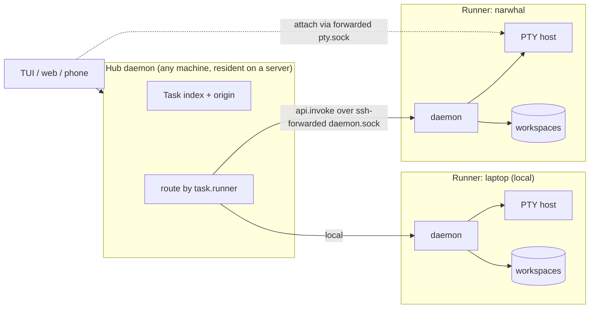

# Workspace backends and runners

> Status: **design draft, nothing implemented.** Maps the current code
> (verified on `main` at 0.9.250) and proposes the seam. Decisions marked
> **OPEN** need the owner.

## Why

Two directions turn out to be one change:

1. **Workspaces as first-class objects.** The agent-infra layer is converging
   on workspaces that fork, checkpoint and rewind cheaply (LayerFS, Turso
   AgentFS, microVM snapshot/fork). Rove's isolation unit is a git worktree: a
   full checkout with no checkpoint, no rewind, and a fork that drops
   uncommitted state.
2. **Dispatch to machines.** A resident daemon (`rove daemon start --resident`)
   on a server dispatching Tasks to registered machines. Today machines are
   read-only (`docs/MACHINES.md`).

Both need the same thing: a Task must stop *being* a local path.

```text
today:    Task = worktreePath + branch + Terminal Tabs
proposed: Task = Workspace (backend + handle) + Runner (machine) + Terminal Tabs
```

## The one invariant that makes this tractable

**A Workspace is always materialized as a stable, absolute, local path on its
Runner, for the Workspace's whole lifetime.**

The code survey found ~60 consumers that treat `worktreePath` as a local path
*and as identity*:

- engine history: Claude's `~/.claude/projects/<encodeCwd>`, the
  codex/kimi/copilot `cwd` fields, pi's directory encoding
  (`engine/*-local/history.ts`, `session-files.ts`)
- trust entries keyed by path (`engine/trust-worktree.ts`, per-engine
  `trust.ts`) and the init marker (`env.ts:110`, sha1 of the path)
- hook cwd → task mapping (`rove-daemon/src/daemon/cwd-task.ts`, lexical
  `pathIdentity`, a local `existsSync(.git)` boundary check)
- the PTY host's spawn `cwd`, persisted in the freeze store and matched by
  string in the warm-spare pool (`pty-freeze-store.ts`, `pty-warm.ts`)
- daemon collectors and caches keyed by path (`worktree-changes-collector.ts`,
  `transcript-activity-collector.ts`, `worktree-probe.ts`, `base-ref-cache.ts`)
- sync fs probes on hot paths (`realpathSync`, `statSync`, `spawnSync` in
  `branch-signals.ts` and `worktree-changes.ts`)

Making all of these remote- or mount-aware is the trap `remote-projects`
walked into. Phase 6 regressed once, and phases 7–8 are "route every reader
through ExecHost". The invariant sidesteps that:

- **Different backend** → the backend owns how the path comes to exist (git
  worktree, CoW mount, …). Every path consumer is unchanged because the path is
  real and stable.
- **Different machine** → *all* Task work runs in the **Runner's own daemon**,
  where the path is local. The hub routes by task id and never reads a remote
  path.

Consequences:

- **Per-call mount models are out.** LayerFS's "mount, exec, commit, unmount
  per Bash call" needs control of the agent's tool loop. Rove runs the real
  engine CLIs (DESIGN principle 1), which spawn their own shells. A backend
  must give one long-lived mount. Rove takes commits as *checkpoints* at turn
  boundaries (see Checkpoints).
- **Path stability across restarts.** A backend whose mountpoint changes after
  a reboot must remount at the same path. Otherwise resume silently starts a
  blank session, the trust entry is lost and the init script re-runs.
- **`remote-projects` (local daemon, remote files over SSH) is the wrong
  topology** for this model (see Retire remote-projects).

## Topology



- **Every Runner is a full Rove daemon.** It is sovereign over its own
  workspaces, PTYs, engine logins and transcripts. This is federation, not
  centralization: engine credentials never leave the machine they were logged
  in on.
- **The Hub is a role, not a new process.** Any daemon can be one. On a
  server it is just `--resident`. It owns routing, the merged view and
  placement. It never reads a remote workspace path.
- **Transport stays SSH-forwarded unix sockets** (what machines do today).
  `api.invoke` (#1297) already gives "run this verb inside the daemon that
  answered", which is exactly the forwarding property needed. Outbound-connect
  runners for NAT'd machines (Cursor's self-hosted model) are a later,
  separate transport.

## The `WorkspaceBackend` interface

Shaped like engine adapters: an id, declared capabilities, and lifecycle
methods. Neutral layers ask for capabilities and never test backend ids.

```ts
interface WorkspaceBackend {
  readonly id: WorkspaceBackendId            // "git-worktree" | "borrowed" | "layerfs" | …
  readonly capabilities: {
    fork: "committed" | "with-uncommitted"    // does fork carry dirty state?
    checkpoint: boolean
    cheapClone: boolean                       // O(1) create (CoW)
    ownsBranch: boolean                       // has a git branch Rove may land/delete
  }
  materialize(spec: { repo: string; slug: string; baseRef?: string; branch?: string }): Promise<WorkspaceHandle>
  /** Re-attach after reboot; MUST return the same path or fail. */
  ensureMounted(h: WorkspaceHandle): Promise<WorkspaceHandle>
  status(h): Promise<{ dirtyPaths: string[]; ignoredWork: string[] }>
  checkpoint?(h, label: string): Promise<CheckpointRef>
  rewind?(h, to: CheckpointRef): Promise<void>
  fork(h, opts: { from?: CheckpointRef; slug: string }): Promise<WorkspaceHandle>
  /** Git is the interchange format: every backend can land as a branch. */
  exportBranch(h): Promise<{ repo: string; branch: string }>
  dispose(h, opts: { force: boolean; deleteBranch: boolean }): Promise<DisposeReport>
}

interface WorkspaceHandle { backend: WorkspaceBackendId; path: string; ref?: string }
```

Notes:

- **`exportBranch` is the land boundary.** Land, sync-base, PR and the branch
  chips keep operating on a git branch. A non-git backend exports to one (or
  is a git branch underneath, as LayerFS/Freestyle argue it should be). This
  keeps `land.ts`, `land-preflight.ts` and `sync-base.ts` almost untouched.
- **`borrowed` absorbs `kind: "main"` and `kind: "dir"`.** It is a backend
  whose `materialize` is "use this existing directory" and whose `dispose` is
  "forget". The ~35 lifecycle `task.kind ===` checks (orchestrator, daemon,
  CLI; all `if` chains, no `switch`) become capability checks. UI grouping can keep `kind`.
- **The seed already exists.** `types/worktree.ts:71` declares a
  `WorktreeManager` interface, but every consumer is typed against the
  concrete `GitWorktreeManager`. The git backend is `GitWorktreeManager` +
  `WorktreeCoordinator`'s slug and branch logic + `clone-ignored.ts`, behind
  the interface.

## Task model change

```ts
// types/task.ts (additive; no TaskIndex version bump, per task.ts:226-231)
workspace?: { backend: WorkspaceBackendId; ref?: string }   // absent → derived from kind
runner?: string                                             // machine alias; absent → this daemon
```

- **Remoteness becomes stored, not sniffed.** Today it is inferred two ways
  (an `ssh://` repo key, a `basePath` prefix) and duplicated across the
  daemon collectors. A third backend needs one answer, and it lives on the
  Task.
- `TaskOrigin` (client-stamped) stays the *display* of where a row came from.
  `runner` is the *routing* fact the hub persists for tasks it dispatched.
- `worktreePath` keeps its meaning (the materialized path on the Runner), so
  the plugin SDK's `PluginEventTask.worktreePath` stays valid. The plugin runs
  on the Runner, where that path is real.

## Checkpoints: the first user-visible payoff, no new infra

The git backend can checkpoint today. `salvage.ts` already snapshots a dirty
tree into a gc-proof ref (`refs/rove/salvage/*`). Generalize it:

- `checkpoint` = commit the working tree (including untracked files, minus
  ignored ones) to `refs/rove/checkpoints/<task>/<n>` without touching the
  branch, index or HEAD.
- **Trigger at turn boundaries.** The engine-turn completion signal already
  exists (hooks → `activity-arbitrate.ts`). That gives one checkpoint per
  agent turn, the granularity users think in.
- `rewind` restores files only. **Conversation rewind is engine-owned**
  (Claude Code has its own). Whether Rove coordinates the two is an engine
  capability, not a Rove feature. **OPEN.**
- `fork({from})` with `"with-uncommitted"` fixes a real gap. Quick-fork and
  `--count N` give every sibling a fresh worktree at `baseRef` and drop the
  parent's uncommitted work (`handlers-add.ts` `addParallel`,
  `quick-fork.ts`).

A CoW backend makes the same verbs O(1) instead of O(tree). The product
surface ships first on git.

## Runner routing: what exists vs what's missing

| Piece | State |
|---|---|
| Registry, discover, ssh tunnel (daemon.sock + pty.sock), backoff | Exists (`machines/*`) |
| `api.invoke` runs a verb inside the answering daemon | Exists (`handlers-api.ts`, `core/daemon-runtime.ts:62`) |
| Resident daemon | Exists (`resident.ts`) |
| Attach pattern on an existing PTY key, never spawning | Exists in the bridge (`rove-bridge/src/terminal.ts`) |
| Write guard | **Missing.** `hub.ts:11` documents `guardRemoteTaskRequests`, but no such function exists. Only the argv CLI's `assertLocalTask` refuses, and `api.invoke` callers bypass it |
| Route writes by `task.runner` / `origin.machineId` | Missing; replaces the refusal |
| Per-machine PTY client in the TUI | Missing. `getSharedPtyClient()` is a process singleton, and routes are keyed by `taskId::tabId` with no machine |
| pty.sock forward | Set up but nothing dials it. The tunnel health check doesn't probe it |
| Hub in the daemon | Missing. `MachineHub` lives in TUI/bridge processes only |
| No recursive fan-out | Missing. A remote `list` calls `mergeTaskList` on *its* registry |
| Per-caller auth | None. Socket reachability is the whole access control. Fine over SSH; not fine for anything else |

## Dispatch: what "the repos are all the same" actually requires

Placement (`add --runner <alias>` or a policy) has to answer:

1. **Base ref reachability.** The Runner's clone must have the `baseRef`.
   Unpushed local commits are invisible. Options: refuse with a "push first"
   recovery, or `git fetch <hub-repo> <ref>` over the existing ssh. **OPEN.**
2. **Repo identity across machines.** Match by remote URL / root commit, not
   path. The two checkouts live at different paths.
3. **Environment.** `.env`, dependencies and init scripts are per machine.
   `repo-init.ts` already resolves the init script from the worktree, so it
   runs on the Runner. Secrets are configured per Runner, never shipped by the
   hub.
4. **Capacity.** `engine.maxLiveSessions` / `ENGINE_LIMIT` already exist per
   daemon, so the hub reads them for placement.
5. **Landing.** `land` runs on the Runner, against the Runner's base
   checkout. Landing into the hub's checkout means pushing the branch. In a
   multi-machine setup, a PR is the natural land target.

## Retire `remote-projects`

`rove add --remote` (local daemon, remote files via ExecHost) needs every one
of the ~60 path consumers above to become remote-aware. Phase 6 has already
regressed once, and phases 7–8 are exactly that rewrite. A machine Runner gets
the same outcome ("my code and engine live on that box") with zero consumer
changes, because the far side runs Rove.

Proposal: freeze `experimental.remoteProjects` (no phase 6–8 work) and
document "use `rove machine add`" as the path. ExecHost's git/fs surface stays
as an implementation detail where it is useful. **OPEN** (owner call; nothing
is deleted by this doc).

## Phases (each shippable alone)

| # | Phase | User-visible? | Risk |
|---|---|---|---|
| 0 | Extract `WorkspaceBackend`; git + borrowed implementations; `task.workspace` defaulted from `kind`; lifecycle `kind` checks → capabilities | No (pure refactor) | Medium: wide, so it needs the `worktree*` / `task-deletion` / `land` suites green |
| 1 | Git checkpoints at turn boundaries, rewind, fork-with-uncommitted | Yes | Low: refs only, reuses salvage |
| 2 | Runner routing: hub routes remote-task writes via `api.invoke`; per-machine PTY client; open a remote tab | Yes (machines become writable) | Medium: TUI PTY singleton |
| 3 | Dispatch: `rove api add --runner`, base-ref reachability, hub inside a resident daemon, placement by capacity | Yes | Medium |
| 4 | Experimental CoW backend (LayerFS or AgentFS) on Linux Runners, behind `experimental.*` | Opt-in | High upstream risk (preview/beta, no durability guarantee); isolated by the seam |

Phase 1 doesn't depend on 2–3, and 2 doesn't depend on 0. The two halves can
proceed in parallel.

## Open questions for the owner

1. Does Rove rewind coordinate with engine conversation rewind, or stay
   files-only?
2. Unreachable base ref on dispatch: refuse, or fetch from the hub?
3. Freeze `remote-projects` in favour of machines?
4. Hub placement: explicit `--runner` only at first, or a default policy?
5. Phase 4 candidate: LayerFS (shared store across machines, Linux + Docker)
   or AgentFS (single SQLite, CoW overlay)? Both need a long-lived mount mode.
   Neither's docs confirm one.

## Bugs found while surveying (independent of this design)

- `machines/hub.ts:11` references a `guardRemoteTaskRequests` that does not
  exist, and `remoteTaskIds()` has no callers. A remote task id sent through
  `api.invoke` or the bridge is not refused.
- `handlers-pr.ts` → `pr-failing-checks.ts` / `pr-rerun-checks.ts` spawn `gh`
  in a remote task's cwd with no `ssh://` skip. The collector
  (`pr-status-collector.ts:194`) has one.
